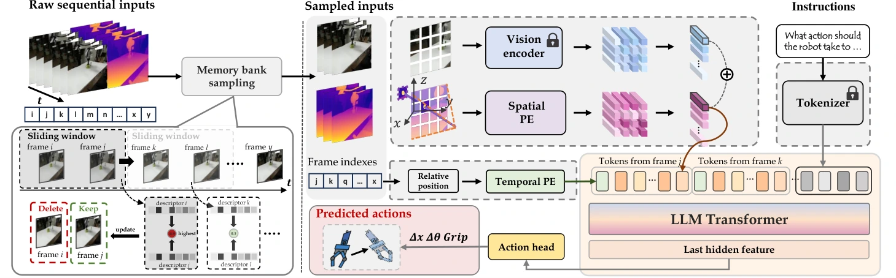

<!-- Generated by scripts/generate.py; edit data/works.json and data/media.json. -->

[← Back to the Awesome index](../../../README.md) · [Interactive website](https://chang-xinhai.github.io/Awesome-RGBDT-Manipulation/?collection=policy&item=4d-vla#library)

# 4D-VLA

4D-VLA: Spatiotemporal Vision-Language-Action Pretraining with Cross-Scene Calibration

**2025-06-27 · NeurIPS 2025 · Fudan University; Huawei Noah’s Ark Lab**

**[Paper](https://arxiv.org/abs/2506.22242)** · [Code](https://github.com/LogosRoboticsGroup/4D-VLA)

Depth-aware temporal features and memory-bank sampling align robot/scenario coordinates in VLA pretraining.

*4D-VLA authors · [Figure source](https://arxiv.org/html/2506.22242) · Original rights retained.*

| Field | Reported value and source scope |
| :-- | :-- |
| Record type | policy |
| Policy family | VLA [1](https://arxiv.org/abs/2506.22242)  |
| Base model and architecture | InternVL-4B VLM with sequential RGB-D spatial coordinates, historical memory-bank sampling and cross-scene calibration. [1](https://arxiv.org/abs/2506.22242)  |
| Model size and component | 4B-class InternVL backbone; added component total not reported [1](https://arxiv.org/abs/2506.22242)  |
| Deployment inputs | Sequential RGB-D observations, camera geometry, language and robot state. [1](https://arxiv.org/abs/2506.22242)  |
| Action outputs and horizon | Robot manipulation actions. [1](https://arxiv.org/abs/2506.22242)  |
| Training method | Cross-scene calibrated action pretraining and target task finetuning. [1](https://arxiv.org/abs/2506.22242)  |
| Training data | DROID pretraining; LIBERO and real Franka task finetuning; dataset totals are not filtered training counts. [1](https://arxiv.org/abs/2506.22242)  |
| Training duration | Pretraining: one epoch / ~20K steps / 96 hours; LIBERO finetuning 20 epochs. [1](https://arxiv.org/abs/2506.22242)  |
| Training hardware | 8 NVIDIA A6000 GPUs for pretraining [1](https://arxiv.org/abs/2506.22242)  |
| Inference and control rates | Not reported in the inspected primary-source sections [1](https://arxiv.org/abs/2506.22242)  |
| Evaluation scope | Simulation, physical manipulation and MV-Bench novel-view generalization. [1](https://arxiv.org/abs/2506.22242)  |
| Observations / modalities | RGB · Depth · Point cloud · Proprioception |
| Evaluation domain | Simulation · Real world |
| Embodiment | Parallel-jaw gripper |
| Release: code | Available [2](https://github.com/LogosRoboticsGroup/4D-VLA) [4](https://github.com/LogosRoboticsGroup/4D-VLA/tree/main)  |
| Release: weights | Not verified [2](https://github.com/LogosRoboticsGroup/4D-VLA)  |
| Release: data | Not verified [2](https://github.com/LogosRoboticsGroup/4D-VLA)  |
| Release: license | MIT for repository code; pretrained models, data and figure rights remain separate [2](https://github.com/LogosRoboticsGroup/4D-VLA) [3](https://github.com/LogosRoboticsGroup/4D-VLA/blob/main/LICENSE)  |
| Release: notes | Code, data and weights are checked independently; an upstream pretrained model is not a released task policy. [2](https://github.com/LogosRoboticsGroup/4D-VLA)  |

**Scope and qualifications**

- Depth availability and estimation differ across source datasets; retain the selected experiment’s sensing/calibration assumptions.

**Primary evidence**

1. [Original manuscript and first submission history](https://arxiv.org/abs/2506.22242) — Full author HTML method/evaluation/appendix inspected; depth observations, pseudo-labels and generated outputs retain distinct roles.
2. [Official implementation and release scope](https://github.com/LogosRoboticsGroup/4D-VLA) — Availability of research implementation does not establish public task-policy checkpoints.
3. [Actual license file in released source](https://github.com/LogosRoboticsGroup/4D-VLA/blob/main/LICENSE) — Only source code covered by this file; not a blanket license for paper figures or upstream weights.
4. [Actual repository content inventory](https://github.com/LogosRoboticsGroup/4D-VLA/tree/main) — 548 tracked paths inspected; code release is distinguished from a README/project/figure-only repository.
