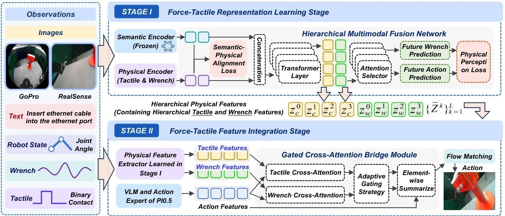

<!-- Generated by scripts/generate.py; edit data/works.json and data/media.json. -->

[← Back to the Awesome index](../../../README.md) · [Interactive website](https://chang-xinhai.github.io/Awesome-RGBDT-Manipulation/?collection=policy&item=a2i-vla#library)

# A2I-VLA

A2I-VLA: A Two-Stage Vision-Language-Action model with Semantic-Physical Alignment and Integration

**2026-11-22 · Preprint · Harbin Institute of Technology; Hikvision Research Institute and collaborators**

**[Paper](https://arxiv.org/abs/2611.29279)**

Aligns force and contact features with semantics, then gates them into a π0.5 VLA for contact-rich execution.

*Kun Dai and coauthors · [Figure source](https://arxiv.org/html/2611.29279v1) · Original rights retained.*

| Field | Reported value and source scope |
| :-- | :-- |
| Record type | policy |
| Policy family | A2I-VLA [1](https://arxiv.org/html/2611.29279v1)  |
| Base model and architecture | π0.5; hierarchical physical feature network and gated cross-attention bridge. [1](https://arxiv.org/html/2611.29279v1)  |
| Model size and component | Not reported [1](https://arxiv.org/html/2611.29279v1)  |
| Deployment inputs | Global and wrist RGB, language, joint state, measured six-axis wrench and binary contact signal. The RealSense D405 is used as the close-up RGB viewpoint. [1](https://arxiv.org/html/2611.29279v1)  |
| Action outputs and horizon | Flow-matched arm-control action chunks from π0.5; future wrench and action signals supervise the physical representation stage. [1](https://arxiv.org/html/2611.29279v1)  |
| Training method | Cross-modal semantic alignment and future wrench/action losses, followed by contact-conditioned integration into the action expert. [1](https://arxiv.org/html/2611.29279v1)  |
| Training data | Task-specific UR10 demonstrations for ring insertion, board wiping and Ethernet insertion. [1](https://arxiv.org/html/2611.29279v1)  |
| Training duration | Not reported [1](https://arxiv.org/html/2611.29279v1)  |
| Training hardware | Not reported [1](https://arxiv.org/html/2611.29279v1)  |
| Inference and control rates | Not reported [1](https://arxiv.org/html/2611.29279v1)  |
| Evaluation scope | Three physical contact-rich tests. For each task the reported score is the highest among five evaluated checkpoints, with 20 trials per checkpoint. [1](https://arxiv.org/html/2611.29279v1)  |
| Observations / modalities | RGB · Tactile · Force/Torque · Proprioception · Language |
| Evaluation domain | Real world |
| Embodiment | Parallel-jaw gripper |
| Release: code | Not verified |
| Release: weights | Not verified |
| Release: data | Not verified |
| Release: license | Not verified |
| Release: notes | Public paper verified. Code, task weights and data are tracked separately. |

**Scope and qualifications**

- Binary contact and continuous wrist wrench are different physical streams. Scene depth is not specified as an input.
- Authors report best-of-five checkpoint selection. Comparisons should preserve that condition.

**Primary evidence**

1. [Original author paper with methods, evaluation and scope](https://arxiv.org/html/2611.29279v1)
