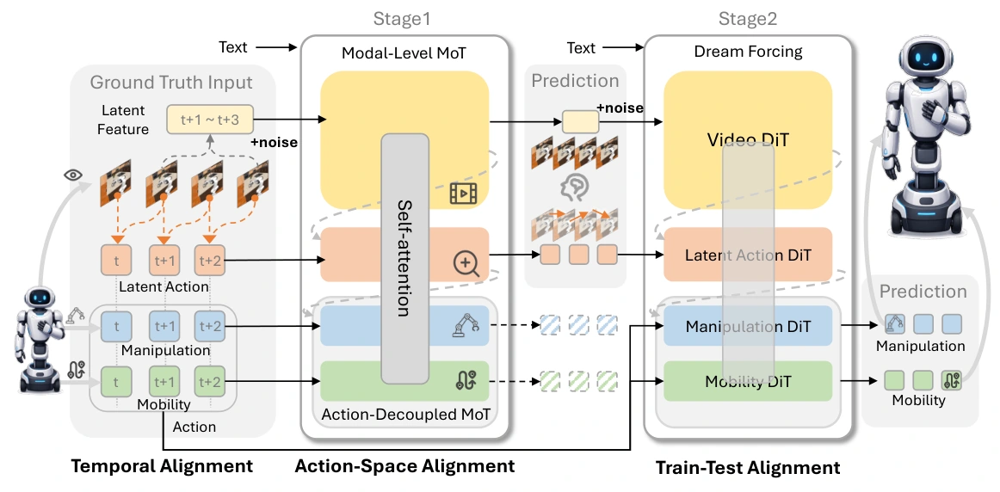

<!-- Generated by scripts/generate.py; edit data/works.json and data/media.json. -->

[← Back to the Awesome index](../../../README.md) · [Interactive website](https://chang-xinhai.github.io/Awesome-RGBDT-Manipulation/?collection=policy&item=abot-m05#library)

# ABot-M0.5

ABot-M0.5: Unified Mobility-and-Manipulation World Action Model

**2026-07-01 · Preprint · AMAP CV Lab**

**[Paper](https://arxiv.org/abs/2607.00678)** · [Project](https://amap-cvlab.github.io/ABot-Manipulation/) · [Code](https://github.com/amap-cvlab/ABot-Manipulation) · [Weights](https://huggingface.co/acvlab)

Models future video, frame-level latent actions and separate mobility/manipulation action streams with progressive dream-forcing alignment.

*ABot-M0.5 authors · [Figure source](https://arxiv.org/html/2607.00678v2) · Original rights retained.*

| Field | Reported value and source scope |
| :-- | :-- |
| Record type | policy |
| Policy family | World-action model [1](https://arxiv.org/abs/2607.00678)  |
| Base model and architecture | Wan2.2-5B video diffusion backbone, latent-action model and dual-level MoT action experts [1](https://arxiv.org/abs/2607.00678)  |
| Model size and component | 5B video foundation backbone; complete latent/action expert total not reported [1](https://arxiv.org/abs/2607.00678)  |
| Deployment inputs | Multi-view RGB histories and language; camera slots retain third-person/wrist semantic roles [1](https://arxiv.org/abs/2607.00678)  |
| Action outputs and horizon | Future video latents, frame-level latent actions and executable arm/base action sequences [1](https://arxiv.org/abs/2607.00678)  |
| Training method | Action-unconditioned visual pretraining → self-supervised latent actions → inverse-dynamics learning with model-predicted-video dream forcing [1](https://arxiv.org/abs/2607.00678)  |
| Training data | Public/synthetic robot mixture: OXE, OXE-AugE, Agibot-Beta, RoboCOIN, RoboMind, InternData-A1 and other sources; aggregate not disclosed [1](https://arxiv.org/abs/2607.00678)  |
| Training duration | World-model and latent-action pretraining then progressive inverse-dynamics SFT; exampleSFT50k + 5k dream-forcing; wall-clock not reported [1](https://arxiv.org/abs/2607.00678)  |
| Training hardware | Not reported [1](https://arxiv.org/abs/2607.00678)  |
| Inference and control rates | Not reported [1](https://arxiv.org/abs/2607.00678)  |
| Evaluation scope | RoboCasa365, mobile/long-horizon simulation and real fine-grained/mobile manipulation [1](https://arxiv.org/abs/2607.00678)  |
| Observations / modalities | RGB · Language |
| Evaluation domain | Simulation · Real world |
| Embodiment | Parallel-jaw gripper · Bimanual · Mobile manipulator |
| Release: code | Available [2](https://github.com/amap-cvlab/ABot-Manipulation)  |
| Release: weights | Available [2](https://github.com/amap-cvlab/ABot-Manipulation)  |
| Release: data | Not verified [2](https://github.com/amap-cvlab/ABot-Manipulation)  |
| Release: license | Not reported [2](https://github.com/amap-cvlab/ABot-Manipulation)  |
| Release: notes | Availability reflects public source/model links; complete paper-scale reproduction and all dataset access terms were not tested. [2](https://github.com/amap-cvlab/ABot-Manipulation)  |

**Scope and qualifications**

- M0.5 is a distinct world-action architecture from original Qwen-VLA-based M0; preserve separate paper/version.

**Primary evidence**

1. [Primary manuscript and first-submission history](https://arxiv.org/abs/2607.00678) — Latest available full manuscript inspected; publication date retains the first arXiv submission. Sizes, training cost and deployment rates keep their experimental scope.
2. [Official policy implementation](https://github.com/amap-cvlab/ABot-Manipulation) — Source and checkpoint availability checked separately; no local policy execution was performed.
