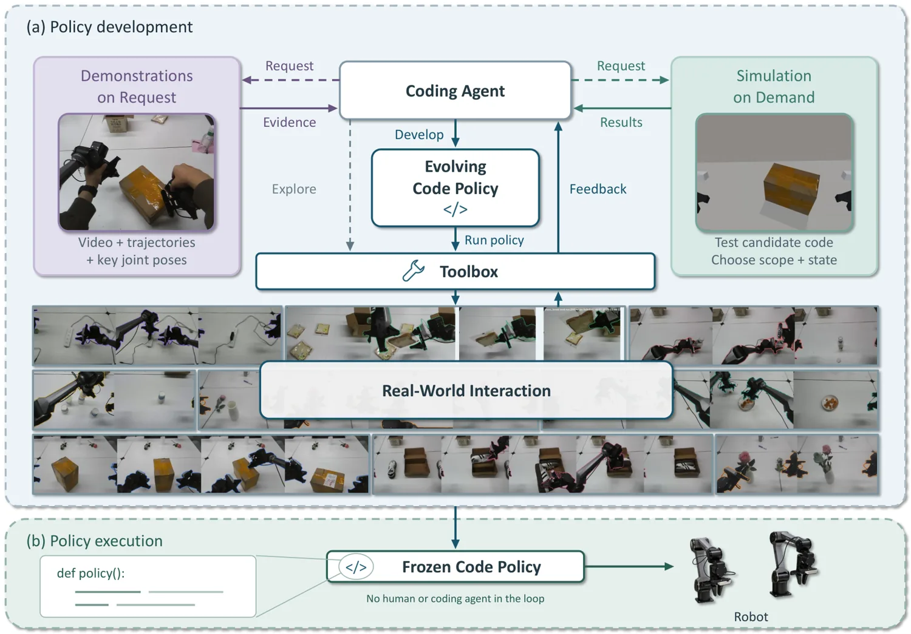

<!-- Generated by scripts/generate.py; edit data/works.json and data/media.json. -->

[← Back to the Awesome index](../../../README.md) · [Interactive website](https://chang-xinhai.github.io/Awesome-RGBDT-Manipulation/?collection=policy&item=ace-cap-0#library)

# ACE-CaP-0

ACE-CaP-0: Real-World Code-as-Policies in the Era of Experience

**2026-11-12 · Preprint · ACE Robotics**

**[Paper](https://arxiv.org/abs/2611.16872)** · [Project](https://acerobotics2025.github.io/ACE-CaP/)

A coding agent revises reusable robot programs with demonstrations and simulation on demand.

*ACE-CaP-0 authors · [Figure source](https://arxiv.org/abs/2611.16872) · Original rights retained.*

| Field | Reported value and source scope |
| :-- | :-- |
| Record type | policy |
| Policy family | Code-as-policy robot agent [1](https://arxiv.org/abs/2611.16872)  |
| Base model and architecture | Claude Opus 5.5 coding agent [1](https://arxiv.org/abs/2611.16872)  |
| Model size and component | Not reported [1](https://arxiv.org/abs/2611.16872)  |
| Deployment inputs | Task instructions, multi-view cameras, robot state and execution feedback. [1](https://arxiv.org/abs/2611.16872)  |
| Action outputs and horizon | Revised Python robot programs and perception/control tool calls. [1](https://arxiv.org/abs/2611.16872)  |
| Training method | Agent requests demonstrations or simulation on demand while developing code; frozen program executes without an agent at runtime. [1](https://arxiv.org/abs/2611.16872)  |
| Training data | Demonstrations requested for specific task segments; limits differ by study. [1](https://arxiv.org/abs/2611.16872)  |
| Training duration | Not reported [1](https://arxiv.org/abs/2611.16872)  |
| Training hardware | Not reported [1](https://arxiv.org/abs/2611.16872)  |
| Inference and control rates | Not reported [1](https://arxiv.org/abs/2611.16872)  |
| Evaluation scope | Eight real-world bimanual tasks, 30 trials each; task-specific program development. [1](https://arxiv.org/abs/2611.16872)  |
| Observations / modalities | RGB · Proprioception · Language |
| Evaluation domain | Simulation · Real world |
| Embodiment |  |
| Release: code | Not verified [2](https://acerobotics2025.github.io/ACE-CaP/)  |
| Release: weights | Not verified [2](https://acerobotics2025.github.io/ACE-CaP/)  |
| Release: data | Not verified [2](https://acerobotics2025.github.io/ACE-CaP/)  |
| Release: license | Not verified [2](https://acerobotics2025.github.io/ACE-CaP/)  |
| Release: notes | Project and paper do not establish a public complete executable implementation. [2](https://acerobotics2025.github.io/ACE-CaP/)  |

**Scope and qualifications**

- Program revisions and selective simulation are development-time adaptation, not updates to foundation-model weights. Eight physical tasks are evaluated after development.

**Primary evidence**

1. [Original paper and first submission](https://arxiv.org/abs/2611.16872)
2. [Official project and release scope](https://acerobotics2025.github.io/ACE-CaP/)
