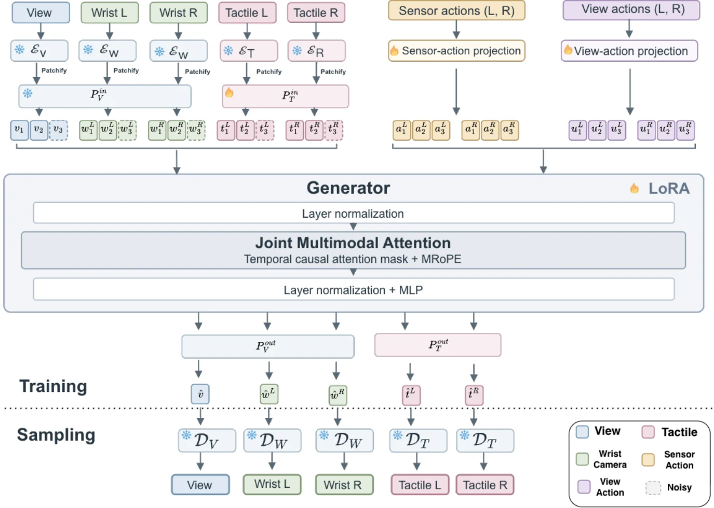

<!-- Generated by scripts/generate.py; edit data/works.json and data/media.json. -->

[← Back to the Awesome index](../../../README.md) · [Interactive website](https://chang-xinhai.github.io/Awesome-RGBDT-Manipulation/?collection=policy&item=acts#library)

# ACTS / React

ACTS: Learning Visuo-Tactile World Models from Human Physical Interaction

**2026-10-16 · Preprint · Massachusetts Institute of Technology**

**[Paper](https://arxiv.org/abs/2610.24285)** · [Project](https://acts-anon.github.io/)

An action-conditioned visuo-tactile world model learns human handheld-sensor contact dynamics and evaluates prediction transfer to robot teleoperation.

*ACTS / React authors; original rights retained · [Figure source](https://arxiv.org/abs/2610.24285) · Original rights retained.*

| Field | Reported value and source scope |
| :-- | :-- |
| Record type | model |
| Model role and downstream interface | Action-conditioned multimodal predictor, not an autonomous manipulation policy. [1](https://arxiv.org/html/2610.24285)  |
| Model family | Predictive contact model [1](https://arxiv.org/html/2610.24285)  |
| Model architecture | Cosmos3-initialized generator with frozen Wan2.2 scene/wrist VAE and adapted tactile VAE. [1](https://arxiv.org/html/2610.24285)  |
| Model size and component | Not reported [1](https://arxiv.org/html/2610.24285)  |
| Model inputs | Scene/wrist RGB, two GelSight image streams,6DoF sensor motion and tactile-derived normal-force changes. [1](https://arxiv.org/html/2610.24285)  |
| Model outputs | Future scene, wrist and tactile observations. [1](https://arxiv.org/html/2610.24285)  |
| Training method | Blockwise teacher forcing and shared multimodal flow generation; train per object on human recordings and evaluate robot teleoperation without target fine-tuning. [1](https://arxiv.org/html/2610.24285)  |
| Training data and scale | React4.91 h across 3 objects, tracked handheld GelSight interactions; tactile encoder adaptation corpus separate. [1](https://arxiv.org/html/2610.24285)  |
| Training duration | 20 epochs per object. [1](https://arxiv.org/html/2610.24285)  |
| Training hardware | 4 NVIDIA H100 GPUs. [1](https://arxiv.org/html/2610.24285)  |
| Inference setting and runtime | Short-horizon 8-frame prediction (0.53s) and long-rollout analyses;30 Hz recording alignment is not model latency. [1](https://arxiv.org/html/2610.24285)  |
| Downstream evaluation and scope | Held-out human prediction and zero-shot robot teleoperation prediction; visual transfer remains mixed acrossPushT/Rope/Motherboard. [1](https://arxiv.org/html/2610.24285)  |
| Observations / modalities | RGB · Tactile · Proprioception |
| Evaluation domain | Human interaction recordings · Real-world recordings |
| Embodiment |  |
| Release: code | Not verified |
| Release: weights | Not verified |
| Release: data | Not verified |
| Release: license | Not verified |
| Release: notes | The inspected primary sources do not establish a public implementation, model checkpoint or dataset download. Paper figures retain their original rights. |

**Scope and qualifications**

- ACTS predicts observations given actions; it does not itself choose an executable robot action.
- Normal force is estimated from tactile sensing and incorporated in sensor-action representation, not an independently measured wrist F/T input.
- Robot transfer is inspected teleoperation prediction; no autonomous closed-loop task-success claim is established.

**Primary evidence**

1. [Original full paper, methods and evaluation](https://arxiv.org/html/2610.24285) — Publication date is arXiv v1; implementation and deployment observations are distinguished from training supervision, generated geometry and base-model identity.
