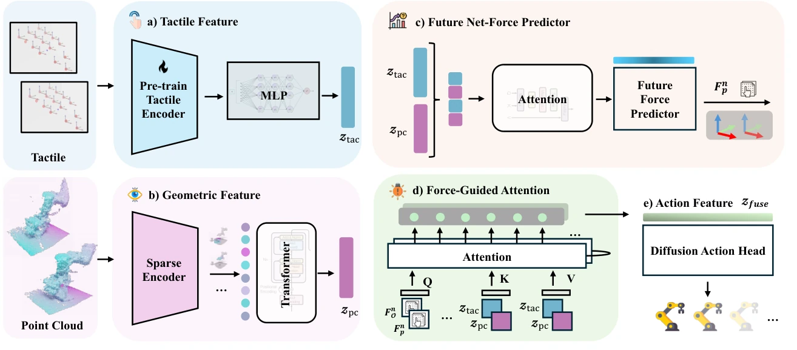

<!-- Generated by scripts/generate.py; edit data/works.json and data/media.json. -->

[← Back to the Awesome index](../../../README.md) · [Interactive website](https://chang-xinhai.github.io/Awesome-RGBDT-Manipulation/?collection=policy&item=adaptac#library)

# AdapTac

Adaptive Visuo-Tactile Fusion with Predictive Force Attention for Dexterous Manipulation

**2025-05-20 · IROS 2025 · Peking University / PKU-Agibot Lab / Ant Group**

**[Paper](https://arxiv.org/abs/2505.13982)** · [Project](https://adaptac-dex.github.io/) · [Code](https://github.com/kingchou007/adaptac-dex) · [Data](https://drive.google.com/file/d/1F6mV1sTDIK1wW3m17eX2PGON7JJenPq3/view)

Observed and predicted tactile net forces guide attention between measured 3D vision and distributed hand touch.

*Adaptive Visuo-Tactile Fusion with Predictive Force Attention for Dexterous Manipulation Thanks: Jinzhou Li, Tianhao Wu, Jiyao Zhang, Zeyuan Chen, Haotian Jin, Mingdong Wu and Hao Dong are with the Center on Frontiers of Computing Studies, School of Computer Science, Peking University, also with PKU-Agibot Lab, School of Computer Science, Peking University, and also with National Key Laboratory for Multimedia Information Processing, School of Computer Science, Peking University. Yunjun Shen is with Ant Group. Yaodong Yang is with Institute for Artificial Intelligence, Peking University. Thanks: * and † \dagger indicates equal contribution. Thanks: Corresponding to hao.dong@pku.edu.cn. authors · [Figure source](https://arxiv.org/abs/2505.13982) · Original rights retained.*

| Field | Reported value and source scope |
| :-- | :-- |
| Record type | policy |
| Policy family | Diffusion [1](https://arxiv.org/abs/2505.13982)  |
| Base model and architecture | RISE sparse 3D visual encoder, pretrained 3DTacDex tactile encoder and diffusion policy with force-guided cross-attention. [1](https://arxiv.org/abs/2505.13982)  |
| Model size and component | Not reported. [1](https://arxiv.org/abs/2505.13982)  |
| Deployment inputs | L515 measured-depth XYZ point cloud and 120 PaXini tri-axis taxels across eight fingertip/fingerpad sensors. Taxel positions, orientations and forces form the tactile representation; kinematics transform forces into camera coordinates. [1](https://arxiv.org/abs/2505.13982)  |
| Action outputs and horizon | 25-dimensional action chunks: arm translation (3), rotation representation (6) and LEAP hand joints (16); future net-force prediction also conditions attention. [1](https://arxiv.org/abs/2505.13982)  |
| Training method | Diffusion imitation loss plus self-supervised future force prediction; predicted and observed net forces query visual/tactile features without manual contact labels. [1](https://arxiv.org/abs/2505.13982)  |
| Training data | Approximately 30 expert demonstrations for each of Open Box, Cup Reorientation and Sponge Flipping. [1](https://arxiv.org/abs/2505.13982)  |
| Training duration | Not reported. [1](https://arxiv.org/abs/2505.13982)  |
| Training hardware | Not reported. [1](https://arxiv.org/abs/2505.13982)  |
| Inference and control rates | 5 Hz for both demonstration collection and inference. [1](https://arxiv.org/abs/2505.13982)  |
| Evaluation scope | Flexiv Rizon 4 with customized 16-DoF LEAP Hand and eight 3×5 PaXini arrays; ten trials/task, maximum 300 steps. Separate unseen-object tests use five objects with four poses each. [1](https://arxiv.org/abs/2505.13982)  |
| Observations / modalities | Depth · Point cloud · Tactile · Proprioception |
| Evaluation domain | Real world |
| Embodiment | Dexterous hand |
| Release: code | Available [2](https://adaptac-dex.github.io/) [3](https://github.com/kingchou007/adaptac-dex)  |
| Release: weights | Not verified [2](https://adaptac-dex.github.io/) [3](https://github.com/kingchou007/adaptac-dex)  |
| Release: data | Partial [2](https://adaptac-dex.github.io/) [3](https://github.com/kingchou007/adaptac-dex) [4](https://drive.google.com/file/d/1F6mV1sTDIK1wW3m17eX2PGON7JJenPq3/view)  |
| Release: license | CC BY-NC-SA 4.0 (actual root LICENSE), despite README MIT badge/text. [2](https://adaptac-dex.github.io/) [3](https://github.com/kingchou007/adaptac-dex)  |
| Release: notes | Training/deployment source and public example_data.zip link verified. Linked 3DTacDex checkpoint is a tactile encoder, not verified AdapTac policy weights; full demonstration-corpus coverage not established. [2](https://adaptac-dex.github.io/) [3](https://github.com/kingchou007/adaptac-dex)  |

**Scope and qualifications**

- Predicted net force guides deployment attention; it is not merely an auxiliary training target.
- Measured tactile forces are summed after pose transformation; this is not a separate wrist six-axis F/T stream.
- Paper interface specifies XYZ point clouds; a camera capable of RGB-D does not establish RGB-color policy input.

**Primary evidence**

1. [Original paper and reviewed full text](https://arxiv.org/abs/2505.13982) — Full primary text, including available supplementary implementation details; first public date retained separately from reviewed revision.
2. [Official author project](https://adaptac-dex.github.io/) — Current project links and release claims checked independently of paper prose.
3. [Official implementation and repository files](https://github.com/kingchou007/adaptac-dex) — Training/deployment implementation, README and actual LICENSE inspected where present.
4. [Official public data link and visible file inventory](https://drive.google.com/file/d/1F6mV1sTDIK1wW3m17eX2PGON7JJenPq3/view) — Accessible public sample/example assets verified; completeness against full paper corpus not established.
