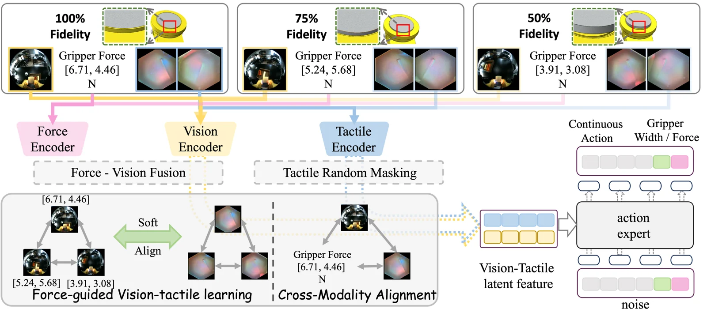

<!-- Generated by scripts/generate.py; edit data/works.json and data/media.json. -->

[← Back to the Awesome index](../../../README.md) · [Interactive website](https://chang-xinhai.github.io/Awesome-RGBDT-Manipulation/?collection=policy&item=aetherock#library)

# AetheRock / ForceVT

AetheRock: An Arm-Worn Robot Teaching System for Force-Guided Vision-Tactile Learning

**2026-06-08 · arXiv preprint · Shanghai Jiao Tong University**

**[Paper](https://arxiv.org/abs/2606.09777)** · [Project](https://www.rhos.ai/research/AetheRock)

An arm-worn demonstrator and force-guided representation learning make visual-tactile manipulation robust to sensor variation.

*AetheRock / ForceVT authors · [Figure source](https://arxiv.org/html/2606.09777v1) · Original rights retained.*

| Field | Reported value and source scope |
| :-- | :-- |
| Record type | policy |
| Policy family | Vision-tactile representation and imitation [1](https://arxiv.org/html/2606.09777v1)  |
| Base model and architecture | Not reported [1](https://arxiv.org/html/2606.09777v1)  |
| Model size and component | Not reported [1](https://arxiv.org/html/2606.09777v1)  |
| Deployment inputs | RGB and vision-based fingertip tactile images; gripper force guides tactile representation training. [1](https://arxiv.org/html/2606.09777v1)  |
| Action outputs and horizon | End-effector relative pose, gripper width and force. [1](https://arxiv.org/html/2606.09777v1)  |
| Training method | Force-guided tactile learning and real robot imitation from collected demonstrations. [1](https://arxiv.org/html/2606.09777v1)  |
| Training data | Human demonstrations collected with the described wearable or handheld interface. [1](https://arxiv.org/html/2606.09777v1)  |
| Training duration | Not reported [1](https://arxiv.org/html/2606.09777v1)  |
| Training hardware | Not reported [1](https://arxiv.org/html/2606.09777v1)  |
| Inference and control rates | Not reported [1](https://arxiv.org/html/2606.09777v1)  |
| Evaluation scope | Real-world experiments evaluate tactile degradation and contact-rich robot manipulation. [1](https://arxiv.org/html/2606.09777v1)  |
| Observations / modalities | RGB · Tactile |
| Evaluation domain | Real world |
| Embodiment | Parallel-jaw gripper |
| Release: code | Not verified [2](https://www.rhos.ai/research/AetheRock)  |
| Release: weights | Not verified [2](https://www.rhos.ai/research/AetheRock)  |
| Release: data | Not verified [2](https://www.rhos.ai/research/AetheRock)  |
| Release: license | Not verified [2](https://www.rhos.ai/research/AetheRock)  |
| Release: notes | No implementation, data or weight release is inferred from the project page. [2](https://www.rhos.ai/research/AetheRock)  |

**Scope and qualifications**

- The predicted tactile representation and actual measured deployment signals must not be conflated.

**Primary evidence**

1. [Author paper and experimental details](https://arxiv.org/html/2606.09777v1) — Observed deployment sensors are distinguished from training-only labels.
2. [Official project](https://www.rhos.ai/research/AetheRock) — Project release and available links inspected.
