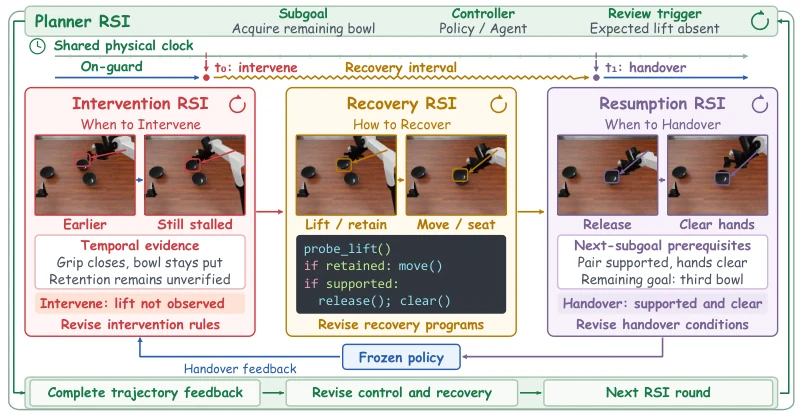

<!-- Generated by scripts/generate.py; edit data/works.json and data/media.json. -->

[← Back to the Awesome index](../../../README.md) · [Interactive website](https://chang-xinhai.github.io/Awesome-RGBDT-Manipulation/?collection=policy&item=agent-on-guard#library)

# Agent on Guard

Agent on Guard: Self-Improving Runtime Intervention for Robust Robotic Manipulation

**2026-11-23 · Preprint · LeapWing AI and collaborators**

**[Paper](https://arxiv.org/abs/2611.30101)**

A coding agent learns when to take control from a frozen robot policy, how to recover, and when to hand control back while physical execution continues.

*Gengming Cui and coauthors · [Figure source](https://arxiv.org/html/2611.30101v1) · Original rights retained.*

| Field | Reported value and source scope |
| :-- | :-- |
| Record type | policy |
| Policy family | Frozen-policy orchestration with recurrent intervention and recovery evolution [1](https://arxiv.org/html/2611.30101v1)  |
| Base model and architecture | VPP2 or Xiaomi-Robotics-1 and GPT-6 Astra / GPT-6.1 Sol in sim; separately fine-tuned pi0.5 with Astra in physical experiments [1](https://arxiv.org/html/2611.30101v1)  |
| Model size and component | Not reported [1](https://arxiv.org/html/2611.30101v1)  |
| Deployment inputs | RGB, public robot state, action history and handover feedback. Physical PiPER setup has three RGB-D cameras, but depth consumption is not established. [1](https://arxiv.org/html/2611.30101v1)  |
| Action outputs and horizon | Continued policy control, queued-action cancellation during takeover, executable recovery and closed-loop handover. [1](https://arxiv.org/html/2611.30101v1)  |
| Training method | Evolves planner guidance, recovery code and intervention/handover conditions over five simulation or four real-world rounds. Executor/policy weights frozen during RSI; physical base policy separately fine-tuned before RSI. [1](https://arxiv.org/html/2611.30101v1)  |
| Training data | Full development rollouts, task outcomes and observations after handover. Physical base policy fine-tuned on 20 real demonstrations per task. [1](https://arxiv.org/html/2611.30101v1)  |
| Training duration | Not reported [1](https://arxiv.org/html/2611.30101v1)  |
| Training hardware | Not reported [1](https://arxiv.org/html/2611.30101v1)  |
| Inference and control rates | Not reported [1](https://arxiv.org/html/2611.30101v1)  |
| Evaluation scope | Paper: 57.26 score and 50.57% success over 42 RoboDojo-Sim tasks using five capability groups; separate RoboCasa365 runs and three physical tasks with 20 test trials per task per method. [1](https://arxiv.org/html/2611.30101v1)  |
| Observations / modalities | RGB · Proprioception |
| Evaluation domain | Simulation · Real world |
| Embodiment | Bimanual · Parallel-jaw gripper |
| Release: code | Not verified |
| Release: weights | Not verified |
| Release: data | Not verified |
| Release: license | Not verified |
| Release: notes | The manuscript reports simulator and physical trials. AoG implementation, trajectory data and resulting weights were not verified. |

**Scope and qualifications**

- RoboDojo-Sim results come from the manuscript protocol with five capability groups and should remain separate from the four-group official Agent leaderboard.
- After adaptation, the shared harness stays fixed across held-out test episodes. Any scene-specific code edits remain inside one test episode.

**Primary evidence**

1. [Original author paper or dataset description](https://arxiv.org/html/2611.30101v1)
