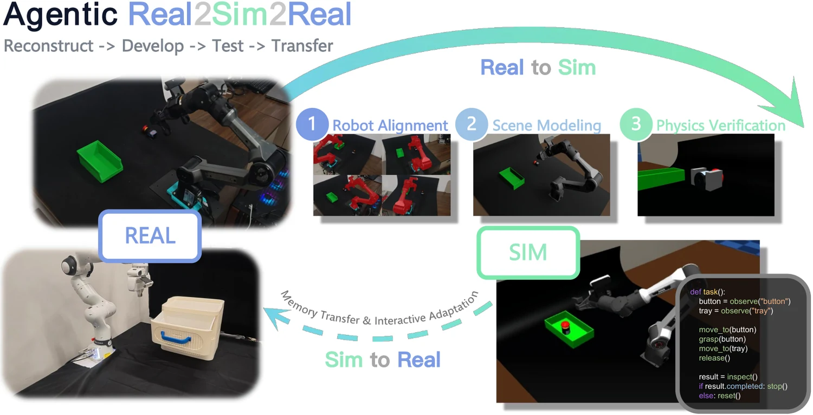

<!-- Generated by scripts/generate.py; edit data/works.json and data/media.json. -->

[← Back to the Awesome index](../../../README.md) · [Interactive website](https://chang-xinhai.github.io/Awesome-RGBDT-Manipulation/?collection=policy&item=agentic-rsr#library)

# Agentic RSR

Agentic RSR: Real-to-Sim-to-Real through Scene Reconstruction and Execution-Grounded Robot Policies

**2026-10-07 · Preprint · Sun Yat-sen University**

**[Paper](https://arxiv.org/abs/2610.10479)**

An agent reconstructs an executable scene from real video, develops policy code through simulation feedback, and transfers code plus experience memory to physical execution.

*Agentic RSR authors; original rights retained · [Figure source](https://arxiv.org/abs/2610.10479) · Original rights retained.*

| Field | Reported value and source scope |
| :-- | :-- |
| Record type | policy |
| Policy family | Robot agent [1](https://arxiv.org/html/2610.10479)  |
| Base model and architecture | Claude Opus 5.5 through DeepSeek Harness in latest v2; Codex comparison and historical reconstruction results are separate. [1](https://arxiv.org/html/2610.10479)  |
| Model size and component | Not reported [1](https://arxiv.org/html/2610.10479)  |
| Deployment inputs | Workspace video/known robot model for reconstruction; task, wrist/third-person images, wrist RGB-D-derived object positions and robot state for execution. [1](https://arxiv.org/html/2610.10479)  |
| Action outputs and horizon | MuJoCo scene/model revisions and executable feedback-driven end-effector/gripper policy programs. [1](https://arxiv.org/html/2610.10479)  |
| Training method | Agent revises scene, then three-pass policy development moves from privileged pose access to visual observations/randomized simulation; transfer code/memory to real robot. [1](https://arxiv.org/html/2610.10479)  |
| Training data | 18 reconstructed scenes on 2 robots plus simulation/physical task trials; no robot-weight fine-tuning claimed. [1](https://arxiv.org/html/2610.10479)  |
| Training duration | Not reported [1](https://arxiv.org/html/2610.10479)  |
| Training hardware | Not reported [1](https://arxiv.org/html/2610.10479)  |
| Inference and control rates | Not reported [1](https://arxiv.org/html/2610.10479)  |
| Evaluation scope | Latest v2 joint scene checks, reconstruction quality and real/sim policy execution. Physical aggregate success is reported as 80% of simulation success, not 80% absolute task success. [1](https://arxiv.org/html/2610.10479)  |
| Observations / modalities | RGB · Depth · Proprioception · Language |
| Evaluation domain | Simulation · Real world |
| Embodiment | Parallel-jaw gripper |
| Release: code | Not released |
| Release: weights | Not applicable |
| Release: data | Not released |
| Release: license | Not verified |
| Release: notes | Paper announces future code and reconstructed-scene data; no author implementation or dataset download was established. |

**Scope and qualifications**

- Scene reconstruction uses RGB-video-estimated depth aligned to known robot URDF geometry, not a measured reconstruction depth stream.
- Policy-facing deployment independently includes wrist RGB-D/SAM3 object-position estimates. Privileged object poses are temporary simulation development inputs.
- Reference depths in reconstruction metrics are estimates, not sensor ground-truth geometry.

**Primary evidence**

1. [Original full paper, methods and evaluation](https://arxiv.org/html/2610.10479) — Publication date is arXiv v1; implementation and deployment observations are distinguished from training supervision, generated geometry and base-model identity.
