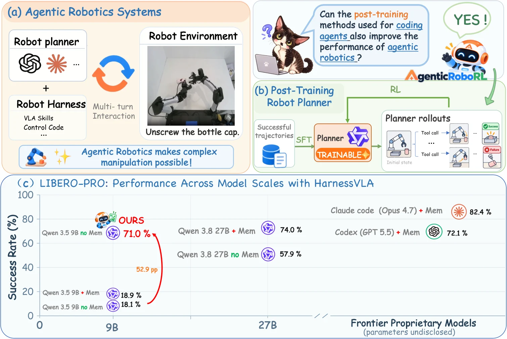

<!-- Generated by scripts/generate.py; edit data/works.json and data/media.json. -->

[← Back to the Awesome index](../../../README.md) · [Interactive website](https://chang-xinhai.github.io/Awesome-RGBDT-Manipulation/?collection=policy&item=agenticroborl#library)

# AgenticRoboRL

AgenticRoboRL: Bringing Coding-Agent Post-Training to Agentic Robotics

**2026-10-20 · Preprint · University of Central Florida**

**[Paper](https://arxiv.org/abs/2610.28589)** · [Code](https://github.com/xinxinliu-ai/AgenticRoboRL) · [Weights](https://huggingface.co/ciciciciliu/AgenticRoboRL-Qwen3.5-9B)

Supervised and multi-turn reinforcement post-training improve a compact robot planner inside fixed execution harnesses.

*AgenticRoboRL authors · [Figure source](https://arxiv.org/abs/2610.28589) · Original rights retained.*

| Field | Reported value and source scope |
| :-- | :-- |
| Record type | policy |
| Policy family | Robot agent [1](https://arxiv.org/abs/2610.28589)  |
| Base model and architecture | Qwen3.5-9B student; Qwen3.8-27B teacher; frozen RPent/CaP-X execution components. [1](https://arxiv.org/abs/2610.28589)  |
| Model size and component | 9B student; 27B teacher. [1](https://arxiv.org/abs/2610.28589)  |
| Deployment inputs | Task, RGB observations and harness/tool feedback; optional separately evaluated external memory. [1](https://arxiv.org/abs/2610.28589)  |
| Action outputs and horizon | Planner code and tool calls to frozen VLA/robot harnesses. [1](https://arxiv.org/abs/2610.28589)  |
| Training method | SFT on successful trajectories followed by multi-turn RL updates planner weights; executor remains frozen. [1](https://arxiv.org/abs/2610.28589)  |
| Training data | Not reported [1](https://arxiv.org/abs/2610.28589)  |
| Training duration | Not reported [1](https://arxiv.org/abs/2610.28589)  |
| Training hardware | Not reported [1](https://arxiv.org/abs/2610.28589)  |
| Inference and control rates | Not reported [1](https://arxiv.org/abs/2610.28589)  |
| Evaluation scope | LIBERO-PRO planner improves 18.1% to 71.0% without memory; Codex GPT-5.5 with external memory scores 72.1% under the stated protocol. [1](https://arxiv.org/abs/2610.28589)  |
| Observations / modalities | RGB · Proprioception · Language |
| Evaluation domain | Simulation |
| Embodiment | Parallel-jaw gripper |
| Release: code | Available [2](https://github.com/xinxinliu-ai/AgenticRoboRL) [3](https://huggingface.co/ciciciciliu/AgenticRoboRL-Qwen3.5-9B)  |
| Release: weights | Available [2](https://github.com/xinxinliu-ai/AgenticRoboRL) [3](https://huggingface.co/ciciciciliu/AgenticRoboRL-Qwen3.5-9B)  |
| Release: data | Not verified [2](https://github.com/xinxinliu-ai/AgenticRoboRL) [3](https://huggingface.co/ciciciciliu/AgenticRoboRL-Qwen3.5-9B)  |
| Release: license | Apache-2.0 original code; checkpoint scope follows its model card and upstream Qwen terms. Vendored harness notices remain separate. [2](https://github.com/xinxinliu-ai/AgenticRoboRL) [3](https://huggingface.co/ciciciciliu/AgenticRoboRL-Qwen3.5-9B)  |
| Release: notes | Actual SFT/RL/evaluation source is public; HF contains separate complete sft/model.safetensors and rl-v006/model.safetensors checkpoints, tokenizer/processor and checksums. These are trained 9B planner weights, not the frozen VLA executor. [2](https://github.com/xinxinliu-ai/AgenticRoboRL) [3](https://huggingface.co/ciciciciliu/AgenticRoboRL-Qwen3.5-9B)  |

**Scope and qualifications**

- Planner post-training is a neural weight update, unlike frozen-model code/memory revision.
- The memory-enabled hosted-model baseline is not a capacity- or context-matched 9B comparison.

**Primary evidence**

1. [Primary manuscript and first-submission history](https://arxiv.org/abs/2610.28589) — Current primary manuscript reviewed; first-public date uses arXiv v1. Observations, training privileges and deployed interfaces retain their separate scopes.
2. [Official code source and actual artifact inventory](https://github.com/xinxinliu-ai/AgenticRoboRL) — Reviewed 26 October 2026. Availability and licensing apply only to the described released component, independently of paper results.
3. [Official weights source and actual artifact inventory](https://huggingface.co/ciciciciliu/AgenticRoboRL-Qwen3.5-9B) — Reviewed 26 October 2026. Availability and licensing apply only to the described released component, independently of paper results.
