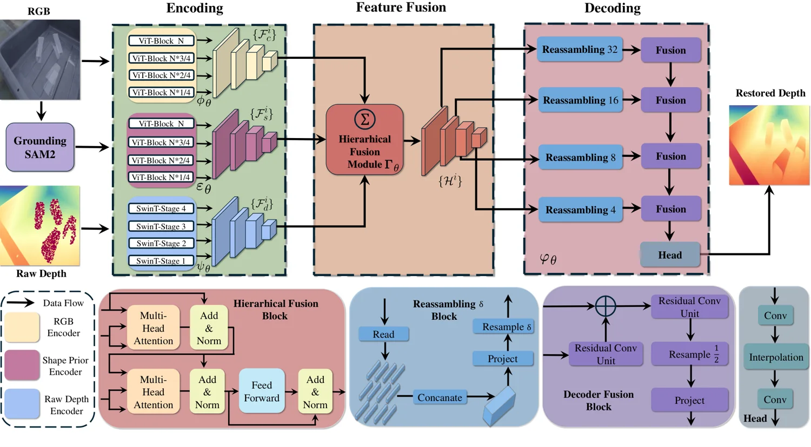

<!-- Generated by scripts/generate.py; edit data/works.json and data/media.json. -->

[← Back to the Awesome index](../../../README.md) · [Interactive website](https://chang-xinhai.github.io/Awesome-RGBDT-Manipulation/?collection=policy&item=aispo-depth#library)

# AISPO

AISPO: Enhancing Depth Reliability for Robotic Manipulation of Non-Lambertian Objects via Affine-Invariant Shape Prior

**2026-06-24 · IEEE RA-L 2026 · LimX Dynamics**

**[Paper](https://arxiv.org/abs/2606.25503)**

An affine-invariant shape prior improves RGB-D restoration for transparent and reflective robot manipulation.

*AISPO authors · [Figure source](https://arxiv.org/abs/2606.25503) · Original rights retained.*

| Field | Reported value and source scope |
| :-- | :-- |
| Record type | model |
| Model role and downstream interface | Depth and geometry perception reference [1](https://arxiv.org/html/2606.25503v1)  |
| Model family | Depth estimation [1](https://arxiv.org/html/2606.25503v1)  |
| Model architecture | See original paper [1](https://arxiv.org/html/2606.25503v1)  |
| Model size and component | Not reported [1](https://arxiv.org/html/2606.25503v1)  |
| Model inputs | RGB and degraded sensor depth; predicted shape prior. [1](https://arxiv.org/html/2606.25503v1)  |
| Model outputs | Completed depth for non-Lambertian objects. [1](https://arxiv.org/html/2606.25503v1)  |
| Training method | Depth completion with learned affine-invariant shape prior. [1](https://arxiv.org/html/2606.25503v1)  |
| Training data and scale | See original paper for dataset scope [1](https://arxiv.org/html/2606.25503v1)  |
| Training duration | Not reported [1](https://arxiv.org/html/2606.25503v1)  |
| Training hardware | Not reported [1](https://arxiv.org/html/2606.25503v1)  |
| Inference setting and runtime | See original paper and official implementation [1](https://arxiv.org/html/2606.25503v1)  |
| Downstream evaluation and scope | Depth benchmarks and real-world manipulation experiments. [1](https://arxiv.org/html/2606.25503v1)  |
| Observations / modalities | RGB · Depth |
| Evaluation domain |  |
| Embodiment |  |
| Release: code | Not verified |
| Release: weights | Not verified |
| Release: data | Not verified |
| Release: license | Not verified. |
| Release: notes | Depth completion is a geometry model rather than an action policy. |

**Scope and qualifications**

- Input depth is sensor-derived; completed depth is model-predicted, and is not an additional measured sensor.

**Primary evidence**

1. [Author paper](https://arxiv.org/html/2606.25503v1)
