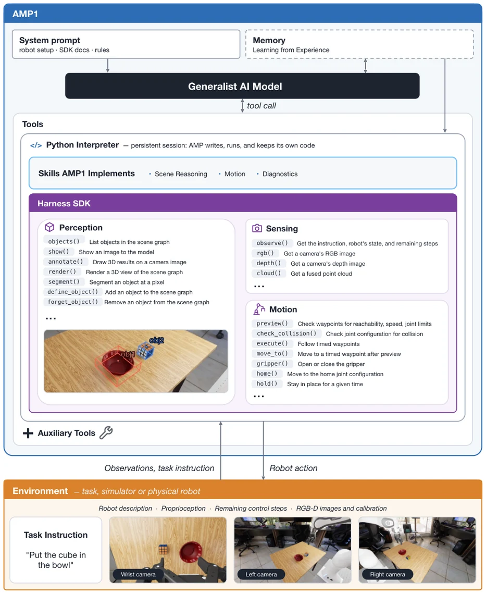

<!-- Generated by scripts/generate.py; edit data/works.json and data/media.json. -->

[← Back to the Awesome index](../../../README.md) · [Interactive website](https://chang-xinhai.github.io/Awesome-RGBDT-Manipulation/?collection=policy&item=amp1#library)

# AMP1

On Agentic Manipulation Policies

**2026-11-06 · Preprint · Apple**

**[Paper](https://arxiv.org/abs/2611.09892)** · [Project](https://apple-aiml-research.github.io/ml-amp/) · [Code](https://github.com/apple-aiml-research/ml-amp)

A generalist model writes Python in a persistent interpreter, uses RGB-D scene tools and commands arms through a shared harness.

*AMP1 authors · [Figure source](https://arxiv.org/html/2611.09892v3) · Original rights retained.*

| Field | Reported value and source scope |
| :-- | :-- |
| Record type | policy |
| Policy family | Direct robot-use agent [1](https://arxiv.org/html/2611.09892) [4](https://github.com/apple-aiml-research/ml-amp/blob/main/docs/robodojo.md)  |
| Base model and architecture | Hosted generalist models, including Gemini 4 Argon and Claude Opus 5.5 [1](https://arxiv.org/html/2611.09892) [4](https://github.com/apple-aiml-research/ml-amp/blob/main/docs/robodojo.md)  |
| Model size and component | Not reported [1](https://arxiv.org/html/2611.09892) [4](https://github.com/apple-aiml-research/ml-amp/blob/main/docs/robodojo.md)  |
| Deployment inputs | Instruction, RGB views, proprioception and motion results; RGB-D, calibration and fused geometry tools where enabled. [1](https://arxiv.org/html/2611.09892) [3](https://github.com/apple-aiml-research/ml-amp) [4](https://github.com/apple-aiml-research/ml-amp/blob/main/docs/robodojo.md)  |
| Action outputs and horizon | Python tool calls with motion targets and gripper commands. [1](https://arxiv.org/html/2611.09892) [4](https://github.com/apple-aiml-research/ml-amp/blob/main/docs/robodojo.md)  |
| Training method | Frozen reasoning models; optional across-episode memory; basic harness makes no task-specific weight updates. [1](https://arxiv.org/html/2611.09892) [4](https://github.com/apple-aiml-research/ml-amp/blob/main/docs/robodojo.md)  |
| Training data | Zero-shot branch uses no demonstrations; separate RoboDojo branch practices and stores experience across episodes. [1](https://arxiv.org/html/2611.09892) [4](https://github.com/apple-aiml-research/ml-amp/blob/main/docs/robodojo.md)  |
| Training duration | Not reported [1](https://arxiv.org/html/2611.09892) [4](https://github.com/apple-aiml-research/ml-amp/blob/main/docs/robodojo.md)  |
| Training hardware | Not reported [1](https://arxiv.org/html/2611.09892) [4](https://github.com/apple-aiml-research/ml-amp/blob/main/docs/robodojo.md)  |
| Inference and control rates | Not reported [1](https://arxiv.org/html/2611.09892) [4](https://github.com/apple-aiml-research/ml-amp/blob/main/docs/robodojo.md)  |
| Evaluation scope | Gemini 4 Argon reaches 85.6% on RoboLab-120. Physical study reports 104/108 trials across twelve tasks and three robot instances. RoboDojo memory experiments are separate. [1](https://arxiv.org/html/2611.09892) [3](https://github.com/apple-aiml-research/ml-amp) [4](https://github.com/apple-aiml-research/ml-amp/blob/main/docs/robodojo.md)  |
| Observations / modalities | RGB · Depth · Proprioception · Language |
| Evaluation domain | Simulation · Real world |
| Embodiment | Franka (DROID-like platform) · ARX X5 · Galaxea R1Pro |
| Release: code | Available — reference harness and simulation adapters [2](https://apple-aiml-research.github.io/ml-amp/)  |
| Release: weights | Not applicable — external hosted reasoning models [2](https://apple-aiml-research.github.io/ml-amp/)  |
| Release: data | Public project demonstrations; no training corpus required for zero-shot experiments [2](https://apple-aiml-research.github.io/ml-amp/)  |
| Release: license | Apple software license in the source repository; external components retain their terms [2](https://apple-aiml-research.github.io/ml-amp/)  |
| Release: notes | Source includes packages and simulation reproduction guidance. Physical deployment setup has different hardware and calibration dependencies. [2](https://apple-aiml-research.github.io/ml-amp/)  |

**Scope and qualifications**

- RoboLab-120 and CaP-Gym provide rendered depth; real experiments infer depth from calibrated stereo. RoboDojo reported memory experiments use the RGB-only branch without sensor depth or supplied camera calibration.
- The complete benchmark results, RGB-only ablations and physical results have different model configurations and denominators.

**Primary evidence**

1. [Primary paper and evaluated setting](https://arxiv.org/html/2611.09892)
2. [Author project and artifact status](https://apple-aiml-research.github.io/ml-amp/)
3. [Official repository and public artifact inventory](https://github.com/apple-aiml-research/ml-amp) — Inspected src/, benchmark documentation and bespoke Apple LICENSE.
4. [Released RoboDojo evaluation harness](https://github.com/apple-aiml-research/ml-amp/blob/main/docs/robodojo.md)
