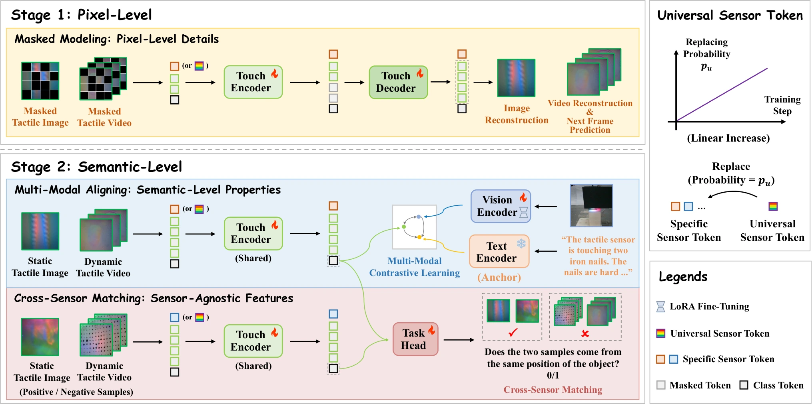

<!-- Generated by scripts/generate.py; edit data/works.json and data/media.json. -->

[← Back to the Awesome index](../../../README.md) · [Interactive website](https://chang-xinhai.github.io/Awesome-RGBDT-Manipulation/?collection=policy&item=anytouch#library)

# AnyTouch

AnyTouch: Learning Unified Static-Dynamic Representation across Multiple Visuo-tactile Sensors

**2025-02-15 · ICLR 2025 · Renmin University of China; Wuhan University of Science and Technology; Beijing University of Posts and Telecommunications**

**[Paper](https://arxiv.org/abs/2502.12191)** · [Project](https://gewu-lab.github.io/AnyTouch/) · [Code](https://github.com/GeWu-Lab/AnyTouch) · [Data](https://huggingface.co/datasets/xxuan01/TacQuad) · [Weights](https://drive.google.com/file/d/1L4jGUjIHNBMzOiD33Rv0jxWYKHBORD1R/view?usp=sharing)

Combines static optical tactile images and temporal tactile clips with cross-sensor matching and touch–vision–language alignment.

*anytouch authors; original paper figure · [Figure source](https://arxiv.org/html/2502.12191#S3.F2) · Original rights retained.*

| Field | Reported value and source scope |
| :-- | :-- |
| Record type | model |
| Model role and downstream interface | Reusable representation or perception model; downstream controllers are separate systems [1](https://arxiv.org/abs/2502.12191)  |
| Model family | Multimodal representation [1](https://arxiv.org/abs/2502.12191)  |
| Model architecture | CLIP ViT-L/14 initialization; multi-sensor tactile transformer with sensor-specific and universal tokens [1](https://arxiv.org/abs/2502.12191)  |
| Model size and component | Not reported [1](https://arxiv.org/abs/2502.12191)  |
| Model inputs | Static optical tactile images or 3-frame tactile clips; sensor identity; paired vision/text during training [1](https://arxiv.org/abs/2502.12191)  |
| Model outputs | Unified tactile representation for material, hardness, grasp prediction and dynamic perception [1](https://arxiv.org/abs/2502.12191)  |
| Training method | Masked tactile modeling plus modality-missing-aware alignment and cross-sensor matching [1](https://arxiv.org/abs/2502.12191)  |
| Training data and scale | Nine-source mixture including TAG, VisGel, Cloth, TVL, SSVTP, YCB-Slide, ObjectFolder Real, Octopi and TacQuad; TacQuad has 72,606 contact frames across 4 sensors [1](https://arxiv.org/abs/2502.12191)  |
| Training duration | 20 epochs stage 1 + 12 epochs stage 2; wall-clock not reported [1](https://arxiv.org/abs/2502.12191)  |
| Training hardware | 4 NVIDIA A800 GPUs [1](https://arxiv.org/abs/2502.12191)  |
| Inference setting and runtime | Not reported [1](https://arxiv.org/abs/2502.12191)  |
| Downstream evaluation and scope | Static property and grasp prediction, unseen-sensor transfer, cross-sensor generation and real-world pouring perception; downstream results are task-specific. [1](https://arxiv.org/abs/2502.12191)  |
| Observations / modalities | Tactile |
| Evaluation domain | Real world |
| Embodiment |  |
| Release: code | Available [2](https://gewu-lab.github.io/AnyTouch/) [3](https://github.com/GeWu-Lab/AnyTouch)  |
| Release: weights | Available — official download link [2](https://gewu-lab.github.io/AnyTouch/) [3](https://github.com/GeWu-Lab/AnyTouch)  |
| Release: data | Available — official resource link [2](https://gewu-lab.github.io/AnyTouch/) [3](https://github.com/GeWu-Lab/AnyTouch)  |
| Release: license | MIT code LICENSE; TacQuad and upstream datasets/checkpoints retain their own terms [2](https://gewu-lab.github.io/AnyTouch/) [3](https://github.com/GeWu-Lab/AnyTouch) [4](https://github.com/GeWu-Lab/AnyTouch/blob/main/LICENSE)  |
| Release: notes | Code, pretrained encoders and downstream task data are separate artifacts; no policy checkpoint is implied by an encoder release. [2](https://gewu-lab.github.io/AnyTouch/) [3](https://github.com/GeWu-Lab/AnyTouch)  |

**Scope and qualifications**

- The model produces representations or perceptual predictions, rather than executable robot actions.

**Primary evidence**

1. [Original model paper and first submission](https://arxiv.org/abs/2502.12191) — Method, experiments and implementation sections; specifications retain component and evaluation scope.
2. [Official project](https://gewu-lab.github.io/AnyTouch/) — Author project; author-reported release scope is distinguished from an executed reproduction.
3. [Official implementation and current release instructions](https://github.com/GeWu-Lab/AnyTouch) — README and repository files inspected on 2026-10-17.
4. [Repository license file](https://github.com/GeWu-Lab/AnyTouch/blob/main/LICENSE) — Applies to repository scope; model/data/base-model terms can differ.
