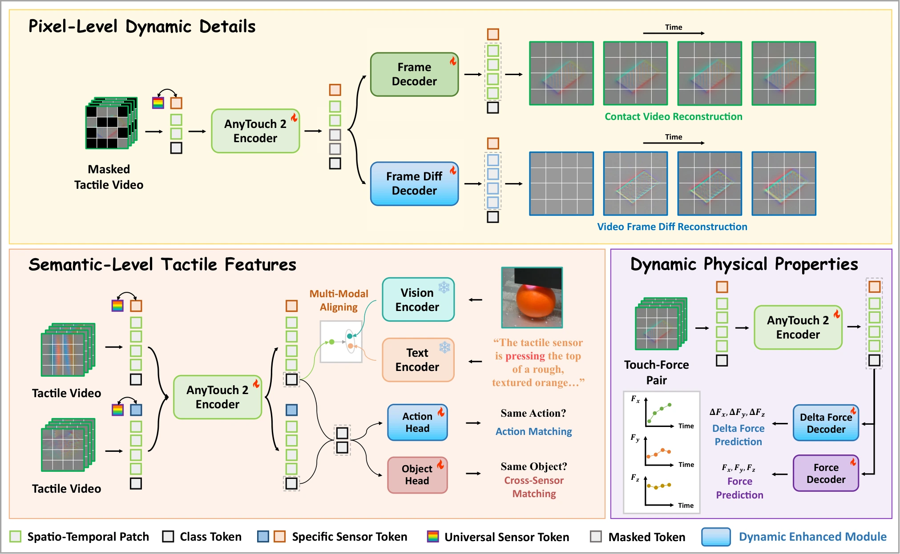

<!-- Generated by scripts/generate.py; edit data/works.json and data/media.json. -->

[← Back to the Awesome index](../../../README.md) · [Interactive website](https://chang-xinhai.github.io/Awesome-RGBDT-Manipulation/?collection=policy&item=anytouch2#library)

# AnyTouch 2 / ToucHD

AnyTouch 2: General Optical Tactile Representation Learning For Dynamic Tactile Perception

**2026-02-10 · ICLR 2026 · Renmin University of China; BAAI; Beijing Jiaotong University; Shanghai AI Laboratory; CAS Institute of Automation; BUPT; Peking University**

**[Paper](https://arxiv.org/abs/2602.09617)** · [Project](https://gewu-lab.github.io/AnyTouch2/) · [Code](https://github.com/GeWu-Lab/AnyTouch2) · [Data](https://huggingface.co/collections/BAAI/touchd) · [Weights](https://huggingface.co/xxuan01/AnyTouch2-Model)

Pretrains dynamic tactile representations from hierarchical atomic-action, manipulation and touch–force data, evaluating both perception and physical policies.

*anytouch2 authors; original paper figure · [Figure source](https://arxiv.org/html/2602.09617#S4.F2) · Original rights retained.*

| Field | Reported value and source scope |
| :-- | :-- |
| Record type | model |
| Model role and downstream interface | Reusable representation or perception model; downstream controllers are separate systems [1](https://arxiv.org/abs/2602.09617)  |
| Model family | Tactile encoder [1](https://arxiv.org/abs/2602.09617)  |
| Model architecture | OpenCLIP-Base encoders with tactile spatiotemporal tokens; 6-layer tactile ViT decoder, width 512 and 8 heads [1](https://arxiv.org/abs/2602.09617)  |
| Model size and component | Not reported [1](https://arxiv.org/abs/2602.09617)  |
| Model inputs | Four optical tactile frames and sensor tokens; optional force, action and vision/language training supervision [1](https://arxiv.org/abs/2602.09617)  |
| Model outputs | Dynamic tactile tokens; auxiliary force predictions and matching scores; downstream task heads consume frozen features [1](https://arxiv.org/abs/2602.09617)  |
| Training method | Original-frame and frame-difference masked reconstruction, object/action matching, force prediction and multimodal alignment [1](https://arxiv.org/abs/2602.09617)  |
| Training data and scale | ToucHD simulated, manipulation and force components, plus existing optical-touch corpora; paper separates source frames, videos, real/sim and sensor counts [1](https://arxiv.org/abs/2602.09617)  |
| Training duration | 40 pretraining epochs, adding matching/force at epoch 20 and alignment at epoch 30; downstream policy 100 epochs [1](https://arxiv.org/abs/2602.09617)  |
| Training hardware | 4 NVIDIA H100 GPUs for pretraining [1](https://arxiv.org/abs/2602.09617)  |
| Inference setting and runtime | Four-frame encoder window; downstream experiment action prediction is separate from encoder latency [1](https://arxiv.org/abs/2602.09617)  |
| Downstream evaluation and scope | Object properties and dynamic force/slip/pose probes; Diffusion Policy on tactile grasping, whiteboard wiping, USB insertion and chip moving. [1](https://arxiv.org/abs/2602.09617)  |
| Observations / modalities | Tactile |
| Evaluation domain | Real world |
| Embodiment |  |
| Release: code | Available [2](https://gewu-lab.github.io/AnyTouch2/) [3](https://github.com/GeWu-Lab/AnyTouch2)  |
| Release: weights | Gated — official model access form required [2](https://gewu-lab.github.io/AnyTouch2/) [3](https://github.com/GeWu-Lab/AnyTouch2)  |
| Release: data | Partial / gated — ToucHD components have independent availability and access forms [2](https://gewu-lab.github.io/AnyTouch2/) [3](https://github.com/GeWu-Lab/AnyTouch2)  |
| Release: license | MIT code LICENSE; gated model/data artifact terms apply separately [2](https://gewu-lab.github.io/AnyTouch2/) [3](https://github.com/GeWu-Lab/AnyTouch2) [4](https://github.com/GeWu-Lab/AnyTouch2/blob/main/LICENSE)  |
| Release: notes | README exposes pretraining/benchmark commands; quick_start and policy-learning sections include Coming Soon markers. Do not infer a complete released physical policy. [2](https://gewu-lab.github.io/AnyTouch2/) [3](https://github.com/GeWu-Lab/AnyTouch2)  |

**Scope and qualifications**

- Force is training supervision from paired measurements, not a separate required wrist-force observation at encoder inference.
- Encoder is reusable; the evaluated robot Diffusion Policy is an additional trained system.
- Official weights and ToucHD-Force require access forms; public repository existence does not imply unrestricted artifact downloads.

**Primary evidence**

1. [Original model paper and first submission](https://arxiv.org/abs/2602.09617) — Method, experiments and implementation sections; specifications retain component and evaluation scope.
2. [Official project](https://gewu-lab.github.io/AnyTouch2/) — Author project; author-reported release scope is distinguished from an executed reproduction.
3. [Official implementation and current release instructions](https://github.com/GeWu-Lab/AnyTouch2) — README and repository files inspected on 2026-10-17.
4. [Repository license file](https://github.com/GeWu-Lab/AnyTouch2/blob/main/LICENSE) — Applies to repository scope; model/data/base-model terms can differ.
