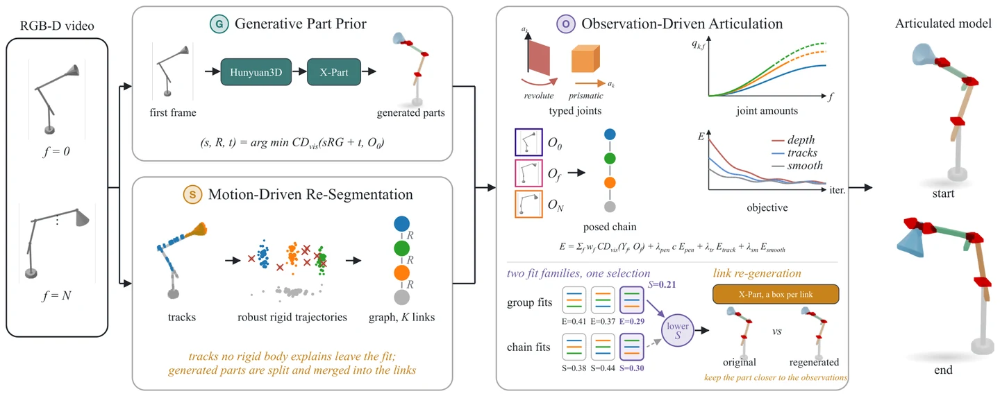

<!-- Generated by scripts/generate.py; edit data/works.json and data/media.json. -->

[← Back to the Awesome index](../../../README.md) · [Interactive website](https://chang-xinhai.github.io/Awesome-RGBDT-Manipulation/?collection=policy&item=artkit#library)

# ArtKit

ArtKit: Motion-Driven Re-Segmentation and Link Re-Generation for Articulated Objects from RGB-D Video

**2026-11-24 · Preprint · UC San Diego; University of Arizona and collaborators**

**[Paper](https://arxiv.org/abs/2611.33403)**

Creates articulated objects and robot hand assets from RGB-D interaction videos by reconciling generated parts with observed motion.

*Sylvia Yuan and coauthors · [Figure source](https://arxiv.org/html/2611.33403v1) · Original rights retained.*

| Field | Reported value and source scope |
| :-- | :-- |
| Record type | model |
| Model role and downstream interface | Articulated geometry reconstruction for simulation assets [1](https://arxiv.org/html/2611.33403v1)  |
| Model family | ArtKit [1](https://arxiv.org/html/2611.33403v1)  |
| Model architecture | Hunyuan3D generation, X-Part decomposition and geometric tracking/reassembly. [1](https://arxiv.org/html/2611.33403v1)  |
| Model size and component | Not reported [1](https://arxiv.org/html/2611.33403v1)  |
| Model inputs | A calibrated RGB-D video with an object mask per frame and a known link count. Qualitative generated-video variants use inferred geometry. [1](https://arxiv.org/html/2611.33403v1)  |
| Model outputs | Complete part meshes, a kinematic tree and typed joints. [1](https://arxiv.org/html/2611.33403v1)  |
| Training method | Uses frozen asset priors and motion-driven geometric fitting; no complete policy training. [1](https://arxiv.org/html/2611.33403v1)  |
| Training data and scale | HArt-O household objects and HArt-H robot hands or grippers with 60 and 8 assets respectively. Real RGB-D clips come from separate RBO and iTACO examples. [1](https://arxiv.org/html/2611.33403v1)  |
| Training duration | Not reported [1](https://arxiv.org/html/2611.33403v1)  |
| Training hardware | Not reported [1](https://arxiv.org/html/2611.33403v1)  |
| Inference setting and runtime | Not reported [1](https://arxiv.org/html/2611.33403v1)  |
| Downstream evaluation and scope | Matches predicted and reference links then evaluates mesh coverage, joint structure and motion. [1](https://arxiv.org/html/2611.33403v1)  |
| Observations / modalities | RGB · Depth · Point cloud |
| Evaluation domain | Simulation · Real world |
| Embodiment | Dexterous hand |
| Release: code | Not verified |
| Release: weights | Not verified |
| Release: data | Not verified |
| Release: license | Not verified |
| Release: notes | Paper or official project reviewed. Code, weights and data are tracked independently. |

**Scope and qualifications**

- A reconstruction tool, with no closed-loop manipulation policy or tactile observation. HArt is an asset/reconstruction test.

**Primary evidence**

1. [Original paper and evaluation settings](https://arxiv.org/html/2611.33403v1)
