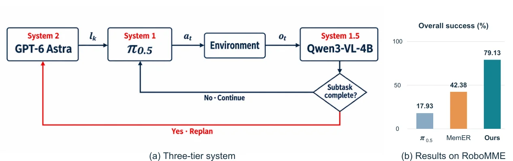

<!-- Generated by scripts/generate.py; edit data/works.json and data/media.json. -->

[← Back to the Awesome index](../../../README.md) · [Interactive website](https://chang-xinhai.github.io/Awesome-RGBDT-Manipulation/?collection=policy&item=astra-three-tier-robomme#library)

# Astra Three-Tier RoboMME

Can Astra Solve RoboMME without Breaking the Bank?

**2026-11-04 · Preprint · Stanford University**

**[Paper](https://arxiv.org/abs/2611.06184)** · [Project](https://bingaochen.github.io/Astra-on-RoboMME/) · [Code](https://github.com/bingaochen/Astra-on-RoboMME)

A three-tier planner, VLA executor and learned monitor reduce high-level calls on memory-dependent manipulation tasks.

*Astra Three-Tier RoboMME authors · [Figure source](https://arxiv.org/abs/2611.06184) · Original rights retained.*

| Field | Reported value and source scope |
| :-- | :-- |
| Record type | policy |
| Policy family | Robot agent [1](https://arxiv.org/html/2611.06184v1)  |
| Base model and architecture | GPT-6 Astra planner; π0.5 executor; Qwen3-VL-4B monitor [1](https://arxiv.org/html/2611.06184v1)  |
| Model size and component | Not reported [1](https://arxiv.org/html/2611.06184v1)  |
| Deployment inputs | Video/history, current RGB, task instruction and robot state [1](https://arxiv.org/html/2611.06184v1)  |
| Action outputs and horizon | Subtask instructions and 16-step robot action chunks [1](https://arxiv.org/html/2611.06184v1)  |
| Training method | Fine-tuned progress monitor; planner and executor orchestrated at different rates. [1](https://arxiv.org/html/2611.06184v1)  |
| Training data | See original paper for dataset and protocol. [1](https://arxiv.org/html/2611.06184v1)  |
| Training duration | Not reported [1](https://arxiv.org/html/2611.06184v1)  |
| Training hardware | Not reported [1](https://arxiv.org/html/2611.06184v1)  |
| Inference and control rates | Not reported [1](https://arxiv.org/html/2611.06184v1)  |
| Evaluation scope | RoboMME: 79.13% reported episode success and 3.63 planner calls per episode. [1](https://arxiv.org/html/2611.06184v1)  |
| Observations / modalities | RGB · Language · Proprioception |
| Evaluation domain | Simulation |
| Embodiment | Not reported |
| Release: code | Available — official source repository [2](https://github.com/bingaochen/Astra-on-RoboMME)  |
| Release: weights | Not verified [2](https://github.com/bingaochen/Astra-on-RoboMME)  |
| Release: data | Not verified [2](https://github.com/bingaochen/Astra-on-RoboMME)  |
| Release: license | Apache-2.0 [2](https://github.com/bingaochen/Astra-on-RoboMME)  |
| Release: notes | Release status checked against author artifacts on 2026-11-05. [2](https://github.com/bingaochen/Astra-on-RoboMME)  |

**Scope and qualifications**

- Simulation results and hosted-model usage should not be interpreted as real-robot evaluation.
- This is a separate paper and architecture from the similarly named waypoint-only Astra on RoboMME agent.

**Primary evidence**

1. [Original paper: method, inputs and evaluation](https://arxiv.org/html/2611.06184v1) — Results and sensing claims are scoped to the authors’ evaluation and deployment setting.
2. [Official repository, source files and license](https://github.com/bingaochen/Astra-on-RoboMME)
