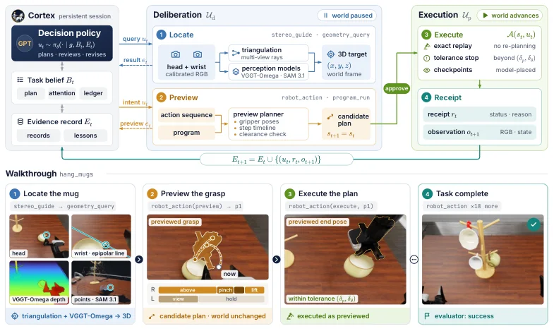

<!-- Generated by scripts/generate.py; edit data/works.json and data/media.json. -->

[← Back to the Awesome index](../../../README.md) · [Interactive website](https://chang-xinhai.github.io/Awesome-RGBDT-Manipulation/?collection=policy&item=auriga#library)

# Auriga

Auriga Technical Report: A Task-Agnostic Agent Harness for Zero-Shot Embodied Manipulation

**2026-10-31 · Preprint · StellarEdge AI**

**[Paper](https://arxiv.org/abs/2611.01112)** · [Code](https://github.com/lose4578/Auriga)

A task-agnostic harness couples a vision-language agent with grounded perception and execution for zero-shot manipulation.

*Auriga authors · [Figure source](https://arxiv.org/abs/2611.01112) · Original rights retained.*

| Field | Reported value and source scope |
| :-- | :-- |
| Record type | policy |
| Policy family | Robot agent [1](https://arxiv.org/html/2611.01112v1)  |
| Base model and architecture | GPT-6 Astra [1](https://arxiv.org/html/2611.01112v1)  |
| Model size and component | Not reported [1](https://arxiv.org/html/2611.01112v1)  |
| Deployment inputs | Multi-view visual observations and task instructions [1](https://arxiv.org/html/2611.01112v1)  |
| Action outputs and horizon | Executable robot tool calls [1](https://arxiv.org/html/2611.01112v1)  |
| Training method | Zero-shot agent harness with task belief and execution feedback. [1](https://arxiv.org/html/2611.01112v1)  |
| Training data | See original paper for dataset and protocol. [1](https://arxiv.org/html/2611.01112v1)  |
| Training duration | Not reported [1](https://arxiv.org/html/2611.01112v1)  |
| Training hardware | Not reported [1](https://arxiv.org/html/2611.01112v1)  |
| Inference and control rates | Not reported [1](https://arxiv.org/html/2611.01112v1)  |
| Evaluation scope | Authors report RoboDojo simulation score 64 and 57.7% task success. [1](https://arxiv.org/html/2611.01112v1)  |
| Observations / modalities | RGB · Language |
| Evaluation domain | Simulation |
| Embodiment | Not reported |
| Release: code | Available — official source repository [2](https://github.com/lose4578/Auriga)  |
| Release: weights | Not verified [2](https://github.com/lose4578/Auriga)  |
| Release: data | Not verified [2](https://github.com/lose4578/Auriga)  |
| Release: license | MIT [2](https://github.com/lose4578/Auriga)  |
| Release: notes | Release status checked against author artifacts on 2026-11-05. [2](https://github.com/lose4578/Auriga)  |

**Scope and qualifications**

- Multi-view depth estimates are not evidence of a deployed physical depth sensor; results are simulated.

**Primary evidence**

1. [Original paper: method, inputs and evaluation](https://arxiv.org/html/2611.01112v1) — Results and sensing claims are scoped to the authors’ evaluation and deployment setting.
2. [Official repository, source files and license](https://github.com/lose4578/Auriga)
