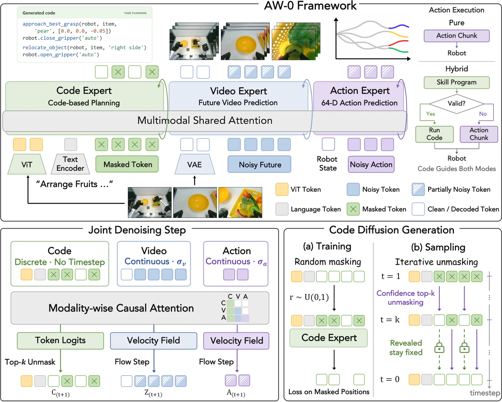

<!-- Generated by scripts/generate.py; edit data/works.json and data/media.json. -->

[← Back to the Awesome index](../../../README.md) · [Interactive website](https://chang-xinhai.github.io/Awesome-RGBDT-Manipulation/?collection=policy&item=aw0#library)

# AW-0

Agentic World Action Models

**2026-10-21 · Preprint · University of California, Berkeley**

**[Paper](https://arxiv.org/abs/2610.30136)** · [Project](https://agentic-wam.github.io/) · [Code](https://github.com/ZhuoyangLiu2005/agentic-wam) · [Weights](https://huggingface.co/miniFranka/agentic-wam-pretrain-yamego3k-soup-e1)

A trained world-action model jointly generates executable skill code, future video and motor actions, with a hybrid program/action execution interface.

*AW-0 authors · [Figure source](https://arxiv.org/abs/2610.30136) · Original rights retained.*

| Field | Reported value and source scope |
| :-- | :-- |
| Record type | policy |
| Policy family | Robot agent [1](https://arxiv.org/abs/2610.30136)  |
| Base model and architecture | Cosmos-Predict2.5 video expert, SDAR/LLaDA-style code expert, frozen Qwen3-VL vision tower and action DiT. [1](https://arxiv.org/abs/2610.30136)  |
| Model size and component | Not reported [1](https://arxiv.org/abs/2610.30136)  |
| Deployment inputs | Current multiview RGB, instruction, robot state and prior program slices. [1](https://arxiv.org/abs/2610.30136)  |
| Action outputs and horizon | Joint skill-program tokens, future video latents and action chunks; hybrid executor selects program or action branch. [1](https://arxiv.org/abs/2610.30136)  |
| Training method | Joint masked code diffusion and video/action flow matching; agentic annotation discovers reusable skills, followed by task fine-tuning. [1](https://arxiv.org/abs/2610.30136)  |
| Training data | 73,101 robot episodes / 1,919.3 h plus 175,541 human episodes / 993.9 h: 248,642 episodes and 2,913.2 h total; 50 consolidated skills. [1](https://arxiv.org/abs/2610.30136)  |
| Training duration | One pretraining epoch; wall-clock duration not reported. [1](https://arxiv.org/abs/2610.30136)  |
| Training hardware | 48 NVIDIA H100 across six nodes for the stated pretraining recipe. [1](https://arxiv.org/abs/2610.30136)  |
| Inference and control rates | Not reported [1](https://arxiv.org/abs/2610.30136)  |
| Evaluation scope | RoboTwin2 simulation and physical YAM/Tianji bimanual manipulation; paper separates program, action and hybrid execution. [1](https://arxiv.org/abs/2610.30136)  |
| Observations / modalities | RGB · Proprioception · Language |
| Evaluation domain | Simulation · Real world |
| Embodiment | Bimanual · Parallel-jaw gripper |
| Release: code | Available [2](https://agentic-wam.github.io/) [3](https://github.com/ZhuoyangLiu2005/agentic-wam) [4](https://huggingface.co/miniFranka/agentic-wam-pretrain-yamego3k-soup-e1)  |
| Release: weights | Available — YAM+ego pretraining checkpoint [2](https://agentic-wam.github.io/) [3](https://github.com/ZhuoyangLiu2005/agentic-wam) [4](https://huggingface.co/miniFranka/agentic-wam-pretrain-yamego3k-soup-e1)  |
| Release: data | Not verified [2](https://agentic-wam.github.io/) [3](https://github.com/ZhuoyangLiu2005/agentic-wam) [4](https://huggingface.co/miniFranka/agentic-wam-pretrain-yamego3k-soup-e1)  |
| Release: license | BSD-2-Clause code; released pretraining checkpoint card declares BSD-2-Clause. Frozen upstream models and corpora retain separate terms. [2](https://agentic-wam.github.io/) [3](https://github.com/ZhuoyangLiu2005/agentic-wam) [4](https://huggingface.co/miniFranka/agentic-wam-pretrain-yamego3k-soup-e1)  |
| Release: notes | Actual annotation/training/inference source and agenticwam_pretrain.pt are released; binary Range 206 verified. This is the YAM+ego pretraining checkpoint, not every task-tuned robot checkpoint or the raw training corpus. [2](https://agentic-wam.github.io/) [3](https://github.com/ZhuoyangLiu2005/agentic-wam) [4](https://huggingface.co/miniFranka/agentic-wam-pretrain-yamego3k-soup-e1)  |

**Scope and qualifications**

- This model learns code/video/action weights; it is not merely a frozen hosted coding-agent wrapper.
- Retargeted human hand labels are training data; they do not establish physical deployment on a dexterous hand.

**Primary evidence**

1. [Primary manuscript and first-submission history](https://arxiv.org/abs/2610.30136) — Current primary manuscript reviewed; first-public date uses arXiv v1. Observations, training privileges and deployed interfaces retain their separate scopes.
2. [Official project source and actual artifact inventory](https://agentic-wam.github.io/) — Reviewed 26 October 2026. Availability and licensing apply only to the described released component, independently of paper results.
3. [Official code source and actual artifact inventory](https://github.com/ZhuoyangLiu2005/agentic-wam) — Reviewed 26 October 2026. Availability and licensing apply only to the described released component, independently of paper results.
4. [Official weights source and actual artifact inventory](https://huggingface.co/miniFranka/agentic-wam-pretrain-yamego3k-soup-e1) — Reviewed 26 October 2026. Availability and licensing apply only to the described released component, independently of paper results.
