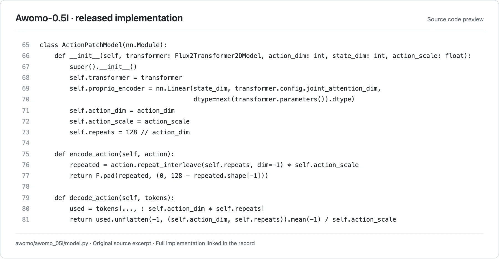

<!-- Generated by scripts/generate.py; edit data/works.json and data/media.json. -->

[← Back to the Awesome index](../../../README.md) · [Interactive website](https://chang-xinhai.github.io/Awesome-RGBDT-Manipulation/?collection=policy&item=awomo05#library)

# Awomo-0.5

Awomo-0.5: World Action Model Pre-trained at Scale

**2026-10-03 · Official project / technical release · Awomo-WestlakeDI / Awomo-WAM Team**

**[Project](https://github.com/Awomo-WestlakeDI/Awomo-0.5)** · [Code](https://github.com/Awomo-WestlakeDI/Awomo-0.5) · [Weights](https://huggingface.co/Auwomo) · [Weights-Robodojo](https://huggingface.co/Auwomo/Awomo-0.5-Robodojo)

Releases image- and video-conditioned world-action policy variants with a common embodied simulation action interface.

*Awomo-WAM Team · [Figure source](https://github.com/Awomo-WestlakeDI/Awomo-0.5/blob/d22dda9aae0f9ae8096e95580a140a784a17b513/awomo/awomo_05i/model.py#L65-L81) · Original rights retained.*

**Preview scope:** Exact contiguous source excerpt (lines 65–81), rendered for legibility. This is a released implementation interface preview; an original architecture figure was not located in the reviewed sources. Source rights remain with the original authors.

| Field | Reported value and source scope |
| :-- | :-- |
| Record type | policy |
| Policy family | World-action model [1](https://github.com/Awomo-WestlakeDI/Awomo-0.5) [3](https://github.com/Awomo-WestlakeDI/Awomo-0.5/blob/main/training/robodojo/README.md) [4](https://huggingface.co/Auwomo/Awomo-0.5-Robodojo/raw/main/LICENSE.md)  |
| Base model and architecture | Qwen3-VL-4B-Instruct; image variant uses FLUX.2-klein-base-4B, video variant Wan2.2-TI2V-5B [1](https://github.com/Awomo-WestlakeDI/Awomo-0.5) [3](https://github.com/Awomo-WestlakeDI/Awomo-0.5/blob/main/training/robodojo/README.md) [4](https://huggingface.co/Auwomo/Awomo-0.5-Robodojo/raw/main/LICENSE.md)  |
| Model size and component | Foundation component labels4B Qwen, 4B FLUX or5B Wan; full action/model aggregate not disclosed [1](https://github.com/Awomo-WestlakeDI/Awomo-0.5) [3](https://github.com/Awomo-WestlakeDI/Awomo-0.5/blob/main/training/robodojo/README.md) [4](https://huggingface.co/Auwomo/Awomo-0.5-Robodojo/raw/main/LICENSE.md)  |
| Deployment inputs | Current RGB and language/state; video variant additionally temporal context [1](https://github.com/Awomo-WestlakeDI/Awomo-0.5) [2](https://github.com/Awomo-WestlakeDI/Awomo-0.5) [3](https://github.com/Awomo-WestlakeDI/Awomo-0.5/blob/main/training/robodojo/README.md)  |
| Action outputs and horizon | Continuous robot action chunks through shared action interface; benchmark-specific layouts [1](https://github.com/Awomo-WestlakeDI/Awomo-0.5) [2](https://github.com/Awomo-WestlakeDI/Awomo-0.5) [3](https://github.com/Awomo-WestlakeDI/Awomo-0.5/blob/main/training/robodojo/README.md)  |
| Training method | World/action pretraining; October 20 release adds actual RoboDojo SFT data loaders, training builders/configurations and XPolicyLab inference support. Other benchmark training integrations remain planned. [1](https://github.com/Awomo-WestlakeDI/Awomo-0.5) [3](https://github.com/Awomo-WestlakeDI/Awomo-0.5/blob/main/training/robodojo/README.md) [4](https://huggingface.co/Auwomo/Awomo-0.5-Robodojo/raw/main/LICENSE.md)  |
| Training data | Pretrained at scale according to project; exact corpus/scale not disclosed [1](https://github.com/Awomo-WestlakeDI/Awomo-0.5) [3](https://github.com/Awomo-WestlakeDI/Awomo-0.5/blob/main/training/robodojo/README.md) [4](https://huggingface.co/Auwomo/Awomo-0.5-Robodojo/raw/main/LICENSE.md)  |
| Training duration | Not reported [1](https://github.com/Awomo-WestlakeDI/Awomo-0.5) [3](https://github.com/Awomo-WestlakeDI/Awomo-0.5/blob/main/training/robodojo/README.md) [4](https://huggingface.co/Auwomo/Awomo-0.5-Robodojo/raw/main/LICENSE.md)  |
| Training hardware | Not reported [1](https://github.com/Awomo-WestlakeDI/Awomo-0.5) [3](https://github.com/Awomo-WestlakeDI/Awomo-0.5/blob/main/training/robodojo/README.md) [4](https://huggingface.co/Auwomo/Awomo-0.5-Robodojo/raw/main/LICENSE.md)  |
| Inference and control rates | Not reported [1](https://github.com/Awomo-WestlakeDI/Awomo-0.5) [3](https://github.com/Awomo-WestlakeDI/Awomo-0.5/blob/main/training/robodojo/README.md) [4](https://huggingface.co/Auwomo/Awomo-0.5-Robodojo/raw/main/LICENSE.md)  |
| Evaluation scope | Released RoboDojo checkpoint/SFT and RoboCasa365 evaluation; LIBERO-Plus, MolmoSpaces and RoboTwin coverage are reported separately from available adapters. [1](https://github.com/Awomo-WestlakeDI/Awomo-0.5) [3](https://github.com/Awomo-WestlakeDI/Awomo-0.5/blob/main/training/robodojo/README.md) [4](https://huggingface.co/Auwomo/Awomo-0.5-Robodojo/raw/main/LICENSE.md)  |
| Observations / modalities | RGB · Proprioception · Language |
| Evaluation domain | Simulation |
| Embodiment | Parallel-jaw gripper · Bimanual |
| Release: code | Partial [1](https://github.com/Awomo-WestlakeDI/Awomo-0.5) [2](https://github.com/Awomo-WestlakeDI/Awomo-0.5) [3](https://github.com/Awomo-WestlakeDI/Awomo-0.5/blob/main/training/robodojo/README.md)  |
| Release: weights | Available [1](https://github.com/Awomo-WestlakeDI/Awomo-0.5) [3](https://github.com/Awomo-WestlakeDI/Awomo-0.5/blob/main/training/robodojo/README.md) [4](https://huggingface.co/Auwomo/Awomo-0.5-Robodojo/raw/main/LICENSE.md)  |
| Release: data | Not verified [1](https://github.com/Awomo-WestlakeDI/Awomo-0.5) [3](https://github.com/Awomo-WestlakeDI/Awomo-0.5/blob/main/training/robodojo/README.md) [4](https://huggingface.co/Auwomo/Awomo-0.5-Robodojo/raw/main/LICENSE.md)  |
| Release: license | Apache-2.0 code; base/RoboCasa model-specific CC BY-NC 4.0 terms. The RoboDojo checkpoint has a separate evaluation-only LICENSE.md restricted to explicitly authorized official evaluators, with no redistribution, training, fine-tuning, distillation or commercial-use grant. Upstream components retain their own terms. [1](https://github.com/Awomo-WestlakeDI/Awomo-0.5) [3](https://github.com/Awomo-WestlakeDI/Awomo-0.5/blob/main/training/robodojo/README.md) [4](https://huggingface.co/Auwomo/Awomo-0.5-Robodojo/raw/main/LICENSE.md)  |
| Release: notes | Actual RoboDojo SFT source/configs are public. Model file presence does not remove checkpoint-specific access/use restrictions: inspect the particular checkpoint license before using it. Broad family README licensing is superseded by the RoboDojo LICENSE.md. [1](https://github.com/Awomo-WestlakeDI/Awomo-0.5) [3](https://github.com/Awomo-WestlakeDI/Awomo-0.5/blob/main/training/robodojo/README.md) [4](https://huggingface.co/Auwomo/Awomo-0.5-Robodojo/raw/main/LICENSE.md)  |

**Scope and qualifications**

- Paper marked TBD; missing size/training costs and architecture figure remain undisclosed.
- October3 dates the public RoboDojo release news; image/video variants and their scores remain distinct.

**Primary evidence**

1. [Official model project / technical release](https://github.com/Awomo-WestlakeDI/Awomo-0.5) — Research-report facts and current executable release are scoped separately; undated releases retain an unknown publication date.
2. [Official implementation / author-contributed adapter](https://github.com/Awomo-WestlakeDI/Awomo-0.5) — Actual deployment contract is checked; adapter presence alone is not evidence of benchmark participation.
3. [Official current source / artifact inventory — 21 October 2026](https://github.com/Awomo-WestlakeDI/Awomo-0.5/blob/main/training/robodojo/README.md) — October 20 actual training package and source builders are released; this is not just an inference adapter.
4. [Official current source / artifact inventory — 21 October 2026](https://huggingface.co/Auwomo/Awomo-0.5-Robodojo/raw/main/LICENSE.md) — Actual LICENSE.md grants only designated official RoboDojo evaluation use; current model card explicitly retains this restriction, overriding the family README’s broader weight summary.
