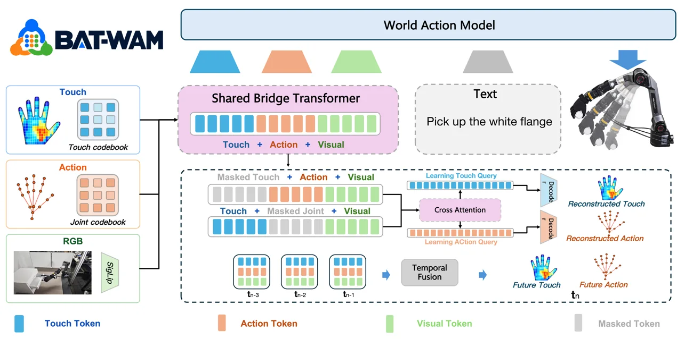

<!-- Generated by scripts/generate.py; edit data/works.json and data/media.json. -->

[← Back to the Awesome index](../../../README.md) · [Interactive website](https://chang-xinhai.github.io/Awesome-RGBDT-Manipulation/?collection=policy&item=bat-wam#library)

# BAT-WAM

BAT-WAM: Bridging Action and Touch in World-Action Models for Dexterous Hands

**2026-11-07 · Preprint · Fudan University**

**[Paper](https://arxiv.org/abs/2611.10967)**

Bridges tactile and hand-state codebooks with RGB context for tactile completion and dexterous actions.

*BAT-WAM authors · [Figure source](https://arxiv.org/html/2611.10967v1) · Original rights retained.*

| Field | Reported value and source scope |
| :-- | :-- |
| Record type | policy |
| Policy family | Visuotactile world-action model [1](https://arxiv.org/html/2611.10967v1)  |
| Base model and architecture | Not reported [1](https://arxiv.org/html/2611.10967v1)  |
| Model size and component | Not reported [1](https://arxiv.org/html/2611.10967v1)  |
| Deployment inputs | RGB observations, full-hand tactile signals, hand state and instruction. [1](https://arxiv.org/html/2611.10967v1)  |
| Action outputs and horizon | Predicted tactile and hand state representations and dexterous manipulation actions. [1](https://arxiv.org/html/2611.10967v1)  |
| Training method | Separate tactile and action tokenizers linked by an RGB-conditioned bridge and WAM policy training; 200 demonstrations for each of seven real tasks. [1](https://arxiv.org/html/2611.10967v1)  |
| Training data | Separate tactile and action tokenizers linked by an RGB-conditioned bridge and WAM policy training; 200 demonstrations for each of seven real tasks. [1](https://arxiv.org/html/2611.10967v1)  |
| Training duration | Not reported [1](https://arxiv.org/html/2611.10967v1)  |
| Training hardware | Not reported [1](https://arxiv.org/html/2611.10967v1)  |
| Inference and control rates | Not reported [1](https://arxiv.org/html/2611.10967v1)  |
| Evaluation scope | HT-Bench offline completion/prediction and seven real tasks using a Linker L6 hand with a tactile glove. [1](https://arxiv.org/html/2611.10967v1)  |
| Observations / modalities | RGB · Tactile · Proprioception |
| Evaluation domain | Real world |
| Embodiment |  |
| Release: code | Not verified |
| Release: weights | Not verified |
| Release: data | Not verified |
| Release: license | Not verified |
| Release: notes | Paper and project links are not evidence of code or model availability. |

**Scope and qualifications**

- The experimental cameras are RGB-D devices, but an actual deployment depth input is not established; do not equate camera capability with policy observations.

**Primary evidence**

1. [Primary paper and first submission](https://arxiv.org/html/2611.10967v1)
