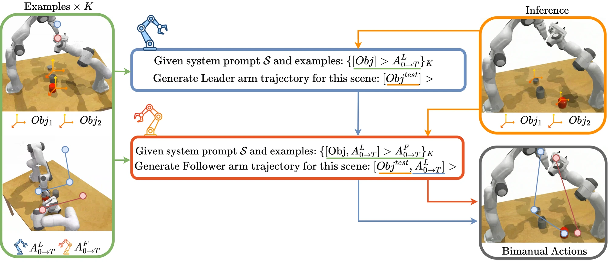

<!-- Generated by scripts/generate.py; edit data/works.json and data/media.json. -->

[← Back to the Awesome index](../../../README.md) · [Interactive website](https://chang-xinhai.github.io/Awesome-RGBDT-Manipulation/?collection=policy&item=bicicle#library)

# BiCICLe

Bimanual Robot Manipulation via Multi-Agent In-Context Learning

**2026-04-22 · Preprint · Sapienza University of Rome / TU Darmstadt**

**[Paper](https://arxiv.org/abs/2604.20348)** · [Project](https://alesspalma.github.io/bicicle) · [Code](https://github.com/alesspalma/icl_bimanual) · [Data](https://huggingface.co/datasets/alesspalma/icl_bimanual_data)

Frozen language-model agents coordinate bimanual keyposes through a leader-follower in-context interface.

*BiCICLe authors · [Figure source](https://alesspalma.github.io/bicicle) · Original rights retained.*

| Field | Reported value and source scope |
| :-- | :-- |
| Record type | policy |
| Policy family | Robot agent [1](https://arxiv.org/abs/2604.20348)  |
| Base model and architecture | GPT-5-mini in main experiments; Qwen2.5-7B local-language-model variant. [1](https://arxiv.org/abs/2604.20348)  |
| Model size and component | 7B Qwen variant; hosted GPT-5-mini parameters not disclosed. [1](https://arxiv.org/abs/2604.20348)  |
| Deployment inputs | Ten serialized demonstration examples plus discretized object/keypoint observations; real object poses are estimated with FoundationPose. [1](https://arxiv.org/abs/2604.20348)  |
| Action outputs and horizon | Two sequentially coordinated seven-dimensional end-effector pose/gripper keyposes, executed using motion planning. [1](https://arxiv.org/abs/2604.20348)  |
| Training method | Training-free leader/follower in-context prediction with inter-arm conditioning. [1](https://arxiv.org/abs/2604.20348)  |
| Training data | Ten prompt demonstrations per task; no method-specific gradient training. [1](https://arxiv.org/abs/2604.20348)  |
| Training duration | No robot-policy gradient training for BiCICLe. [1](https://arxiv.org/abs/2604.20348)  |
| Training hardware | Not applicable to frozen hosted-model use; local inference hardware not reported. [1](https://arxiv.org/abs/2604.20348)  |
| Inference and control rates | Not reported [1](https://arxiv.org/abs/2604.20348)  |
| Evaluation scope | 13 TWIN simulated bimanual tasks, three seeds × 100 episodes per task; three real bimanual Franka tasks. [1](https://arxiv.org/abs/2604.20348)  |
| Observations / modalities | RGB · Depth · Proprioception · Language |
| Evaluation domain | Simulation · Real world |
| Embodiment | Bimanual |
| Release: code | Available [2](https://alesspalma.github.io/bicicle) [3](https://github.com/alesspalma/icl_bimanual)  |
| Release: weights | Not applicable [2](https://alesspalma.github.io/bicicle) [3](https://github.com/alesspalma/icl_bimanual)  |
| Release: data | Available [2](https://alesspalma.github.io/bicicle) [3](https://github.com/alesspalma/icl_bimanual)  |
| Release: license | MIT for repository code; external model, dataset and dependency terms remain separate. [2](https://alesspalma.github.io/bicicle) [3](https://github.com/alesspalma/icl_bimanual) [4](https://github.com/alesspalma/icl_bimanual/blob/HEAD/LICENSE)  |
| Release: notes | Code, prompt templates, TWIN integrations and task dataset are public. Included learned-policy baseline checkpoints are not BiCICLe-trained weights. [2](https://alesspalma.github.io/bicicle) [3](https://github.com/alesspalma/icl_bimanual)  |

**Scope and qualifications**

- Simulation uses benchmark state / keypoint observations; real perception and MoveIt execution are separate components.
- No claim of direct high-rate torque control by the LLM.

**Primary evidence**

1. [Original paper / author report](https://arxiv.org/abs/2604.20348) — Original full paper and supplementary experimental / implementation details; deployment inputs are separated from supervision and benchmark state.
2. [Official project](https://alesspalma.github.io/bicicle) — Author-linked project and current release checked on the catalog cutoff.
3. [Official code / release documentation](https://github.com/alesspalma/icl_bimanual) — Current repository documentation; paper settings and subsequently released artifacts are distinguished.
4. [Repository LICENSE](https://github.com/alesspalma/icl_bimanual/blob/HEAD/LICENSE) — Actual license file inspected; code license does not automatically license data or weights.
