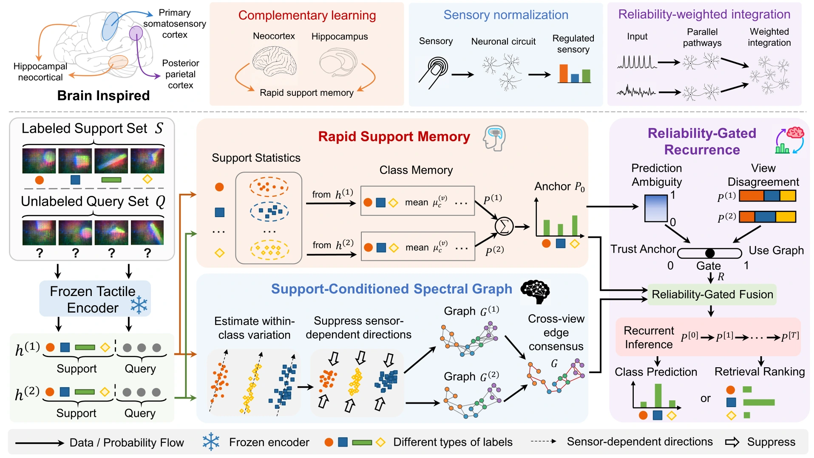

<!-- Generated by scripts/generate.py; edit data/works.json and data/media.json. -->

[← Back to the Awesome index](../../../README.md) · [Interactive website](https://chang-xinhai.github.io/Awesome-RGBDT-Manipulation/?collection=policy&item=bideta#library)

# BIDETA / BIFTA

BIDETA: Brain-Inspired Data-Efficient Tactile Adaptation for Unseen Sensors

**2026-09-08 · Preprint · Beijing Institute of Technology; Imperial College London**

**[Paper](https://arxiv.org/abs/2609.08673)**

Adapts frozen tactile representations to unseen sensors through support memory, feature graphs and reliability-gated recurrence.

*bideta authors; original paper figure · [Figure source](https://arxiv.org/html/2609.08673#S3.F2) · Original rights retained.*

| Field | Reported value and source scope |
| :-- | :-- |
| Record type | model |
| Model role and downstream interface | Reusable representation or perception model; downstream controllers are separate systems [1](https://arxiv.org/abs/2609.08673)  |
| Model family | Tactile encoder [1](https://arxiv.org/abs/2609.08673)  |
| Model architecture | Frozen Sparsh or DINOv2 features with dual-view statistical memory, a support-conditioned spectral graph and recurrent inference [1](https://arxiv.org/abs/2609.08673)  |
| Model size and component | Depends on the frozen encoder; added adaptation parameter count not reported [1](https://arxiv.org/abs/2609.08673)  |
| Model inputs | Unseen-sensor tactile queries plus a small labeled target support set and pretrained source features [1](https://arxiv.org/abs/2609.08673)  |
| Model outputs | Adapted class probabilities and closed-set identity rankings [1](https://arxiv.org/abs/2609.08673)  |
| Training method | Support-conditioned statistical and graph adaptation while the tactile backbone stays frozen; label-budget protocols and inner-validation tuning [1](https://arxiv.org/abs/2609.08673)  |
| Training data and scale | SITR, TacVerse Shape and TacQuad unseen-sensor splits. Required support labels are separate from the query samples. [1](https://arxiv.org/abs/2609.08673)  |
| Training duration | Not reported [1](https://arxiv.org/abs/2609.08673)  |
| Training hardware | NVIDIA H800 80GB for reported experiments [1](https://arxiv.org/abs/2609.08673)  |
| Inference setting and runtime | Not reported [1](https://arxiv.org/abs/2609.08673)  |
| Downstream evaluation and scope | Unseen-sensor classification and closed-set identity ranking under controlled label budgets, pretrained backbones and random seeds. [1](https://arxiv.org/abs/2609.08673)  |
| Observations / modalities | Tactile |
| Evaluation domain | Real world |
| Embodiment |  |
| Release: code | Not verified |
| Release: weights | Not verified |
| Release: data | Not verified |
| Release: license | Paper CC BY-SA 4.0; official code/model release not verified. |
| Release: notes | Code, pretrained encoders and downstream task data are separate artifacts; no policy checkpoint is implied by an encoder release. |

**Scope and qualifications**

- Version 1 was BIFTA: Brain-Inspired Few-Shot Tactile Adaptation for Unknown Sensors. Version 2 (2026-09-23) renames and revises the work as BIDETA; the first-public date stays 2026-09-08.
- Target support labels enable adaptation; this is not zero-shot policy transfer or an actuator controller.

**Primary evidence**

1. [Original model paper and first submission](https://arxiv.org/abs/2609.08673) — Method, experiments and implementation sections; specifications retain component and evaluation scope.
