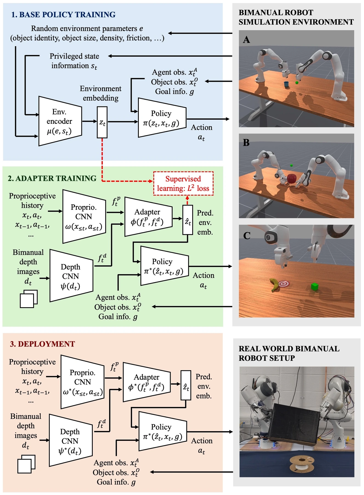

<!-- Generated by scripts/generate.py; edit data/works.json and data/media.json. -->

[← Back to the Awesome index](../../../README.md) · [Interactive website](https://chang-xinhai.github.io/Awesome-RGBDT-Manipulation/?collection=policy&item=bimanual-rma#library)

# Bimanual RMA

Scaling Latent Motor Adaptation to Coordinated Bimanual Manipulation

**2026-10-10 · IROS 2026 Bimanual Manipulation Workshop · University of Oxford; Technical University of Munich; Toyota Motor Europe**

**[Paper](https://arxiv.org/abs/2610.14833)**

Latent adaptation inferred from wrist depth and interaction history supports contact-rich dual-arm control.

*Bimanual RMA authors · [Figure source](https://arxiv.org/html/2610.14833) · Original rights retained.*

| Field | Reported value and source scope |
| :-- | :-- |
| Record type | policy |
| Policy family | RL / sim-to-real [1](https://arxiv.org/abs/2610.14833)  |
| Base model and architecture | Privileged PPO teacher with dynamics latent, depth/history adaptation student and bimanual motor policy. [1](https://arxiv.org/abs/2610.14833)  |
| Model size and component | Not reported in the inspected primary-source sections [1](https://arxiv.org/abs/2610.14833)  |
| Deployment inputs | Dual wrist depth images, observation-action history and proprioception. [1](https://arxiv.org/abs/2610.14833)  |
| Action outputs and horizon | Coordinated bimanual motor actions. [1](https://arxiv.org/abs/2610.14833)  |
| Training method | Privileged dynamics training followed by history/depth latent adaptation and sim-to-real. [1](https://arxiv.org/abs/2610.14833)  |
| Training data | Randomized YCB object mass/friction/scale/geometry in ManiSkill. [1](https://arxiv.org/abs/2610.14833)  |
| Training duration | Not reported in the inspected primary-source sections [1](https://arxiv.org/abs/2610.14833)  |
| Training hardware | Not reported in the inspected primary-source sections [1](https://arxiv.org/abs/2610.14833)  |
| Inference and control rates | Not reported in the inspected primary-source sections [1](https://arxiv.org/abs/2610.14833)  |
| Evaluation scope | Three simulated bimanual tasks; zero-shot dual-Franka lifting experiment. [1](https://arxiv.org/abs/2610.14833)  |
| Observations / modalities | Depth · Proprioception |
| Evaluation domain | Simulation · Real world |
| Embodiment | Bimanual · Parallel-jaw gripper |
| Release: code | Not verified |
| Release: weights | Not verified |
| Release: data | Not verified |
| Release: license | Not verified |
| Release: notes | Code, data and weights are checked independently; an upstream pretrained model is not a released task policy. |

**Scope and qualifications**

- Privileged object parameters are teacher-training information, not deployment observations.
- Long-horizon stacking remains limited for all compared methods.

**Primary evidence**

1. [Original manuscript and first submission history](https://arxiv.org/abs/2610.14833) — Full author HTML method/evaluation/appendix inspected; depth observations, pseudo-labels and generated outputs retain distinct roles.
