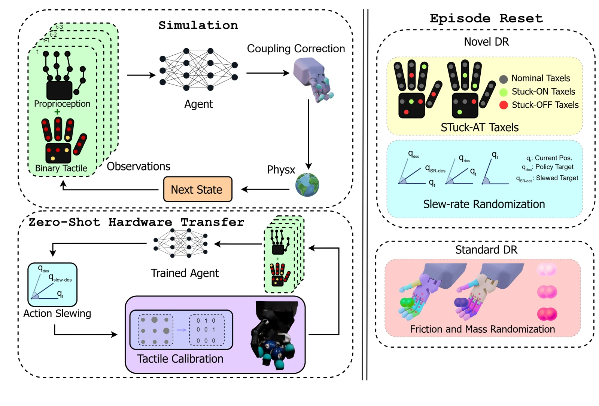

<!-- Generated by scripts/generate.py; edit data/works.json and data/media.json. -->

[← Back to the Awesome index](../../../README.md) · [Interactive website](https://chang-xinhai.github.io/Awesome-RGBDT-Manipulation/?collection=policy&item=blind-baoding#library)

# No Eyes, No Problem: Blind Baoding Manipulation

No Eyes, No Problem: What Does Touch Contribute to Blind Baoding Ball Manipulation?

**2026-10-16 · arXiv preprint · University of Edinburgh**

**[Paper](https://arxiv.org/abs/2610.23438)**

Studies which binary contact signals enable sustained blind Baoding rotation and zero-shot transfer.

*Blind Baoding authors; original rights retained. · [Figure source](https://arxiv.org/html/2610.23438v1) · Original rights retained.*

| Field | Reported value and source scope |
| :-- | :-- |
| Record type | policy |
| Policy family | RL [2](https://arxiv.org/html/2610.23438v1)  |
| Base model and architecture | PPO in Isaac Lab with a sensor-aligned, coupling-aware Shadow Hand Lite model. [2](https://arxiv.org/html/2610.23438v1)  |
| Model size and component | Not reported [2](https://arxiv.org/html/2610.23438v1)  |
| Deployment inputs | Four frames of 52 proprioceptive values and 16 binary tactile contacts per frame; 272 values total. [2](https://arxiv.org/html/2610.23438v1)  |
| Action outputs and horizon | 13 joint-position commands. [2](https://arxiv.org/html/2610.23438v1)  |
| Training method | PPO; tactile calibration and episodic SlewDR/STAT randomization for zero-shot transfer. [2](https://arxiv.org/html/2610.23438v1)  |
| Training data | Simulation rollouts with physical-parameter, slew-rate and stuck-taxel randomization. [2](https://arxiv.org/html/2610.23438v1)  |
| Training duration | Not reported [2](https://arxiv.org/html/2610.23438v1)  |
| Training hardware | Not reported [2](https://arxiv.org/html/2610.23438v1)  |
| Inference and control rates | 60 Hz hardware commands. [2](https://arxiv.org/html/2610.23438v1)  |
| Evaluation scope | Shadow Dexterous Hand Lite Baoding rotation; tactile-off and regional-sensor ablations. [2](https://arxiv.org/html/2610.23438v1)  |
| Observations / modalities | Tactile · Proprioception |
| Evaluation domain | Simulation · Real world |
| Embodiment | Dexterous hand |
| Release: code | Not verified |
| Release: weights | Not verified |
| Release: data | Not verified |
| Release: license | Not verified |
| Release: notes | Paper and public presentation verified; no implementation, weight or data release is inferred from a publication or demonstration. |

**Scope and qualifications**

- The reported 225 consecutive half-turns are one continuous hardware trial, not an aggregate success rate.
- Tactile channels combine twelve FSRs and four BioTac sensors, thresholded to binary contacts. No images or object-state estimates enter deployment.

**Primary evidence**

1. [Canonical author manuscript and arXiv submission history](https://arxiv.org/abs/2610.23438) — Date retains the initial v1 submission, independently of revisions or current artifact releases.
2. [Full author paper: method, observations and evaluation scope](https://arxiv.org/html/2610.23438v1) — Physical sensors, predicted signals, training labels and policy inputs are recorded separately; undisclosed quantities remain unknown.
