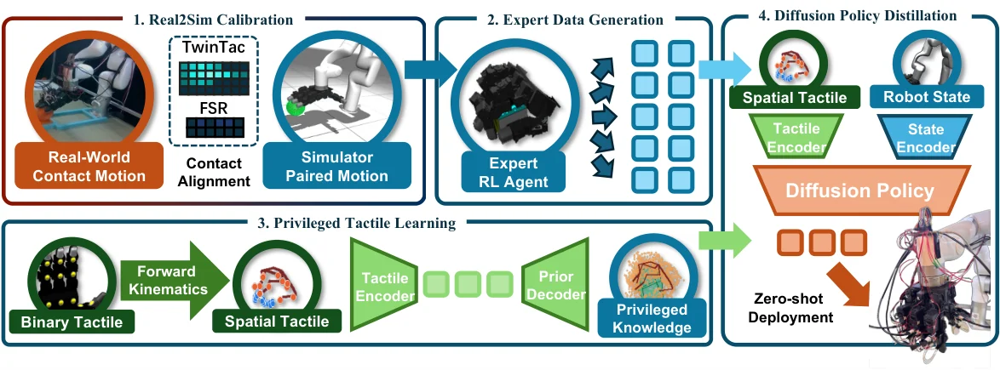

<!-- Generated by scripts/generate.py; edit data/works.json and data/media.json. -->

[← Back to the Awesome index](../../../README.md) · [Interactive website](https://chang-xinhai.github.io/Awesome-RGBDT-Manipulation/?collection=policy&item=blind-dex-grasp#library)

# Blind Dexterous Grasping

Blind Dexterous Grasping via Real2Sim2Real Tactile Policy Learning

**2026-06-10 · CoRL 2026 · ShanghaiTech University**

**[Paper](https://arxiv.org/abs/2606.11767)** · [Project](https://dex-blind-grasp.github.io/)

A tactile-only diffusion policy distills simulation experts after real-to-sim contact calibration for blind grasping.

*Blind Dexterous Grasping authors · [Figure source](https://arxiv.org/html/2606.11767) · Original rights retained.*

| Field | Reported value and source scope |
| :-- | :-- |
| Record type | policy |
| Policy family | Tactile diffusion policy [1](https://arxiv.org/abs/2606.11767)  |
| Base model and architecture | Layout-aware tactile encoder with diffusion action model [1](https://arxiv.org/abs/2606.11767)  |
| Model size and component | Not reported [1](https://arxiv.org/abs/2606.11767)  |
| Deployment inputs | 44 binary tactile channels and joint proprioception; no deployment vision. [1](https://arxiv.org/abs/2606.11767)  |
| Action outputs and horizon | Dexterous hand action sequences [1](https://arxiv.org/abs/2606.11767)  |
| Training method | Calibrate contact events, train privileged RL experts, pretrain tactile encoder, then distill demonstrations into diffusion policy. [1](https://arxiv.org/abs/2606.11767)  |
| Training data | Object-specific simulated expert trajectories; calibrated real contacts do not constitute grasp demonstrations. [1](https://arxiv.org/abs/2606.11767)  |
| Training duration | Not reported [1](https://arxiv.org/abs/2606.11767)  |
| Training hardware | Not reported [1](https://arxiv.org/abs/2606.11767)  |
| Inference and control rates | Not reported [1](https://arxiv.org/abs/2606.11767)  |
| Evaluation scope | Physical xArm6–LEAP hand tested on 10 seen and 10 unseen objects. [1](https://arxiv.org/abs/2606.11767)  |
| Observations / modalities | Tactile · Proprioception |
| Evaluation domain | Simulation · Real world |
| Embodiment |  |
| Release: code | Not verified [2](https://dex-blind-grasp.github.io/)  |
| Release: weights | Not verified [2](https://dex-blind-grasp.github.io/)  |
| Release: data | Not verified [2](https://dex-blind-grasp.github.io/)  |
| Release: license | Not verified [2](https://dex-blind-grasp.github.io/)  |
| Release: notes | Project labels code and hardware as forthcoming; no public artifact established. [2](https://dex-blind-grasp.github.io/)  |

**Scope and qualifications**

- Privileged geometric labels supervise training only; deployed policy does not observe object pose or images.
- Project code and hardware buttons do not currently link to released repositories.

**Primary evidence**

1. [Author paper and first submission](https://arxiv.org/abs/2606.11767)
2. [Official project and artifact scope](https://dex-blind-grasp.github.io/)
