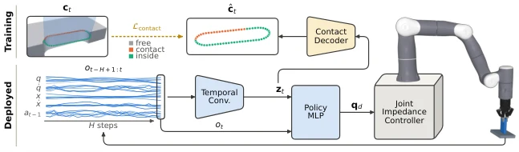

<!-- Generated by scripts/generate.py; edit data/works.json and data/media.json. -->

[← Back to the Awesome index](../../../README.md) · [Interactive website](https://chang-xinhai.github.io/Awesome-RGBDT-Manipulation/?collection=policy&item=blind-precise-assembly#library)

# Blind Precise Assembly

Blind Precise Assembly: Proprioceptive Sim-to-Real Peg-in-Hole for Diverse Parts

**2026-10-16 · arXiv preprint · MIT**

**[Paper](https://arxiv.org/abs/2610.23849)** · [Project](https://younghyopark.me/blind-proprioceptive-assembly/) · [Code](https://github.com/younghyopark/mjfit)

Uses joint history alone for contact-driven assembly; transfers a simulation-trained insertion policy to physical parts.

*Blind Precise Assembly authors; original rights retained. · [Figure source](https://arxiv.org/html/2610.23849v1) · Original rights retained.*

| Field | Reported value and source scope |
| :-- | :-- |
| Record type | policy |
| Policy family | RL [2](https://arxiv.org/html/2610.23849v1)  |
| Base model and architecture | Temporal-convolution encoder and MLP actor; asymmetric privileged critic during PPO training. [2](https://arxiv.org/html/2610.23849v1)  |
| Model size and component | Not reported [2](https://arxiv.org/html/2610.23849v1)  |
| Deployment inputs | 0.6-second joint-position/velocity, kinematic gripper pose/twist and previous-action history; no visual, wrench or tactile observations. [2](https://arxiv.org/html/2610.23849v1)  |
| Action outputs and horizon | Seven joint-position increments tracked by joint impedance control. [2](https://arxiv.org/html/2610.23849v1)  |
| Training method | PPO with domain randomization, training-only privileged critic and contact supervision. [2](https://arxiv.org/html/2610.23849v1)  |
| Training data | Procedurally randomized peg/hole, gear and thread assemblies in MuJoCo Warp; 12,288 parallel training worlds. [2](https://arxiv.org/html/2610.23849v1)  |
| Training duration | Not reported [2](https://arxiv.org/html/2610.23849v1)  |
| Training hardware | Not reported [2](https://arxiv.org/html/2610.23849v1)  |
| Inference and control rates | 50 Hz policy; 1 kHz simulated physics. [2](https://arxiv.org/html/2610.23849v1)  |
| Evaluation scope | Peg insertion, gear meshing and nut threading in simulation; zero-shot physical peg insertion on Flexiv Rizon 4S/Robotiq 2F-85. [2](https://arxiv.org/html/2610.23849v1)  |
| Observations / modalities | Proprioception |
| Evaluation domain | Simulation · Real world |
| Embodiment | Parallel-jaw gripper |
| Release: code | Partial — mjfit geometry generator [3](https://younghyopark.me/blind-proprioceptive-assembly/) [4](https://github.com/younghyopark/mjfit)  |
| Release: weights | Not verified [3](https://younghyopark.me/blind-proprioceptive-assembly/) [4](https://github.com/younghyopark/mjfit)  |
| Release: data | Not verified [3](https://younghyopark.me/blind-proprioceptive-assembly/) [4](https://github.com/younghyopark/mjfit)  |
| Release: license | MIT for mjfit; policy artifacts not verified [3](https://younghyopark.me/blind-proprioceptive-assembly/) [4](https://github.com/younghyopark/mjfit)  |
| Release: notes | Official mjfit repository contains procedural assembly generators, examples and benchmarks. This is a geometry/tool release, not evidence that policy training or checkpoints are released. [3](https://younghyopark.me/blind-proprioceptive-assembly/) [4](https://github.com/younghyopark/mjfit)  |

**Scope and qualifications**

- Physical transfer is demonstrated for peg insertion; gear meshing and nut threading remain simulation evaluations.
- The linked mjfit repository releases procedural collision geometry, not a verified trained assembly-policy checkpoint.

**Primary evidence**

1. [Canonical author manuscript and arXiv submission history](https://arxiv.org/abs/2610.23849) — Date retains the initial v1 submission, independently of revisions or current artifact releases.
2. [Full author paper: method, observations and evaluation scope](https://arxiv.org/html/2610.23849v1) — Physical sensors, predicted signals, training labels and policy inputs are recorded separately; undisclosed quantities remain unknown.
3. [Official paper-linked project page; release review on 19 October 2026](https://younghyopark.me/blind-proprioceptive-assembly/) — Current artifacts are checked separately from paper experiments. A project-only link is not proof of an implementation release.
4. [Official linked implementation and current file inventory](https://github.com/younghyopark/mjfit) — Official mjfit repository contains procedural assembly generators, examples and benchmarks. This is a geometry/tool release, not evidence that policy training or checkpoints are released.
