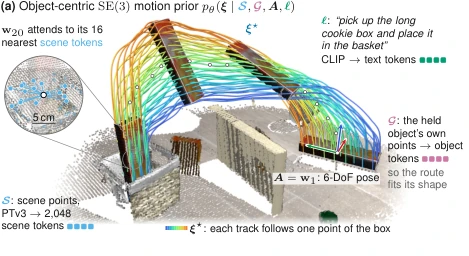

<!-- Generated by scripts/generate.py; edit data/works.json and data/media.json. -->

[← Back to the Awesome index](../../../README.md) · [Interactive website](https://chang-xinhai.github.io/Awesome-RGBDT-Manipulation/?collection=policy&item=cairn#library)

# Cairn

Cairn: Object-Centric 3D Trajectory Priors for Steering Frozen VLAs

**2026-11-25 · Preprint · University of Pennsylvania; Athena Research Center**

**[Paper](https://arxiv.org/abs/2611.34914)**

Steers a frozen VLA with sampled object-centric SE(3) routes, using scene and held-object geometry to reduce collision and orientation errors.

*Agelos Kratimenos and coauthors · [Figure source](https://arxiv.org/html/2611.34914v1) · Original rights retained.*

| Field | Reported value and source scope |
| :-- | :-- |
| Record type | policy |
| Policy family | Cairn [1](https://arxiv.org/html/2611.34914v1)  |
| Base model and architecture | Frozen π0.5 action policy plus Point Transformer V3/3DFA motion prior [1](https://arxiv.org/html/2611.34914v1)  |
| Model size and component | Not reported [1](https://arxiv.org/html/2611.34914v1)  |
| Deployment inputs | Colored scene and held-object point clouds, grasp object pose and instruction in the prior, alongside the frozen π0.5 RGB and state interface. The physical setup reconstructs the clouds from camera depth. [1](https://arxiv.org/html/2611.34914v1)  |
| Action outputs and horizon | Execution-ready action chunks guided by selected object SE(3) waypoints within the frozen VLA denoiser. [1](https://arxiv.org/html/2611.34914v1)  |
| Training method | The separate prior learns object trajectories from automatically generated feasible routes; the downstream VLA weights stay frozen. [1](https://arxiv.org/html/2611.34914v1)  |
| Training data | Procedural LIBERO scenes and simulated replica of the physical scene; the physical setup uses no new robot demonstrations for the prior. [1](https://arxiv.org/html/2611.34914v1)  |
| Training duration | Not reported [1](https://arxiv.org/html/2611.34914v1)  |
| Training hardware | Not reported [1](https://arxiv.org/html/2611.34914v1)  |
| Inference and control rates | Not reported [1](https://arxiv.org/html/2611.34914v1)  |
| Evaluation scope | LIBERO-Shift: 1,941 held-out layouts across 27 tasks, three seeds per layout (5,823 episodes). Frozen π0.5 baseline versus Cairn is 24.5% versus 95.1%; three physical cube tasks are separate. [1](https://arxiv.org/html/2611.34914v1)  |
| Observations / modalities | RGB · Depth · Point cloud · Proprioception · Language |
| Evaluation domain | Simulation · Real world |
| Embodiment | Parallel-jaw gripper |
| Release: code | Not verified |
| Release: weights | Not verified |
| Release: data | Not verified |
| Release: license | Not verified |
| Release: notes | Public paper verified. Code, task weights and data are tracked separately. |

**Scope and qualifications**

- The physical geometry prior depends on measured camera depth, kinematics and an initial grasp measurement. Frozen base policy inputs are unchanged.

**Primary evidence**

1. [Original author paper with methods, evaluation and scope](https://arxiv.org/html/2611.34914v1)
