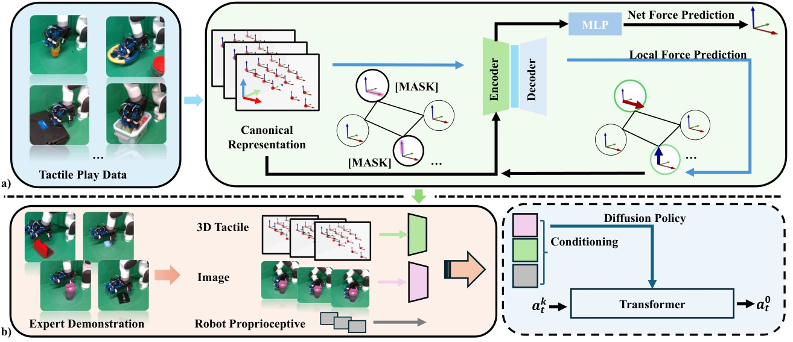

<!-- Generated by scripts/generate.py; edit data/works.json and data/media.json. -->

[← Back to the Awesome index](../../../README.md) · [Interactive website](https://chang-xinhai.github.io/Awesome-RGBDT-Manipulation/?collection=policy&item=canonical-3d-tactile#library)

# Canonical 3D Tactile Pretraining

Canonical Representation and Force-Based Pretraining of 3D Tactile for Dexterous Visuo-Tactile Policy Learning

**2024-09-26 · Preprint · Peking University / PKU-Agibot Lab**

**[Paper](https://arxiv.org/abs/2409.17549)** · [Project](https://3dtacdex.github.io) · [Code](https://github.com/tianhaowuhz/3dtacdex)

Canonical i zed distributed 3D touch and force-based pretraining improve dexterous visual-tactile imitation.

*Canonical Representation and Force-Based Pretraining of 3D Tactile for Dexterous Visuo-Tactile Policy Learning authors · [Figure source](https://arxiv.org/abs/2409.17549) · Original rights retained.*

| Field | Reported value and source scope |
| :-- | :-- |
| Record type | policy |
| Policy family | Diffusion [1](https://arxiv.org/abs/2409.17549)  |
| Base model and architecture | Canonical tactile point/force representation, force self-supervised encoder and diffusion policy. [1](https://arxiv.org/abs/2409.17549)  |
| Model size and component | Not reported [1](https://arxiv.org/abs/2409.17549)  |
| Deployment inputs | RGB, 3D tactile geometry/force and robot proprioception. [1](https://arxiv.org/abs/2409.17549)  |
| Action outputs and horizon | Arm end-effector pose and 16-Do F hand joint targets. [1](https://arxiv.org/abs/2409.17549)  |
| Training method | Force-based tactile pretraining then visuotactile diffusion behavior cloning. [1](https://arxiv.org/abs/2409.17549)  |
| Training data | Real dexterous demonstrations across open box, reorientation, flip and assembly; exact dataset count Not reported in inspected source. [1](https://arxiv.org/abs/2409.17549)  |
| Training duration | Not reported [1](https://arxiv.org/abs/2409.17549)  |
| Training hardware | Not reported [1](https://arxiv.org/abs/2409.17549)  |
| Inference and control rates | 5 Hz demonstration collection and inference. [1](https://arxiv.org/abs/2409.17549)  |
| Evaluation scope | Four real contact-rich dexterous task families. [1](https://arxiv.org/abs/2409.17549)  |
| Observations / modalities | RGB · Tactile · Proprioception |
| Evaluation domain | Real world |
| Embodiment | Dexterous hand |
| Release: code | Available [2](https://3dtacdex.github.io) [3](https://github.com/tianhaowuhz/3dtacdex)  |
| Release: weights | Not verified [2](https://3dtacdex.github.io) [3](https://github.com/tianhaowuhz/3dtacdex)  |
| Release: data | Not verified [2](https://3dtacdex.github.io) [3](https://github.com/tianhaowuhz/3dtacdex)  |
| Release: license | MIT [2](https://3dtacdex.github.io) [3](https://github.com/tianhaowuhz/3dtacdex)  |
| Release: notes | Author-linked repository and actual LICENSE inspected; code, checkpoints anddatasets have independent availability. [2](https://3dtacdex.github.io) [3](https://github.com/tianhaowuhz/3dtacdex)  |

**Scope and qualifications**

- 3D tactile contact coordinates are local touch geometry, not external measured depth.

**Primary evidence**

1. [Original paper and supplementary implementation details](https://arxiv.org/abs/2409.17549) — Primary full text reviewed; dataset, deployment modalities and training-only privileges are scoped separately.
2. [Official author project](https://3dtacdex.github.io) — Live project artifact links inspected on2026-10-17.
3. [Official released implementation and LICENSE](https://github.com/tianhaowuhz/3dtacdex) — Repository metadata,README and actualLICENSE inspected; availability scoped to the listed component.
