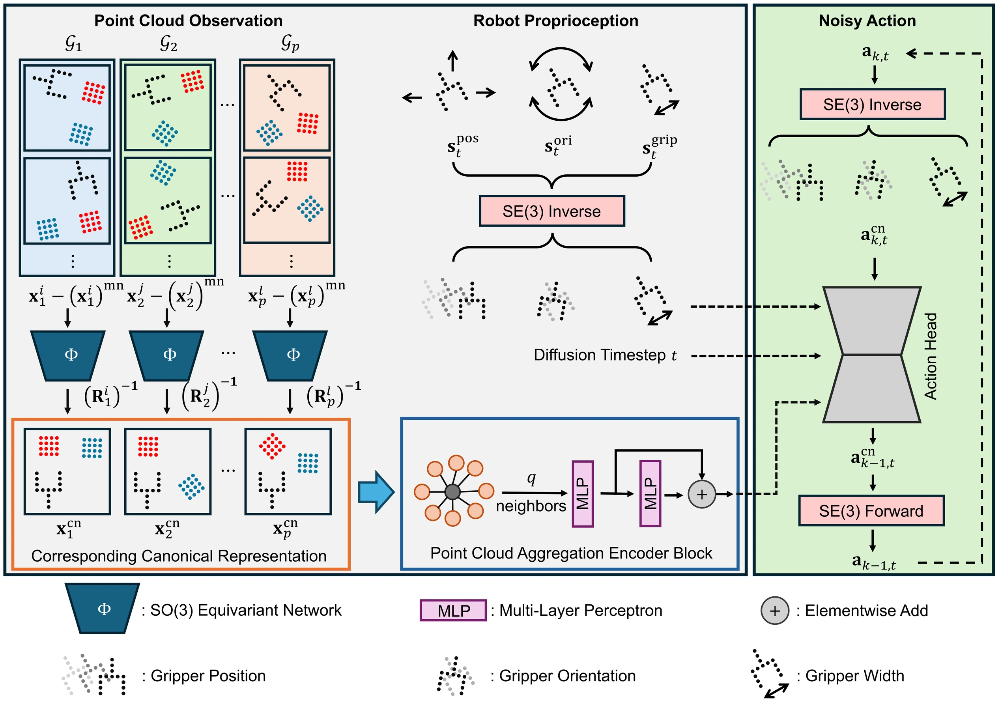

<!-- Generated by scripts/generate.py; edit data/works.json and data/media.json. -->

[← Back to the Awesome index](../../../README.md) · [Interactive website](https://chang-xinhai.github.io/Awesome-RGBDT-Manipulation/?collection=policy&item=canonical-policy#library)

# Canonical Policy

Canonical Policy: Learning Canonical 3D Representation for SE(3)-Equivariant Policy

**2025-05-24 · IEEE Transactions on Robotics 2026 · Purdue University**

**[Paper](https://arxiv.org/abs/2505.18474)** · [Project](https://zhangzhiyuanzhang.github.io/cp-website/) · [Code](https://github.com/ZhangZhiyuanZhang/canonical_policy)

Point clouds, proprioception and actions are canonicalized to learn an SE(3)-equivariant generative manipulation policy.

*Canonical Policy authors · [Figure source](https://arxiv.org/html/2505.18474) · Original rights retained.*

| Field | Reported value and source scope |
| :-- | :-- |
| Record type | policy |
| Policy family | Diffusion [1](https://arxiv.org/abs/2505.18474)  |
| Base model and architecture | Vector-neuron canonical frame estimator, point-cloud aggregation encoder and diffusion policy. [1](https://arxiv.org/abs/2505.18474)  |
| Model size and component | Not reported in the inspected primary-source sections [1](https://arxiv.org/abs/2505.18474)  |
| Deployment inputs | RGB-D-derived point clouds and robot proprioception. [1](https://arxiv.org/abs/2505.18474)  |
| Action outputs and horizon | End-effector pose and gripper action trajectories transformed back from the canonical frame. [1](https://arxiv.org/abs/2505.18474)  |
| Training method | Behavior cloning with learned geometric canonicalization. [1](https://arxiv.org/abs/2505.18474)  |
| Training data | 200 demonstrations per MimicGen/Push-T task; 50 per bimanual task in the reported simulation protocol. [1](https://arxiv.org/abs/2505.18474)  |
| Training duration | Not reported in the inspected primary-source sections [1](https://arxiv.org/abs/2505.18474)  |
| Training hardware | Not reported in the inspected primary-source sections [1](https://arxiv.org/abs/2505.18474)  |
| Inference and control rates | Not reported in the inspected primary-source sections [1](https://arxiv.org/abs/2505.18474)  |
| Evaluation scope | Twelve simulation tasks and four real task types under object, layout and viewpoint changes. [1](https://arxiv.org/abs/2505.18474)  |
| Observations / modalities | RGB · Depth · Point cloud · Proprioception |
| Evaluation domain | Simulation · Real world |
| Embodiment | Parallel-jaw gripper |
| Release: code | Available [2](https://zhangzhiyuanzhang.github.io/cp-website/) [3](https://github.com/ZhangZhiyuanZhang/canonical_policy) [5](https://github.com/ZhangZhiyuanZhang/canonical_policy/tree/main)  |
| Release: weights | Not verified [2](https://zhangzhiyuanzhang.github.io/cp-website/) [3](https://github.com/ZhangZhiyuanZhang/canonical_policy)  |
| Release: data | Not verified [2](https://zhangzhiyuanzhang.github.io/cp-website/) [3](https://github.com/ZhangZhiyuanZhang/canonical_policy)  |
| Release: license | MIT for repository code; pretrained models, data and figure rights remain separate [2](https://zhangzhiyuanzhang.github.io/cp-website/) [3](https://github.com/ZhangZhiyuanZhang/canonical_policy) [4](https://github.com/ZhangZhiyuanZhang/canonical_policy/blob/main/LICENSE)  |
| Release: notes | Code, data and weights are checked independently; an upstream pretrained model is not a released task policy. [2](https://zhangzhiyuanzhang.github.io/cp-website/) [3](https://github.com/ZhangZhiyuanZhang/canonical_policy)  |

**Scope and qualifications**

- Single-view occlusion changes can remove shared geometry; equivariance does not recover unobserved surfaces.

**Primary evidence**

1. [Original manuscript and first submission history](https://arxiv.org/abs/2505.18474) — Full author HTML method/evaluation/appendix inspected; depth observations, pseudo-labels and generated outputs retain distinct roles.
2. [Official author project](https://zhangzhiyuanzhang.github.io/cp-website/) — Public author-linked project; figure and downstream scope verified separately.
3. [Official implementation and release scope](https://github.com/ZhangZhiyuanZhang/canonical_policy) — Availability of research implementation does not establish public task-policy checkpoints.
4. [Actual license file in released source](https://github.com/ZhangZhiyuanZhang/canonical_policy/blob/main/LICENSE) — Only source code covered by this file; not a blanket license for paper figures or upstream weights.
5. [Actual repository content inventory](https://github.com/ZhangZhiyuanZhang/canonical_policy/tree/main) — 152 tracked paths inspected; code release is distinguished from a README/project/figure-only repository.
