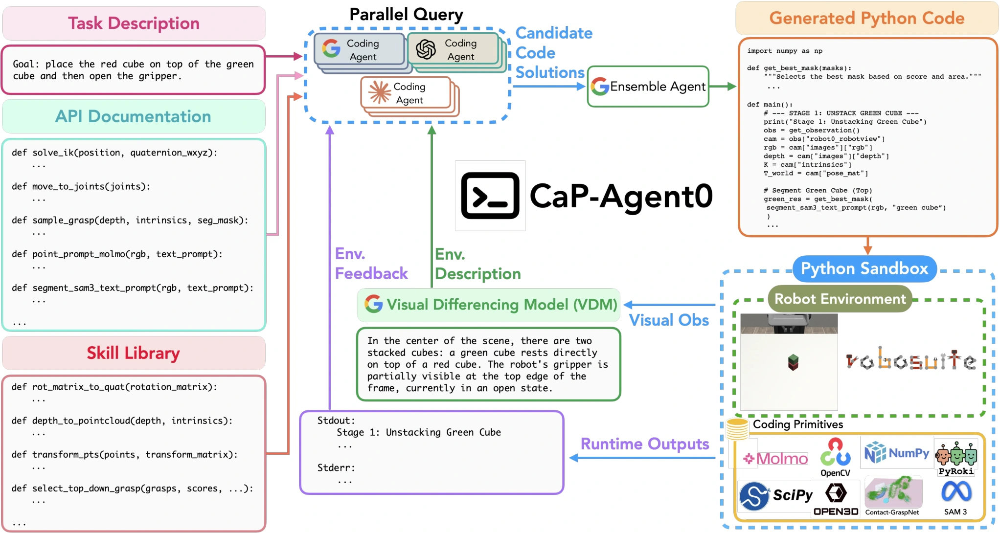

<!-- Generated by scripts/generate.py; edit data/works.json and data/media.json. -->

[← Back to the Awesome index](../../../README.md) · [Interactive website](https://chang-xinhai.github.io/Awesome-RGBDT-Manipulation/?collection=policy&item=cap-x#library)

# CaP-X / CaP-Agent0

CaP-X: A Framework for Benchmarking and Improving Coding Agents for Robot Manipulation

**2026-03-23 · Preprint · Not reported**

**[Paper](https://arxiv.org/abs/2603.22435)** · [Project](https://capgym.github.io)

Provides robot-programming interfaces and evaluates coding agents across abstraction and perception-grounding tiers; CaP-Agent0 and trained CaP-RL variants are distinct policies.

*CaP-X / CaP-Agent0 authors · [Figure source](https://arxiv.org/abs/2603.22435) · Original rights retained.*

| Field | Reported value and source scope |
| :-- | :-- |
| Record type | policy |
| Policy family | Hybrid [1](https://arxiv.org/abs/2603.22435)  |
| Base model and architecture | Twelve coding-model backbones in the benchmark, including Gemini 3 Pro and GPT / Claude-family agents; CaP-Agent0 is training-free and CaP-RL adds training. [1](https://arxiv.org/abs/2603.22435)  |
| Model size and component | Not reported [1](https://arxiv.org/abs/2603.22435)  |
| Deployment inputs | Task, Python robot APIs and tier-specific observations. The physical API can return RGB / depth / intrinsics, wrist RGB, end-effector force wrenches and joint configuration. [1](https://arxiv.org/abs/2603.22435)  |
| Action outputs and horizon | Executable Python programs invoking perception, geometry, inverse-kinematics and motion APIs. [1](https://arxiv.org/abs/2603.22435)  |
| Training method | Training-free coding-agent control and reinforcement-trained coding variants are evaluated under explicitly different interface tiers. [1](https://arxiv.org/abs/2603.22435)  |
| Training data | CaP-Agent0 uses prompts and interaction rather than weight training; CaP-RL has separately reported training data / objectives. [1](https://arxiv.org/abs/2603.22435)  |
| Training duration | Not reported [1](https://arxiv.org/abs/2603.22435)  |
| Training hardware | Not reported [1](https://arxiv.org/abs/2603.22435)  |
| Inference and control rates | Not reported [1](https://arxiv.org/abs/2603.22435)  |
| Evaluation scope | CaP-Bench: seven principal manipulation tasks and twelve model backbones; additional LIBERO-Pro, Robosuite, BEHAVIOR and physical studies. [1](https://arxiv.org/abs/2603.22435)  |
| Observations / modalities | RGB · Depth · Force/Torque · Proprioception · Language |
| Evaluation domain | Simulation · Real world |
| Embodiment | Parallel-jaw gripper |
| Release: code | Not verified |
| Release: weights | Not verified |
| Release: data | Not verified |
| Release: license | Not verified |
| Release: notes | The paper is public; implementation and artifact availability require separate verification. |

**Scope and qualifications**

- Observation access ranges from privileged state to visual grounding; tiers are not interchangeable.
- The API exposing a depth image or force wrench does not mean every benchmark tier supplies those signals.

**Primary evidence**

1. [Primary paper, full text](https://arxiv.org/abs/2603.22435) — Publication date is the first arXiv submission. Policy fields distinguish model calls, controller execution and learning.
