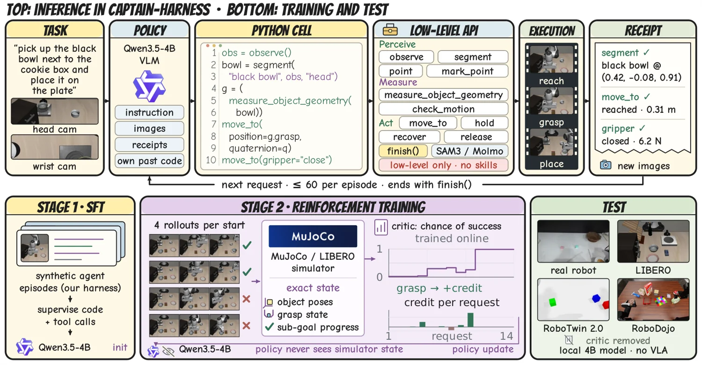

<!-- Generated by scripts/generate.py; edit data/works.json and data/media.json. -->

[← Back to the Awesome index](../../../README.md) · [Interactive website](https://chang-xinhai.github.io/Awesome-RGBDT-Manipulation/?collection=policy&item=captain-code-policy#library)

# CaPtain

CaPtain: A Pipeline for Post-Training Code-as-Policy Robot Agents

**2026-10-29 · Preprint · The Chinese University of Hong Kong; NovaXBot**

**[Paper](https://arxiv.org/abs/2610.40799)** · [Project](https://waltstephen.github.io/captain/) · [Code](https://github.com/waltstephen/CaPtain) · [Data](https://huggingface.co/datasets/YijiaFan/CaPtain-SFT-Data) · [Weights](https://huggingface.co/YijiaFan/CaPtain-4B) · [Harness](https://github.com/waltstephen/CaPtain-Harness)

A 4B vision-language model is post-trained to write grounded robot control code through a manipulation harness.

*CaPtain authors · [Figure source](https://arxiv.org/abs/2610.40799) · Original rights retained.*

| Field | Reported value and source scope |
| :-- | :-- |
| Record type | policy |
| Policy family | Code-as-policy robot agent [1](https://arxiv.org/html/2610.40799v1)  |
| Base model and architecture | CaPtain-4B [1](https://arxiv.org/html/2610.40799v1)  |
| Model size and component | 4B [1](https://arxiv.org/html/2610.40799v1)  |
| Deployment inputs | Visual observations, instructions and robot tool feedback [1](https://arxiv.org/html/2610.40799v1)  |
| Action outputs and horizon | Executable robot control code and tool calls [1](https://arxiv.org/html/2610.40799v1)  |
| Training method | Supervised fine-tuning and reinforcement learning for code-as-policy. [1](https://arxiv.org/html/2610.40799v1)  |
| Training data | See original paper for dataset and protocol. [1](https://arxiv.org/html/2610.40799v1)  |
| Training duration | Not reported [1](https://arxiv.org/html/2610.40799v1)  |
| Training hardware | Not reported [1](https://arxiv.org/html/2610.40799v1)  |
| Inference and control rates | Not reported [1](https://arxiv.org/html/2610.40799v1)  |
| Evaluation scope | Authors evaluate a manipulation harness in simulation and on physical robots. [1](https://arxiv.org/html/2610.40799v1)  |
| Observations / modalities | RGB · Language |
| Evaluation domain | Simulation · Real world |
| Embodiment | Not reported |
| Release: code | Available — official source repository [2](https://github.com/waltstephen/CaPtain) [3](https://huggingface.co/YijiaFan/CaPtain-4B) [4](https://huggingface.co/datasets/YijiaFan/CaPtain-SFT-Data)  |
| Release: weights | Available — CaPtain-4B model files [2](https://github.com/waltstephen/CaPtain) [3](https://huggingface.co/YijiaFan/CaPtain-4B) [4](https://huggingface.co/datasets/YijiaFan/CaPtain-SFT-Data)  |
| Release: data | Available — official SFT dataset [2](https://github.com/waltstephen/CaPtain) [3](https://huggingface.co/YijiaFan/CaPtain-4B) [4](https://huggingface.co/datasets/YijiaFan/CaPtain-SFT-Data)  |
| Release: license | MIT for code; model and data licenses are separate. [2](https://github.com/waltstephen/CaPtain) [3](https://huggingface.co/YijiaFan/CaPtain-4B) [4](https://huggingface.co/datasets/YijiaFan/CaPtain-SFT-Data)  |
| Release: notes | Release status checked against author artifacts on 2026-11-05. [2](https://github.com/waltstephen/CaPtain) [3](https://huggingface.co/YijiaFan/CaPtain-4B) [4](https://huggingface.co/datasets/YijiaFan/CaPtain-SFT-Data)  |

**Scope and qualifications**

- The model weights, SFT data and harness are separately released artifacts with separate licenses.

**Primary evidence**

1. [Original paper: method, inputs and evaluation](https://arxiv.org/html/2610.40799v1) — Results and sensing claims are scoped to the authors’ evaluation and deployment setting.
2. [Official repository, source files and license](https://github.com/waltstephen/CaPtain)
3. [Official model weights and model card](https://huggingface.co/YijiaFan/CaPtain-4B)
4. [Official SFT dataset](https://huggingface.co/datasets/YijiaFan/CaPtain-SFT-Data)
