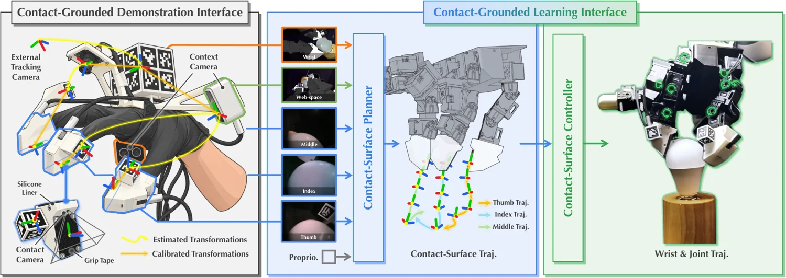

<!-- Generated by scripts/generate.py; edit data/works.json and data/media.json. -->

[← Back to the Awesome index](../../../README.md) · [Interactive website](https://chang-xinhai.github.io/Awesome-RGBDT-Manipulation/?collection=policy&item=cimi#library)

# CIMI

Contact Imitation Interface: Transferring Dexterous Skills by Showing How Contact Unfolds

**2026-10-29 · Preprint · National University of Singapore**

**[Paper](https://arxiv.org/abs/2610.41028)** · [Project](https://nus-lins-lab.github.io/CIMIWeb/) · [Code](https://github.com/ariszxxu/CIMI)

Contact-aligned human demonstrations and a hierarchical policy transfer dexterous skills to robot hands.

*cimi authors · [Figure source](https://arxiv.org/abs/2610.41028) · Original rights retained.*

| Field | Reported value and source scope |
| :-- | :-- |
| Record type | policy |
| Policy family | Contact-grounded hierarchical policy [1](https://arxiv.org/html/2610.41028v1)  |
| Base model and architecture | Not reported [1](https://arxiv.org/html/2610.41028v1)  |
| Model size and component | Not reported [1](https://arxiv.org/html/2610.41028v1)  |
| Deployment inputs | Contact-surface geometry, fingertip RGB and wider scene views. [1](https://arxiv.org/html/2610.41028v1)  |
| Action outputs and horizon | Contact-surface trajectories and coordinated wrist/finger commands. [1](https://arxiv.org/html/2610.41028v1)  |
| Training method | Human contact-aligned retargeted demonstrations train a contact-surface planner and controller. [1](https://arxiv.org/html/2610.41028v1)  |
| Training data | Human demonstrations retargeted to LEAP and Wuji robot hands. [1](https://arxiv.org/html/2610.41028v1)  |
| Training duration | Not reported [1](https://arxiv.org/html/2610.41028v1)  |
| Training hardware | Not reported [1](https://arxiv.org/html/2610.41028v1)  |
| Inference and control rates | Not reported [1](https://arxiv.org/html/2610.41028v1)  |
| Evaluation scope | Six hand-task pairs on real LEAP and Wuji hands; authors report at least 50 percentage points mean final-stage improvement over evaluated baselines. [1](https://arxiv.org/html/2610.41028v1)  |
| Observations / modalities | RGB · Proprioception |
| Evaluation domain | Real world |
| Embodiment | Not reported |
| Release: code | Available — official software and hardware designs [2](https://nus-lins-lab.github.io/CIMIWeb/)  |
| Release: weights | Not verified [2](https://nus-lins-lab.github.io/CIMIWeb/)  |
| Release: data | Not verified [2](https://nus-lins-lab.github.io/CIMIWeb/)  |
| Release: license | See repository LICENSE and third-party notices. [2](https://nus-lins-lab.github.io/CIMIWeb/)  |
| Release: notes | Official repository has implementation and hardware assets; individual components have separate licenses. [2](https://nus-lins-lab.github.io/CIMIWeb/)  |

**Scope and qualifications**

- Shared fingertip contact-surface geometry and RGB views are visual sensing, not direct tactile-force measurements.

**Primary evidence**

1. [Author paper: methods, scope, and evaluation](https://arxiv.org/html/2610.41028v1)
2. [Official project and linked releases](https://nus-lins-lab.github.io/CIMIWeb/)
