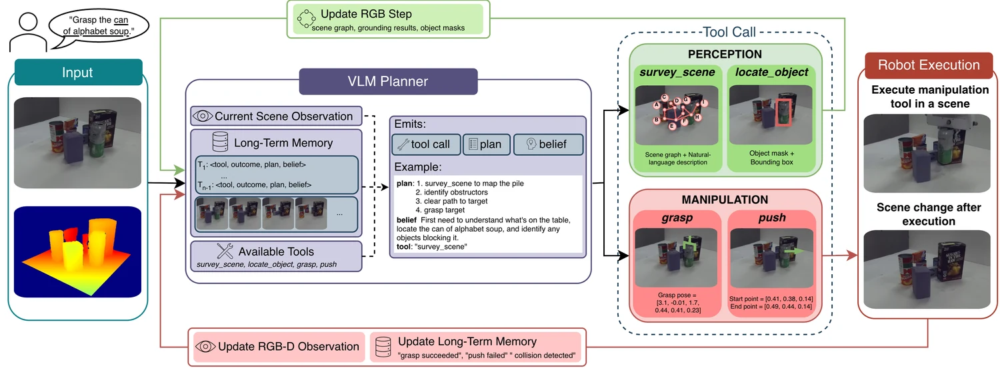

<!-- Generated by scripts/generate.py; edit data/works.json and data/media.json. -->

[← Back to the Awesome index](../../../README.md) · [Interactive website](https://chang-xinhai.github.io/Awesome-RGBDT-Manipulation/?collection=policy&item=claro#library)

# CLARO

CLARO: Clutter Aware Robot Orchestrator for Open-Vocabulary Grasping using VLM Agents

**2026-10-16 · WACV 2027 · New York University**

**[Paper](https://arxiv.org/abs/2610.24016)**

A closed-loop VLM orchestrates scene survey, object localization, six-degree-of-freedom grasping and pushing to retrieve language-specified targets from clutter.

*CLARO authors; original rights retained · [Figure source](https://arxiv.org/abs/2610.24016) · Original rights retained.*

| Field | Reported value and source scope |
| :-- | :-- |
| Record type | policy |
| Policy family | Robot agent [1](https://arxiv.org/html/2610.24016)  |
| Base model and architecture | Gemini 3.1 Pro planner plus perception/segmentation and grasp-generation tools; alternate planner ablations are separate. [1](https://arxiv.org/html/2610.24016)  |
| Model size and component | Not reported [1](https://arxiv.org/html/2610.24016)  |
| Deployment inputs | Task, settled RGB-D observations, image-grounded scene graph, tool receipts and accumulated action/belief memory. [1](https://arxiv.org/html/2610.24016)  |
| Action outputs and horizon | Named skill calls yielding 6-DoF grasps and metric push waypoints; controller checks feasibility/collisions. [1](https://arxiv.org/html/2610.24016)  |
| Training method | Training-free target-task orchestration of pretrained skills; execution feedback updates long-term memory and replans. [1](https://arxiv.org/html/2610.24016)  |
| Training data | No task-specific training demonstrations. [1](https://arxiv.org/html/2610.24016)  |
| Training duration | Not reported [1](https://arxiv.org/html/2610.24016)  |
| Training hardware | Not reported [1](https://arxiv.org/html/2610.24016)  |
| Inference and control rates | Not reported [1](https://arxiv.org/html/2610.24016)  |
| Evaluation scope | PyBullet/Blender UR5 cluttered retrieval, static RGS datasets and Franka with a fixed ZED2 RGB-D camera. Paper reports 89.1% dynamic simulation average and 88.8% real success. [1](https://arxiv.org/html/2610.24016)  |
| Observations / modalities | RGB · Depth · Point cloud · Proprioception · Language |
| Evaluation domain | Simulation · Real world |
| Embodiment | Parallel-jaw gripper |
| Release: code | Not released |
| Release: weights | Not applicable |
| Release: data | Not released |
| Release: license | Not verified |
| Release: notes | The paper says CLARO code and simulation benchmark will be released; no official implementation/download was established from the inspected primary manuscript. |

**Scope and qualifications**

- The planner reasons over visual observations and tool feedback; depth lifts masks/pixels to metric object point clouds for manipulation skills. This is measured/simulated depth input, not monocular depth prediction.
- Static referring-grasp image benchmarks, dynamic retrieval success and real-robot trials are separate settings.

**Primary evidence**

1. [Original full paper, methods and evaluation](https://arxiv.org/html/2610.24016) — Publication date is arXiv v1; implementation and deployment observations are distinguished from training supervision, generated geometry and base-model identity.
