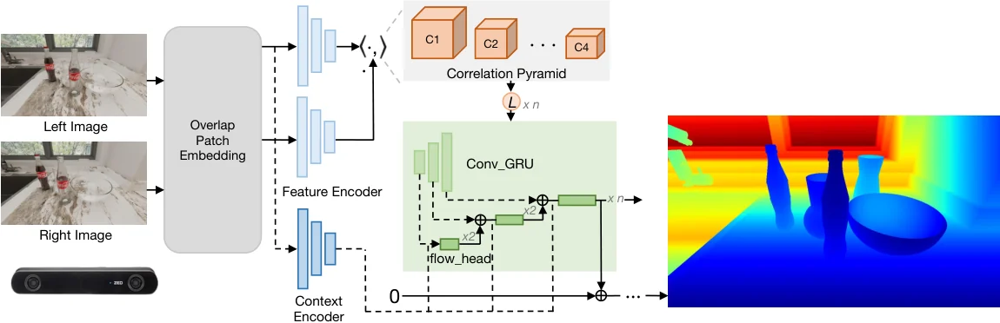

<!-- Generated by scripts/generate.py; edit data/works.json and data/media.json. -->

[← Back to the Awesome index](../../../README.md) · [Interactive website](https://chang-xinhai.github.io/Awesome-RGBDT-Manipulation/?collection=policy&item=cleardepth#library)

# ClearDepth

ClearDepth: Enhanced Stereo Perception of Transparent Objects for Robotic Manipulation

**2024-09-13 · Preprint · University of Hamburg and Agile Robots**

**[Paper](https://arxiv.org/abs/2409.08926)**

Combines stereo appearance and structural features with matched synthetic data for transparent-object depth recovery.

*ClearDepth authors · [Figure source](https://arxiv.org/html/2409.08926v3) · Original rights retained.*

| Field | Reported value and source scope |
| :-- | :-- |
| Record type | model |
| Model role and downstream interface | Stereo depth for transparent-object grasping [1](https://arxiv.org/html/2409.08926)  |
| Model family | Structure-aware stereo depth network [1](https://arxiv.org/html/2409.08926)  |
| Model architecture | Cascaded vision transformer features [1](https://arxiv.org/html/2409.08926)  |
| Model size and component | Not reported [1](https://arxiv.org/html/2409.08926)  |
| Model inputs | Calibrated left and right RGB views. [1](https://arxiv.org/html/2409.08926)  |
| Model outputs | Inferred dense scene depth. [1](https://arxiv.org/html/2409.08926)  |
| Training method | Synthetic and real validation using multi-scale structural features and stereo matching. [1](https://arxiv.org/html/2409.08926)  |
| Training data and scale | SynClearDepth contains 14,091 stereo RGB images with depth and segmentation labels, as reported in the paper. [1](https://arxiv.org/html/2409.08926)  |
| Training duration | Not reported [1](https://arxiv.org/html/2409.08926)  |
| Training hardware | Not reported [1](https://arxiv.org/html/2409.08926)  |
| Inference setting and runtime | Fuse structural context with stereo appearance to infer depth. [1](https://arxiv.org/html/2409.08926)  |
| Downstream evaluation and scope | Stereo depth comparisons and physical grasping of isolated and cluttered transparent objects. [1](https://arxiv.org/html/2409.08926)  |
| Observations / modalities | RGB |
| Evaluation domain | Simulation · Real world |
| Embodiment |  |
| Release: code | Not verified |
| Release: weights | Not verified |
| Release: data | SynClearDepth described; public file access not verified |
| Release: license | Not verified |
| Release: notes | Paper reports dataset generation and includes sensor configuration and methods. |

**Scope and qualifications**

- Model depth is inferred from calibrated stereo pairs. Physical grasping experiments report benefits of the downstream depth pipeline.
- This differs from completing missing depth values in a single RGB-D observation.

**Primary evidence**

1. [Primary paper and evaluated setting](https://arxiv.org/html/2409.08926)
