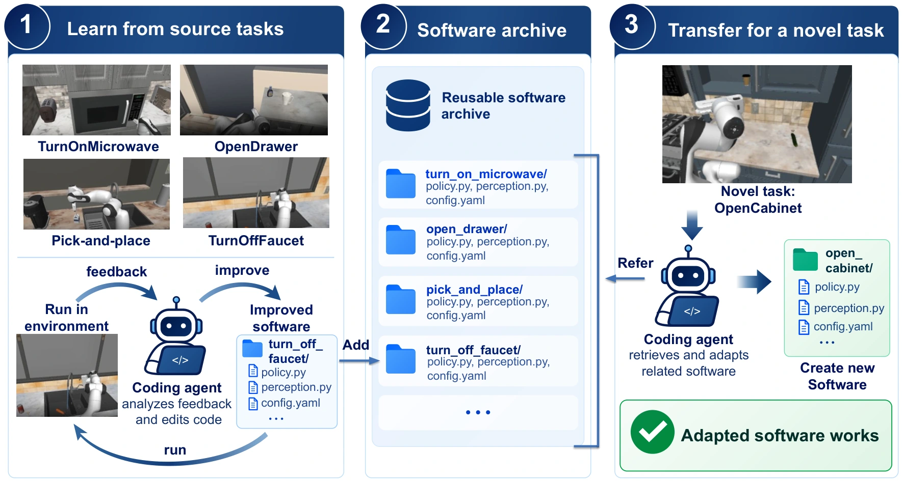

<!-- Generated by scripts/generate.py; edit data/works.json and data/media.json. -->

[← Back to the Awesome index](../../../README.md) · [Interactive website](https://chang-xinhai.github.io/Awesome-RGBDT-Manipulation/?collection=policy&item=closed-loop-robot-software#library)

# Closed-Loop Robot Software

Learning and Transferring Closed-Loop Robot Software

**2026-09-17 · Preprint · Not reported**

**[Paper](https://arxiv.org/abs/2609.19906)**

Optimizes per-task executable controllers from demonstrations and reuses optimized software as references for related tasks.

*Closed-Loop Robot Software authors · [Figure source](https://arxiv.org/abs/2609.19906) · Original rights retained.*

| Field | Reported value and source scope |
| :-- | :-- |
| Record type | policy |
| Policy family | Robot agent [1](https://arxiv.org/abs/2609.19906)  |
| Base model and architecture | Coding-agent controller optimization with an archive of validated task programs. [1](https://arxiv.org/abs/2609.19906)  |
| Model size and component | Not reported [1](https://arxiv.org/abs/2609.19906)  |
| Deployment inputs | RoboCasa Full observations: three RGB views, metric depth / calibrated point clouds, ground-truth MuJoCo geometry-ID masks and labels, binary robot / gripper / finger contacts, and robot state. [1](https://arxiv.org/abs/2609.19906)  |
| Action outputs and horizon | Frozen executable robot-control source code with observation-dependent feedback and recovery. [1](https://arxiv.org/abs/2609.19906)  |
| Training method | Frozen coding model revises code through rollout / validation feedback; selected source programs execute without further corrective model calls at test. [1](https://arxiv.org/abs/2609.19906)  |
| Training data | Demonstration-initialized software for four source tasks; optimized references transfer to nine target tasks. [1](https://arxiv.org/abs/2609.19906)  |
| Training duration | Not reported [1](https://arxiv.org/abs/2609.19906)  |
| Training hardware | Not reported [1](https://arxiv.org/abs/2609.19906)  |
| Inference and control rates | Not reported [1](https://arxiv.org/abs/2609.19906)  |
| Evaluation scope | RoboCasa PandaOmron: four source tasks and nine target tasks involving faucet, drawer, transport and appliance behaviors. [1](https://arxiv.org/abs/2609.19906)  |
| Observations / modalities | RGB · Depth · Proprioception · Language |
| Evaluation domain | Simulation |
| Embodiment | Parallel-jaw gripper |
| Release: code | Not verified |
| Release: weights | Not applicable |
| Release: data | Not verified |
| Release: license | Not verified |
| Release: notes | The paper is public; implementation and artifact availability require separate verification. |

**Scope and qualifications**

- The method receives Full observations while public VLA references receive RGB and robot state.
- Programs are optimized separately per task, unlike multi-task learned-policy baselines; reported numerical comparisons are references rather than fully matched evaluations.
- Binary contact indicators have neither contact-force values nor object IDs; they are simulator state, not a released physical tactile sensor. Physical effectiveness remains untested.

**Primary evidence**

1. [Primary paper, full text](https://arxiv.org/abs/2609.19906) — Publication date is the first arXiv submission. Policy fields distinguish model calls, controller execution and learning.
