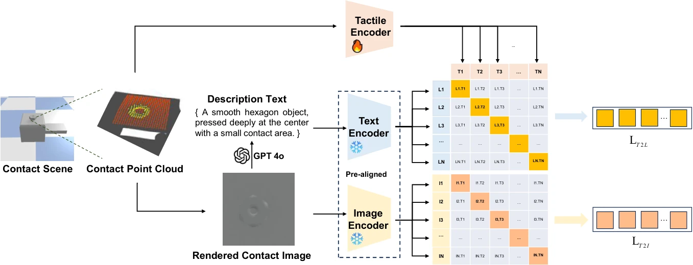

<!-- Generated by scripts/generate.py; edit data/works.json and data/media.json. -->

[← Back to the Awesome index](../../../README.md) · [Interactive website](https://chang-xinhai.github.io/Awesome-RGBDT-Manipulation/?collection=policy&item=cltp#library)

# CLTP / Tac3D-LLM

CLTP: Contrastive Language-Tactile Pre-training for 3D Contact Geometry Understanding

**2025-05-13 · arXiv preprint 2025 · Institute of Automation, Chinese Academy of Sciences; Beihang University; Beijing University of Posts and Telecommunications; Samsung Research China**

**[Paper](https://arxiv.org/abs/2505.08194)** · [Project](https://sites.google.com/view/cltp/)

Contrastive alignment links 3D tactile contact geometry to language; a downstream tactile-language model also demonstrates primitive-based grasp refinement.

*CLTP / Tac3D-LLM authors · [Figure source](https://arxiv.org/abs/2505.08194) · Original rights retained.*

| Field | Reported value and source scope |
| :-- | :-- |
| Record type | model |
| Model role and downstream interface | Contact-state representation and tactile-language grounding [1](https://arxiv.org/abs/2505.08194)  |
| Model family | Tactile-language model [1](https://arxiv.org/abs/2505.08194)  |
| Model architecture | ULIP-2-derived 3D tactile encoder aligned to frozen CLIP image/text encoders; Tac3D-LLM adds a projection into Qwen2.5-VL-3B. [1](https://arxiv.org/abs/2505.08194)  |
| Model size and component | Tac3D-LLM uses a 3B language-model backbone; tactile encoder and complete-system parameter counts are not reported. [1](https://arxiv.org/abs/2505.08194)  |
| Model inputs | 1,024-point tactile contact clouds; paired rendered contact images and contact-state language during pretraining. These are local deformation geometry, not external scene-depth observations. [1](https://arxiv.org/abs/2505.08194)  |
| Model outputs | Contact-aligned embeddings, contact-state predictions and tactile-language responses; Appendix B converts responses to predefined robot adjustments. [1](https://arxiv.org/abs/2505.08194) [3](https://arxiv.org/html/2505.08194v1#A2)  |
| Training method | Frozen vision-language towers supervise tactile contrastive alignment; caption training adapts an MLP for Tac3D-LLM. [1](https://arxiv.org/abs/2505.08194)  |
| Training data and scale | TCL3D: 50,860 simulated contacts from 117 objects; 1,450 GelStereo and 115 GelSight real contacts support transfer evaluation. These are distinct subsets. [1](https://arxiv.org/abs/2505.08194)  |
| Training duration | Not reported in the inspected primary manuscript [1](https://arxiv.org/abs/2505.08194)  |
| Training hardware | Not reported in the inspected primary manuscript [1](https://arxiv.org/abs/2505.08194)  |
| Inference setting and runtime | Not reported in the inspected primary manuscript [1](https://arxiv.org/abs/2505.08194)  |
| Downstream evaluation and scope | Zero-shot/classified contact attributes and tactile question answering; Appendix B demonstrates closed-loop strawberry positioning and delicate grasp refinement using predefined motion/force primitives. [1](https://arxiv.org/abs/2505.08194) [3](https://arxiv.org/html/2505.08194v1#A2)  |
| Observations / modalities | Tactile · Point cloud · Language |
| Evaluation domain | Simulation · Real robot |
| Embodiment |  |
| Release: code | Not verified [2](https://sites.google.com/view/cltp/)  |
| Release: weights | Not verified [2](https://sites.google.com/view/cltp/)  |
| Release: data | Not verified [2](https://sites.google.com/view/cltp/)  |
| Release: license | Not verified [2](https://sites.google.com/view/cltp/)  |
| Release: notes | Abstract advertises code/data release, but the inspected official Google Sites page exposes no verified code, checkpoint or dataset download destination. [2](https://sites.google.com/view/cltp/)  |

**Scope and qualifications**

- Primary role is reusable tactile pretraining; its qualitative Tac3D-LLM agent application does not establish a general continuous-action policy or a large manipulation benchmark.
- Depth labels describe local tactile indentation, not measured scene depth; contact descriptions are qualitative rather than calibrated force estimates.

**Primary evidence**

1. [Original manuscript and first public submission history](https://arxiv.org/abs/2505.08194) — Full author method, evaluation and appendix reviewed; downstream controller probes are distinguished from the reusable model.
2. [Official author project and current artifact destinations](https://sites.google.com/view/cltp/) — A project button or advertised artifact does not establish a downloadable release; paper-version differences are retained.
3. [Appendix B: actual Tac3D-LLM grasp-refinement loop](https://arxiv.org/html/2505.08194v1#A2) — Algorithm 1 selects predefined position/force primitives from tactile-language feedback; the manuscript illustrates a strawberry grasp rather than reporting a broad policy evaluation.
