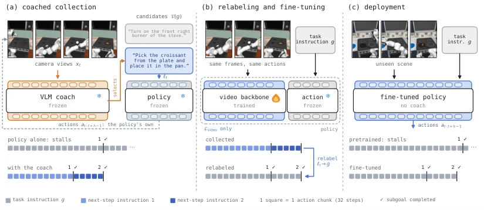

<!-- Generated by scripts/generate.py; edit data/works.json and data/media.json. -->

[← Back to the Awesome index](../../../README.md) · [Interactive website](https://chang-xinhai.github.io/Awesome-RGBDT-Manipulation/?collection=policy&item=coachsi#library)

# CoachSI

CoachSI: Self-Improvement of Robot Policies with a Language Coach

**2026-11-19 · Preprint · University of Illinois Chicago**

**[Paper](https://arxiv.org/abs/2611.25529)** · [Project](https://tlxhlll.github.io/CoachSI/)

An off-the-shelf VLM supplies training-time language subgoals, then successful coached rollouts refine a policy deployed without coaching.

*CoachSI authors · [Figure source](https://arxiv.org/html/2611.25529v1) · Original rights retained.*

| Field | Reported value and source scope |
| :-- | :-- |
| Record type | policy |
| Policy family | Rollout-based weight adaptation with a language coach [1](https://arxiv.org/html/2611.25529v1)  |
| Base model and architecture | Frozen VLM coach plus visual WAM or VLA policy. [1](https://arxiv.org/html/2611.25529v1)  |
| Model size and component | Not reported [1](https://arxiv.org/html/2611.25529v1)  |
| Deployment inputs | Deployed policy uses camera images and the original long-horizon instruction. The paper separately tests training coaches with and without privileged state. [1](https://arxiv.org/html/2611.25529v1)  |
| Action outputs and horizon | Task-directed robot actions from the policy. The coach emits language-only atomic instructions at training time. [1](https://arxiv.org/html/2611.25529v1)  |
| Training method | Collect successful coached rollouts, relabel the successful chunks with the original task in hindsight, and tune the policy while freezing its action backbone. [1](https://arxiv.org/html/2611.25529v1)  |
| Training data | Self-collected successful interaction sequences; compared with demo- and self-collected-success baselines at an equal data budget. [1](https://arxiv.org/html/2611.25529v1)  |
| Training duration | Not reported [1](https://arxiv.org/html/2611.25529v1)  |
| Training hardware | Not reported [1](https://arxiv.org/html/2611.25529v1)  |
| Inference and control rates | Not reported [1](https://arxiv.org/html/2611.25529v1)  |
| Evaluation scope | Unseen-scene long-horizon task success for the unassisted policy and an additional camera-only coach condition. [1](https://arxiv.org/html/2611.25529v1)  |
| Observations / modalities | RGB |
| Evaluation domain | Simulation |
| Embodiment |  |
| Release: code | Not verified [2](https://tlxhlll.github.io/CoachSI/)  |
| Release: weights | Not verified [2](https://tlxhlll.github.io/CoachSI/)  |
| Release: data | Not verified [2](https://tlxhlll.github.io/CoachSI/)  |
| Release: license | Not verified [2](https://tlxhlll.github.io/CoachSI/)  |
| Release: notes | Authors provide method and demonstrations. No separate runnable code, checkpoint or dataset was verified. [2](https://tlxhlll.github.io/CoachSI/)  |

**Scope and qualifications**

- This is policy self-improvement through training-time gradient updates, rather than adaptation by a live language coach during deployment.

**Primary evidence**

1. [Original author paper or dataset description](https://arxiv.org/html/2611.25529v1)
2. [Author source and artifact entry points](https://tlxhlll.github.io/CoachSI/)
