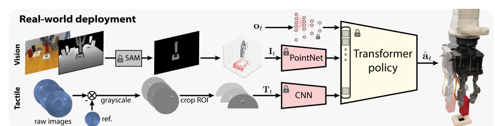

<!-- Generated by scripts/generate.py; edit data/works.json and data/media.json. -->

[← Back to the Awesome index](../../../README.md) · [Interactive website](https://chang-xinhai.github.io/Awesome-RGBDT-Manipulation/?collection=policy&item=compliant-hand-visuotactile-insertion#library)

# Compliant-Hand Visuotactile Insertion

Visuotactile-Based Learning for Insertion with Compliant Hands

**2024-11-10 · Preprint · Tel Aviv University / Rutgers University**

**[Paper](https://arxiv.org/abs/2411.06408)** · [Project](https://osheraz.github.io/visuotactile/) · [Code](https://github.com/osheraz/IsaacGymInsertion)

A privileged simulation teacher transfers multimodal insertion to an underactuated compliant hand using touch and depth point clouds.

*Visuotactile-Based Learning for Insertion with Compliant Hands authors · [Figure source](https://arxiv.org/abs/2411.06408) · Original rights retained.*

| Field | Reported value and source scope |
| :-- | :-- |
| Record type | policy |
| Policy family | RL [1](https://arxiv.org/abs/2411.06408)  |
| Base model and architecture | RL teacher and visuotactile student with AllSight tactile encoders and scene-pointcloud perception. [1](https://arxiv.org/abs/2411.06408)  |
| Model size and component | Not reported [1](https://arxiv.org/abs/2411.06408)  |
| Deployment inputs | Runtime AllSight tactile images, depth-backprojected object point clouds, end-effector pose and last action. [1](https://arxiv.org/abs/2411.06408)  |
| Action outputs and horizon | Robot end-effector motions for compliant grasped insertion. [1](https://arxiv.org/abs/2411.06408)  |
| Training method | Privileged teacher RL, visuotactile student distillation and zero-shot sim-to-real transfer. [1](https://arxiv.org/abs/2411.06408)  |
| Training data | 4096 teacher/32 rendered student parallel training environments;11 real test objects, 6 novel. [1](https://arxiv.org/abs/2411.06408)  |
| Training duration | Teacher~24 h, student~48 h;~1e8 and 0.7e7 states respectively. [1](https://arxiv.org/abs/2411.06408)  |
| Training hardware | Single RTX4090training; RTX3060local deployment. [1](https://arxiv.org/abs/2411.06408)  |
| Inference and control rates | Tactile/image 30 Hz; Tracking SAM segmentation 10 Hz; kinematics 100 Hz. [1](https://arxiv.org/abs/2411.06408)  |
| Evaluation scope | Kinova Gen3/OpenHand Model O with 3 AllSight fingertips;20 trials/object/policy. [1](https://arxiv.org/abs/2411.06408)  |
| Observations / modalities | Depth · Tactile · Proprioception |
| Evaluation domain | Simulation · Real world |
| Embodiment | Underactuated hand |
| Release: code | Available [2](https://osheraz.github.io/visuotactile/) [3](https://github.com/osheraz/IsaacGymInsertion)  |
| Release: weights | Not verified [2](https://osheraz.github.io/visuotactile/) [3](https://github.com/osheraz/IsaacGymInsertion)  |
| Release: data | Not verified [2](https://osheraz.github.io/visuotactile/) [3](https://github.com/osheraz/IsaacGymInsertion)  |
| Release: license | BSD-3-Clause (NVIDIA-inherited repository LICENSE; third-party terms may differ) [2](https://osheraz.github.io/visuotactile/) [3](https://github.com/osheraz/IsaacGymInsertion)  |
| Release: notes | Author-linked repository and actual LICENSE inspected; code, checkpoints anddatasets have independent availability. [2](https://osheraz.github.io/visuotactile/) [3](https://github.com/osheraz/IsaacGymInsertion)  |

**Scope and qualifications**

- Scene RGB used forone-frame interactive object mask annotation/tracking; policy geometric observations are depth point clouds.
- Teacher privileged object state is not available to deployed student.

**Primary evidence**

1. [Original paper and supplementary implementation details](https://arxiv.org/abs/2411.06408) — Primary full text reviewed; dataset, deployment modalities and training-only privileges are scoped separately.
2. [Official author project](https://osheraz.github.io/visuotactile/) — Live project artifact links inspected on2026-10-17.
3. [Official released implementation and LICENSE](https://github.com/osheraz/IsaacGymInsertion) — Repository metadata,README and actualLICENSE.txt inspected; availability scoped to the listed component.
