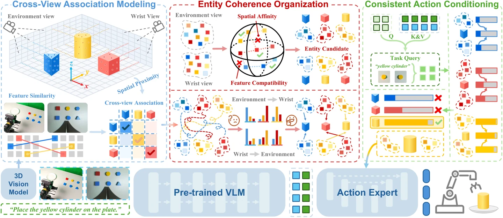

<!-- Generated by scripts/generate.py; edit data/works.json and data/media.json. -->

[← Back to the Awesome index](../../../README.md) · [Interactive website](https://chang-xinhai.github.io/Awesome-RGBDT-Manipulation/?collection=policy&item=consisx#library)

# ConsisX

ConsisX: Cross-View Consistency Thinking in 3D for Vision-Language-Action Models

**2026-11-23 · Preprint · Xidian University and collaborators**

**[Paper](https://arxiv.org/abs/2611.30308)**

Reasons over cross-view geometric associations and merges corresponding entity features before generating manipulation actions.

*Yunhe Zhang and coauthors · [Figure source](https://arxiv.org/html/2611.30308v2) · Original rights retained.*

| Field | Reported value and source scope |
| :-- | :-- |
| Record type | policy |
| Policy family | 3D cross-view association VLA [1](https://arxiv.org/html/2611.30308v1)  |
| Base model and architecture | Not reported [1](https://arxiv.org/html/2611.30308v1)  |
| Model size and component | Not reported [1](https://arxiv.org/html/2611.30308v1)  |
| Deployment inputs | Multi-view RGB images and instruction; camera-frame 3D features come from a pretrained image-to-geometry model. The action head also receives robot state. [1](https://arxiv.org/html/2611.30308v1)  |
| Action outputs and horizon | Action chunks following the instruction, with entity-level action attention. [1](https://arxiv.org/html/2611.30308v1)  |
| Training method | Cross-view association and composition under a common 3D geometry, combined with action-head imitation learning. [1](https://arxiv.org/html/2611.30308v1)  |
| Training data | Benchmark demonstrations; separate real-task collection and benchmark training. [1](https://arxiv.org/html/2611.30308v1)  |
| Training duration | Not reported [1](https://arxiv.org/html/2611.30308v1)  |
| Training hardware | Not reported [1](https://arxiv.org/html/2611.30308v1)  |
| Inference and control rates | Not reported [1](https://arxiv.org/html/2611.30308v1)  |
| Evaluation scope | Four simulation benchmarks including CALVIN and LIBERO-PRO; three real robot tasks. Tasks and sensor settings are reported separately. [1](https://arxiv.org/html/2611.30308v1)  |
| Observations / modalities | RGB · Proprioception · Language |
| Evaluation domain | Simulation · Real world |
| Embodiment | Parallel-jaw gripper |
| Release: code | Not verified |
| Release: weights | Not verified |
| Release: data | Not verified |
| Release: license | Not verified |
| Release: notes | Paper or official project reviewed. Code, weights and data are tracked independently. |

**Scope and qualifications**

- Paper uses a pretrained geometry model to generate 3D features from images; the evaluated policy does not establish a separate measured depth input.

**Primary evidence**

1. [Original paper and evaluation settings](https://arxiv.org/html/2611.30308v1)
