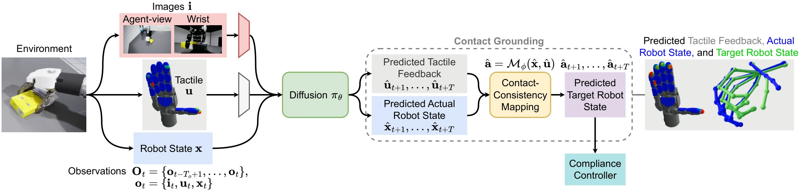

<!-- Generated by scripts/generate.py; edit data/works.json and data/media.json. -->

[← Back to the Awesome index](../../../README.md) · [Interactive website](https://chang-xinhai.github.io/Awesome-RGBDT-Manipulation/?collection=policy&item=contact-grounded-policy#library)

# Contact-Grounded Policy

Contact-Grounded Policy: Dexterous Visuotactile Policy with Generative Contact Grounding

**2026-03-05 · Preprint · Not reported**

**[Paper](https://arxiv.org/abs/2603.05687)** · [Project](https://contact-grounded-policy.github.io/)

A diffusion generator predicts coupled actual-state/tactile futures, then a learned contact-consistency mapping translates them into compliance-controller targets.

*Contact-Grounded Policy: Dexterous Visuotactile Policy with Generative Contact Grounding authors · [Figure source](https://arxiv.org/abs/2603.05687) · Original rights retained.*

| Field | Reported value and source scope |
| :-- | :-- |
| Record type | policy |
| Policy family | Diffusion [1](https://arxiv.org/abs/2603.05687)  |
| Base model and architecture | U-Net diffusion policy; KL-regularized tactile VAE; contact-consistency MLP. [1](https://arxiv.org/abs/2603.05687)  |
| Model size and component | Not reported [1](https://arxiv.org/abs/2603.05687)  |
| Deployment inputs | RGB, tactile arrays or four Digit 360 images, and robot proprioceptive state. [1](https://arxiv.org/abs/2603.05687)  |
| Action outputs and horizon | Future robot-state/tactile trajectories converted to executable target states. [1](https://arxiv.org/abs/2603.05687)  |
| Training method | Separate tactile compression and contact-consistency training, then conditional trajectory diffusion. [1](https://arxiv.org/abs/2603.05687)  |
| Training data | Teleoperated demonstrations across three simulation and two real tasks; exact training counts Not reported in inspected text. [1](https://arxiv.org/abs/2603.05687)  |
| Training duration | Not reported [1](https://arxiv.org/abs/2603.05687)  |
| Training hardware | Not reported [1](https://arxiv.org/abs/2603.05687)  |
| Inference and control rates | Observation 2, prediction 16, execution 8 steps; physical Hz Not reported. [1](https://arxiv.org/abs/2603.05687)  |
| Evaluation scope | Three simulated and two real dexterous tasks, including dish wiping, in-hand box flipping and jar opening; single-task training/evaluation. [1](https://arxiv.org/abs/2603.05687)  |
| Observations / modalities | RGB · Tactile · Proprioception |
| Evaluation domain | Simulation · Real world |
| Embodiment | Dexterous hand |
| Release: code | Not verified [2](https://contact-grounded-policy.github.io/)  |
| Release: weights | Not verified [2](https://contact-grounded-policy.github.io/)  |
| Release: data | Not verified [2](https://contact-grounded-policy.github.io/)  |
| Release: license | Not verified [2](https://contact-grounded-policy.github.io/)  |
| Release: notes | Original paper reviewed; claimed future releases are not treated as currently available. [2](https://contact-grounded-policy.github.io/)  |

**Scope and qualifications**

- Reported A10080GB measurements are inference timing, not evidence of traininghardware.
- No cross-task generalist transfer is established by single-task evaluations.

**Primary evidence**

1. [Original paper and supplementary implementation details](https://arxiv.org/abs/2603.05687) — Primary full text reviewed; dataset, deployment modalities and training-only privileges are scoped separately.
2. [Official author project](https://contact-grounded-policy.github.io/) — Live project artifact links inspected on2026-10-17.
