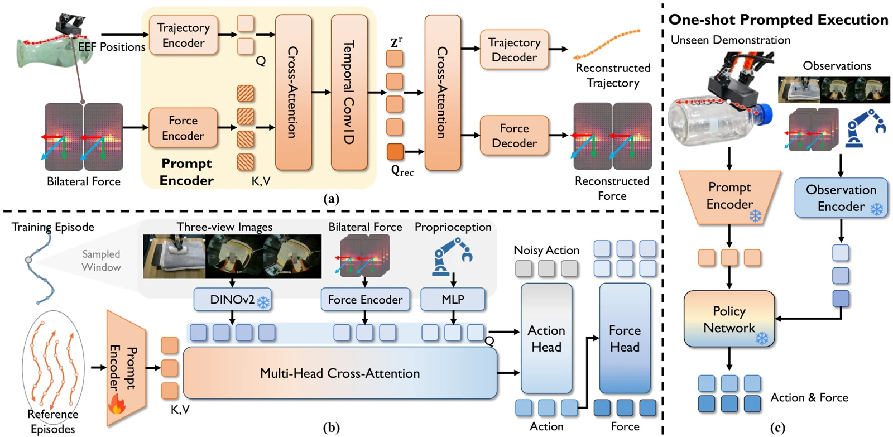

<!-- Generated by scripts/generate.py; edit data/works.json and data/media.json. -->

[← Back to the Awesome index](../../../README.md) · [Interactive website](https://chang-xinhai.github.io/Awesome-RGBDT-Manipulation/?collection=policy&item=contact-trajectory-prompting#library)

# Contact Trajectory Prompting (CTP)

Contact Trajectory Prompting: In-Context Transfer of Contact-Rich Behaviors from a Single Demonstration

**2026-10-13 · arXiv preprint · Institute of Automation, Chinese Academy of Sciences**

**[Paper](https://arxiv.org/abs/2610.18848)** · [Project](https://ctp-robotics.github.io/project_page/)

Encodes a reference motion/contact trajectory into a prompt for one-shot transfer without test-time weight updates.

*Contact Trajectory Prompting authors; original rights retained. · [Figure source](https://arxiv.org/html/2610.18848v1) · Original rights retained.*

| Field | Reported value and source scope |
| :-- | :-- |
| Record type | policy |
| Policy family | Flow matching [2](https://arxiv.org/html/2610.18848v1)  |
| Base model and architecture | DINOv2 visual features, contact-trajectory prompt encoder and flow-matching action head. [2](https://arxiv.org/html/2610.18848v1)  |
| Model size and component | Not reported [2](https://arxiv.org/html/2610.18848v1)  |
| Deployment inputs | RGB, eight-step proprioceptive history, bilateral fingertip wrenches and distributed force maps; one reference contact trajectory. [2](https://arxiv.org/html/2610.18848v1)  |
| Action outputs and horizon | 32-step relative 10D action chunk: translation, 6D rotation and gripper; first 16 actions executed. [2](https://arxiv.org/html/2610.18848v1)  |
| Training method | Prompt reconstruction pretraining then joint policy learning; encoder and policy stay fixed at test time. [2](https://arxiv.org/html/2610.18848v1)  |
| Training data | PICO teleoperated wiping, rotation and insertion demonstrations with synchronized contact observations. [2](https://arxiv.org/html/2610.18848v1)  |
| Training duration | Not reported [2](https://arxiv.org/html/2610.18848v1)  |
| Training hardware | Not reported [2](https://arxiv.org/html/2610.18848v1)  |
| Inference and control rates | Data synchronized at 30 Hz; inference measured on RTX 4090, deployed control frequency Not reported. [2](https://arxiv.org/html/2610.18848v1)  |
| Evaluation scope | xArm7 on unseen wiping, rotation and insertion objects, with contact-intensity/direction specification. [2](https://arxiv.org/html/2610.18848v1)  |
| Observations / modalities | RGB · Tactile · Force/Torque · Proprioception |
| Evaluation domain | Real world |
| Embodiment | Parallel-jaw gripper |
| Release: code | Not verified [3](https://ctp-robotics.github.io/project_page/)  |
| Release: weights | Not verified [3](https://ctp-robotics.github.io/project_page/)  |
| Release: data | Not verified [3](https://ctp-robotics.github.io/project_page/)  |
| Release: license | Not verified [3](https://ctp-robotics.github.io/project_page/)  |
| Release: notes | Paper and public presentation verified; no implementation, weight or data release is inferred from a publication or demonstration. [3](https://ctp-robotics.github.io/project_page/)  |

**Scope and qualifications**

- Fingertip F/T sensors and optical tactile maps are separate channels.
- The camera is RGB-D-capable; the described online policy consumes RGB, not a verified depth-image stream.

**Primary evidence**

1. [Canonical author manuscript and arXiv submission history](https://arxiv.org/abs/2610.18848) — Date retains the initial v1 submission, independently of revisions or current artifact releases.
2. [Full author paper: method, observations and evaluation scope](https://arxiv.org/html/2610.18848v1) — Physical sensors, predicted signals, training labels and policy inputs are recorded separately; undisclosed quantities remain unknown.
3. [Official paper-linked project page; release review on 19 October 2026](https://ctp-robotics.github.io/project_page/) — Current artifacts are checked separately from paper experiments. A project-only link is not proof of an implementation release.
