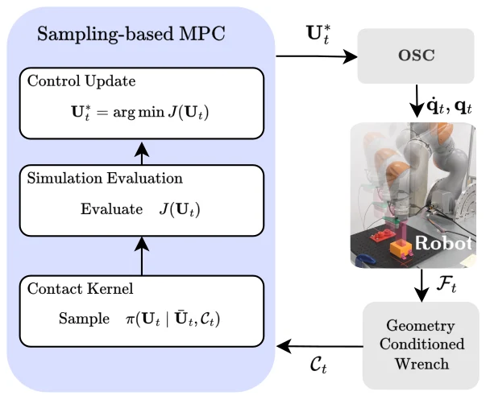

<!-- Generated by scripts/generate.py; edit data/works.json and data/media.json. -->

[← Back to the Awesome index](../../../README.md) · [Interactive website](https://chang-xinhai.github.io/Awesome-RGBDT-Manipulation/?collection=policy&item=contactkernels#library)

# ContactKernels

ContactKernels: Adaptive Proposals using Geometry-COnditioned Wrenches for Contact-Rich Manipulation

**2026-09-26 · Preprint · University of Edinburgh**

**[Paper](https://arxiv.org/abs/2610.23887)**

Geometry-conditioned wrist wrenches estimate contact location and normal, adapting the sampling proposals of model-predictive insertion control.

*ContactKernels authors; original rights retained · [Figure source](https://arxiv.org/abs/2610.23887) · Original rights retained.*

| Field | Reported value and source scope |
| :-- | :-- |
| Record type | policy |
| Policy family | Model-based planning [1](https://arxiv.org/html/2610.23887)  |
| Base model and architecture | Predictive Sampling or MPPI with contact-adaptive proposals; MuJoCo dynamics. [1](https://arxiv.org/html/2610.23887)  |
| Model size and component | Not reported [1](https://arxiv.org/html/2610.23887)  |
| Deployment inputs | Robot state, measured six-axis wrench and known peg/contact geometry. [1](https://arxiv.org/html/2610.23887)  |
| Action outputs and horizon | Optimized end-effector twists tracked by an operational-space controller. [1](https://arxiv.org/html/2610.23887)  |
| Training method | No policy weight training: contact estimates bias proposal means and shape covariance online. [1](https://arxiv.org/html/2610.23887)  |
| Training data | Simulation rollouts for sampling-based optimization; no learned demonstration dataset claimed. [1](https://arxiv.org/html/2610.23887)  |
| Training duration | Not reported [1](https://arxiv.org/html/2610.23887)  |
| Training hardware | Not reported [1](https://arxiv.org/html/2610.23887)  |
| Inference and control rates | Real controller20 Hz; ATI F/T sensor100 Hz. [1](https://arxiv.org/html/2610.23887)  |
| Evaluation scope | MuJoCo insertion geometries and KUKA IIWA 7/ATI sensor real insertion; reported real success 53.3%→90% and mean insertion time 33% lower. [1](https://arxiv.org/html/2610.23887)  |
| Observations / modalities | Force/Torque · Proprioception |
| Evaluation domain | Simulation · Real world |
| Embodiment | Parallel-jaw gripper |
| Release: code | Not verified |
| Release: weights | Not applicable |
| Release: data | Not verified |
| Release: license | Not verified |
| Release: notes | The inspected primary sources do not establish a public implementation, model checkpoint or dataset download. Paper figures retain their original rights. |

**Scope and qualifications**

- Wrist F/T measurements are not skin tactile; known local geometry supports contact inference.
- No RGB-D observation or learned neural policy is required by this controller.
- The arXiv identifier month is October but its recorded v1 date is September 26.

**Primary evidence**

1. [Original full paper, methods and evaluation](https://arxiv.org/html/2610.23887) — Publication date is arXiv v1; implementation and deployment observations are distinguished from training supervision, generated geometry and base-model identity.
