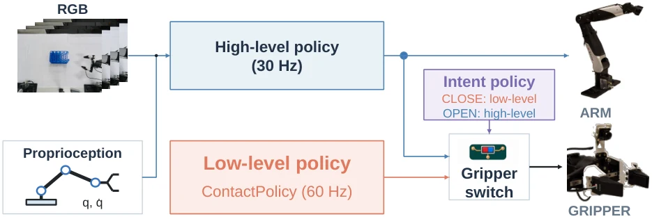

<!-- Generated by scripts/generate.py; edit data/works.json and data/media.json. -->

[← Back to the Awesome index](../../../README.md) · [Interactive website](https://chang-xinhai.github.io/Awesome-RGBDT-Manipulation/?collection=policy&item=contactpolicy#library)

# ContactPolicy

Touch Where It Matters: Learning Local Tactile Policies for Fine-Grained Gripper Control

**2026-10-17 · Preprint · University of Sydney**

**[Paper](https://arxiv.org/abs/2610.24485)**

A tactile–force local controller adjusts gripper width during contact while a visual base policy keeps moving the arm; an Intent policy controls handover.

*ContactPolicy authors; original rights retained · [Figure source](https://arxiv.org/abs/2610.24485) · Original rights retained.*

| Field | Reported value and source scope |
| :-- | :-- |
| Record type | policy |
| Policy family | Hybrid [1](https://arxiv.org/html/2610.24485)  |
| Base model and architecture | ACT visual arm checkpoint; ResNet-18 tactile encoder, force MLP, temporal GRU and action/modulation heads; ResNet-transformer Intent gate. [1](https://arxiv.org/html/2610.24485)  |
| Model size and component | Not reported [1](https://arxiv.org/html/2610.24485)  |
| Deployment inputs | Contact controller: recent tactile images, fingertip force, arm/gripper state; Intent/base policy: scene RGB and robot state. [1](https://arxiv.org/html/2610.24485)  |
| Action outputs and horizon | Gripper width increments and retain/update decisions; separate base arm trajectory. [1](https://arxiv.org/html/2610.24485)  |
| Training method | Imitation on contact-stage windows; auxiliary future tactile and force predictions; stage-wise learned ownership switches. [1](https://arxiv.org/html/2610.24485)  |
| Training data | 50 teleoperated demonstrations/task; same complete-episode partitions across methods. [1](https://arxiv.org/html/2610.24485)  |
| Training duration | Not reported [1](https://arxiv.org/html/2610.24485)  |
| Training hardware | Not reported [1](https://arxiv.org/html/2610.24485)  |
| Inference and control rates | Visual base and Intent30 Hz; local ContactPolicy60 Hz with 50 ms timestamp tolerance. [1](https://arxiv.org/html/2610.24485)  |
| Evaluation scope | Physical container opening, object handling and tool-operation tasks; per-task success and arm-state/contact-input ablations. [1](https://arxiv.org/html/2610.24485)  |
| Observations / modalities | RGB · Tactile · Force/Torque · Proprioception |
| Evaluation domain | Real world |
| Embodiment | Parallel-jaw gripper · Bimanual |
| Release: code | Not verified |
| Release: weights | Not verified |
| Release: data | Not verified |
| Release: license | Not verified |
| Release: notes | The inspected primary sources do not establish a public implementation, model checkpoint or dataset download. Paper figures retain their original rights. |

**Scope and qualifications**

- Local gripper control and visual whole-arm control have different input and update contracts.
- Predicted tactile/force futures regularize training; deployment uses the contact encoder and width/modulation heads.

**Primary evidence**

1. [Original full paper, methods and evaluation](https://arxiv.org/html/2610.24485) — Publication date is arXiv v1; implementation and deployment observations are distinguished from training supervision, generated geometry and base-model identity.
