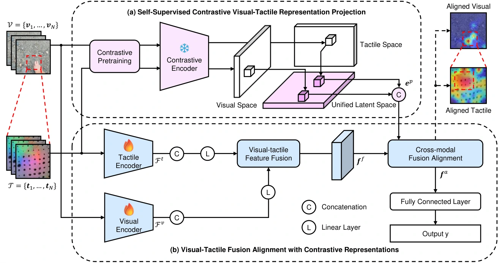

<!-- Generated by scripts/generate.py; edit data/works.json and data/media.json. -->

[← Back to the Awesome index](../../../README.md) · [Interactive website](https://chang-xinhai.github.io/Awesome-RGBDT-Manipulation/?collection=policy&item=convitac#library)

# ConViTac

ConViTac: Aligning Visual-Tactile Fusion with Contrastive Representations

**2025-06-25 · IROS 2025 (official repository) · Department of Engineering, King’s College London**

**[Paper](https://arxiv.org/abs/2506.20757)** · [Project](https://georgewuzy.github.io/ConViTac-website/) · [Code](https://github.com/GeorgeWuzy/ConViTac)

Conditions visual–tactile feature fusion with contrastively aligned embeddings for tactile property and grasp-outcome prediction.

*convitac authors; original paper figure · [Figure source](https://arxiv.org/html/2506.20757#S2.F2) · Original rights retained.*

| Field | Reported value and source scope |
| :-- | :-- |
| Record type | model |
| Model role and downstream interface | Reusable representation or perception model; downstream controllers are separate systems [1](https://arxiv.org/abs/2506.20757)  |
| Model family | Multimodal representation [1](https://arxiv.org/abs/2506.20757)  |
| Model architecture | Contrastive visual/tactile encoder; Contrastive Embedding Conditioning with cross-modal attention [1](https://arxiv.org/abs/2506.20757)  |
| Model size and component | Not reported [1](https://arxiv.org/abs/2506.20757)  |
| Model inputs | Paired visual and tactile image/sequence observations [1](https://arxiv.org/abs/2506.20757)  |
| Model outputs | Fused representations; material/property labels and grasp-success predictions [1](https://arxiv.org/abs/2506.20757)  |
| Training method | SimCLR-style contrastive pretraining followed by conditioned supervised fusion [1](https://arxiv.org/abs/2506.20757)  |
| Training data and scale | Touch and Go, ObjectFolder Real and grasp-outcome datasets under task-specific splits [1](https://arxiv.org/abs/2506.20757)  |
| Training duration | Typically converges within 30 epochs per task/dataset; wall-clock duration not reported [1](https://arxiv.org/abs/2506.20757)  |
| Training hardware | 1 NVIDIA RTX 3080 Ti; batch size 16 [1](https://arxiv.org/abs/2506.20757)  |
| Inference setting and runtime | Not reported [1](https://arxiv.org/abs/2506.20757)  |
| Downstream evaluation and scope | Material classification and grasp-success prediction; ablations isolate Contrastive Embedding Conditioning. [1](https://arxiv.org/abs/2506.20757)  |
| Observations / modalities | Tactile · RGB |
| Evaluation domain | Real world |
| Embodiment |  |
| Release: code | Partial — model.py released; remaining code announced [2](https://georgewuzy.github.io/ConViTac-website/) [3](https://github.com/GeorgeWuzy/ConViTac)  |
| Release: weights | Not verified [2](https://georgewuzy.github.io/ConViTac-website/) [3](https://github.com/GeorgeWuzy/ConViTac)  |
| Release: data | Not verified [2](https://georgewuzy.github.io/ConViTac-website/) [3](https://github.com/GeorgeWuzy/ConViTac)  |
| Release: license | MIT repository LICENSE [2](https://georgewuzy.github.io/ConViTac-website/) [3](https://github.com/GeorgeWuzy/ConViTac) [4](https://github.com/GeorgeWuzy/ConViTac/blob/main/LICENSE)  |
| Release: notes | Code, pretrained encoders and downstream task data are separate artifacts; no policy checkpoint is implied by an encoder release. [2](https://georgewuzy.github.io/ConViTac-website/) [3](https://github.com/GeorgeWuzy/ConViTac)  |

**Scope and qualifications**

- The official README explicitly says only model.py is released and further details are pending.
- Classification and success prediction should not be counted as an executable manipulation policy.

**Primary evidence**

1. [Original model paper and first submission](https://arxiv.org/abs/2506.20757) — Method, experiments and implementation sections; specifications retain component and evaluation scope.
2. [Official project](https://georgewuzy.github.io/ConViTac-website/) — Author project; author-reported release scope is distinguished from an executed reproduction.
3. [Official implementation and current release instructions](https://github.com/GeorgeWuzy/ConViTac) — README and repository files inspected on 2026-10-17.
4. [Repository license file](https://github.com/GeorgeWuzy/ConViTac/blob/main/LICENSE) — Applies to repository scope; model/data/base-model terms can differ.
