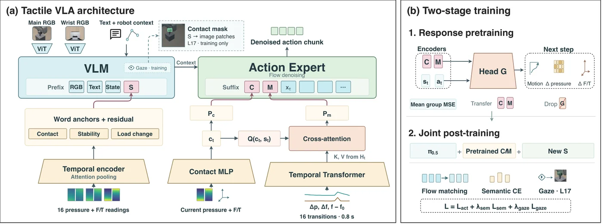

<!-- Generated by scripts/generate.py; edit data/works.json and data/media.json. -->

[← Back to the Awesome index](../../../README.md) · [Interactive website](https://chang-xinhai.github.io/Awesome-RGBDT-Manipulation/?collection=policy&item=cora-vtla#library)

# CoRA-VTLA

CoRA-VTLA: Contact-Guided Attention and Queryable Response Memory for Tactile Post-Training

**2026-11-18 · Preprint · Tsinghua University**

**[Paper](https://arxiv.org/abs/2611.23963)** · [Project](https://cora-vtla.github.io/)

Adds fingertip pressure and wrist-wrench history to contact-guided VLA post-training.

*CoRA-VTLA authors · [Figure source](https://arxiv.org/html/2611.23963v1) · Original rights retained.*

| Field | Reported value and source scope |
| :-- | :-- |
| Record type | policy |
| Policy family | Contact-conditioned VLA post-training [1](https://arxiv.org/html/2611.23963)  |
| Base model and architecture | Pretrained VLA with a flow-matching action expert [1](https://arxiv.org/html/2611.23963)  |
| Model size and component | Not reported [1](https://arxiv.org/html/2611.23963)  |
| Deployment inputs | Task RGB and language, robot history, fingertip pressure and wrist force/torque. [1](https://arxiv.org/html/2611.23963)  |
| Action outputs and horizon | Contact-conditioned continuous action chunks. [1](https://arxiv.org/html/2611.23963)  |
| Training method | First pretrain response encoders on task demonstrations, then adapt the VLA using supervised contact attention and rollout-memory tokens. [1](https://arxiv.org/html/2611.23963)  |
| Training data | Synchronized task demonstrations; nominal and recovery trajectories in simulation. [1](https://arxiv.org/html/2611.23963)  |
| Training duration | Not reported [1](https://arxiv.org/html/2611.23963)  |
| Training hardware | Not reported [1](https://arxiv.org/html/2611.23963)  |
| Inference and control rates | Not reported [1](https://arxiv.org/html/2611.23963)  |
| Evaluation scope | Three MuJoCo tasks, a separately reported UniVTAC optical tactile task, and physical cup stacking, stamping and other contact tasks. [1](https://arxiv.org/html/2611.23963)  |
| Observations / modalities | RGB · Tactile · Force · Proprioception · Language |
| Evaluation domain | Simulation · Real world |
| Embodiment | UR5e + Robotiq 140 (physical) |
| Release: code | Not verified [2](https://cora-vtla.github.io/)  |
| Release: weights | Not verified [2](https://cora-vtla.github.io/)  |
| Release: data | Not verified [2](https://cora-vtla.github.io/)  |
| Release: license | Not verified [2](https://cora-vtla.github.io/)  |
| Release: notes | Author project provides diagrams and rollouts; separate executable artifacts were not verified. [2](https://cora-vtla.github.io/)  |

**Scope and qualifications**

- Real fingertip pressure and wrist force/torque are different sensor channels. The public UniVTAC test uses optical tactile data under its own setting.
- Future response labels supervise training; deployed action selection queries recent measured responses.

**Primary evidence**

1. [Primary paper and evaluated setting](https://arxiv.org/html/2611.23963)
2. [Author project and artifact status](https://cora-vtla.github.io/)
