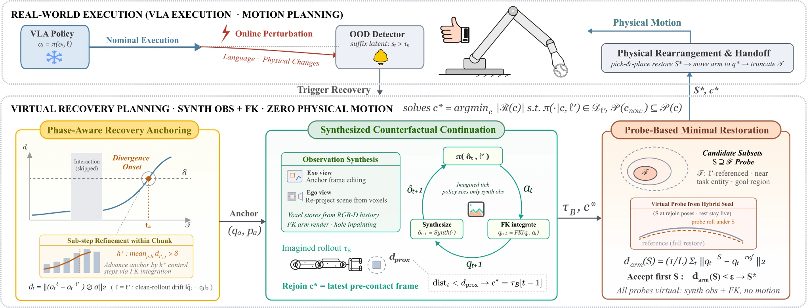

<!-- Generated by scripts/generate.py; edit data/works.json and data/media.json. -->

[← Back to the Awesome index](../../../README.md) · [Interactive website](https://chang-xinhai.github.io/Awesome-RGBDT-Manipulation/?collection=policy&item=core-counterfactual#library)

# CoRe

Imagining Recovery: Inference-Time Counterfactual Realignment for Vision-Language-Action Models

**2026-08-14 · Preprint · Not reported in accessible author affiliation markup**

**[Paper](https://arxiv.org/abs/2608.14822)**

A frozen VLA is probed on counterfactually restored observations to choose a minimal physical recovery after task switches or disruptions.

*CoRe authors · [Figure source](https://arxiv.org/html/2608.14822) · Original rights retained.*

| Field | Reported value and source scope |
| :-- | :-- |
| Record type | policy |
| Policy family | Hybrid [1](https://arxiv.org/abs/2608.14822)  |
| Base model and architecture | Inference-time counterfactual recovery wrapper. Frozen π0/π0.5, X-VLA, GR00T and OpenVLA variants; calibrated 3D observation synthesis rather than a learned video world model. [1](https://arxiv.org/abs/2608.14822)  |
| Model size and component | Not reported [1](https://arxiv.org/abs/2608.14822)  |
| Deployment inputs | VLA observations/state/language plus a recovery system with depth, object masks/poses, robot kinematics and retained scene geometry. Simulation uses privileged poses/masks; real perception uses Grounding-DINO, SAM2 and shape-specific geometry. [1](https://arxiv.org/abs/2608.14822)  |
| Action outputs and horizon | Recovery object-restoration plan and robot rejoin configuration, followed by resumed frozen-policy actions. [1](https://arxiv.org/abs/2608.14822)  |
| Training method | Underlying policies are task-trained offline; recovery uses OOD detection, synthesized counterfactual observations and physical restoration without policy updates. [1](https://arxiv.org/abs/2608.14822)  |
| Training data | Underlying policy demonstrations only; real π0.5 fine-tuning uses 100 clean demonstrations each for pick, place and push. [1](https://arxiv.org/abs/2608.14822)  |
| Training duration | No recovery-specific training; underlying fine-tuning wall time not reported. [1](https://arxiv.org/abs/2608.14822)  |
| Training hardware | Real π0.5 fine-tuning: one H200. Physical inference/perception: two RTX 4090 cards; simulation evaluation uses RTX A6000 shards. [1](https://arxiv.org/abs/2608.14822)  |
| Inference and control rates | Real xArm6 control 10 Hz; ten-step policy chunks, eight executed before a query. [1](https://arxiv.org/abs/2608.14822)  |
| Evaluation scope | LangSwitch language changes, perturbed LIBERO-Long and physical xArm6 recovery. [1](https://arxiv.org/abs/2608.14822)  |
| Observations / modalities | RGB · Depth · Proprioception · Language |
| Evaluation domain | Simulation · Real world |
| Embodiment | Parallel-jaw gripper |
| Release: code | Not verified |
| Release: weights | Not verified |
| Release: data | Not verified |
| Release: license | Not verified |
| Release: notes | No author-linked implementation was verified in the inspected primary manuscript/project. This is an evidence gap, not proof that no implementation exists. |

**Scope and qualifications**

- Simulation recovery relies on privileged state; real recovery replaces it with object detection, depth/analytic pose estimators and motion planning.
- This is a full perception-and-restoration system around a VLA, not an RGB-only VLA recovery improvement.

**Primary evidence**

1. [Original manuscript and first submission history](https://arxiv.org/abs/2608.14822) — Original method, evaluation and available implementation/appendix sections inspected. The survey is discovery evidence only.
