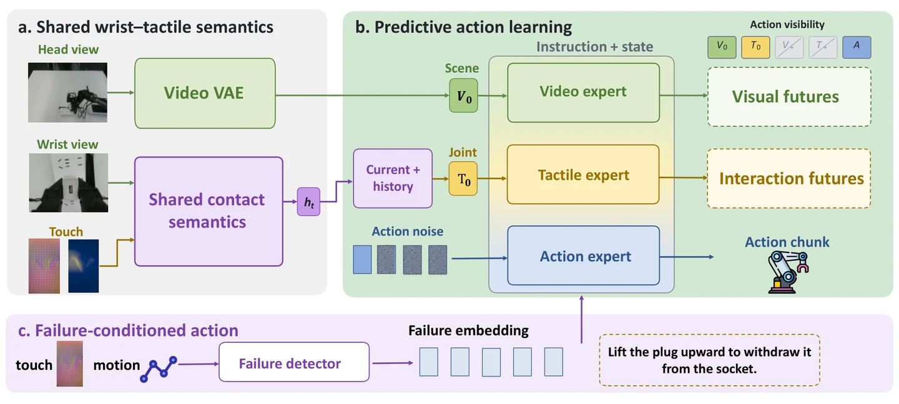

<!-- Generated by scripts/generate.py; edit data/works.json and data/media.json. -->

[← Back to the Awesome index](../../../README.md) · [Interactive website](https://chang-xinhai.github.io/Awesome-RGBDT-Manipulation/?collection=policy&item=cotacwam#library)

# CoTacWAM

CoTacWAM: Joint Modeling of Vision and Touch for Robotic Manipulation

**2026-11-25 · Preprint · Tsinghua University; Beihang University; Manifold AI**

**[Paper](https://arxiv.org/abs/2611.34117)**

Learns shared wrist-vision and touch semantics for contact-aware prediction, action generation and separately triggered recovery.

*Lei Jin and coauthors · [Figure source](https://arxiv.org/html/2611.34117v1) · Original rights retained.*

| Field | Reported value and source scope |
| :-- | :-- |
| Record type | policy |
| Policy family | CoTacWAM [1](https://arxiv.org/html/2611.34117v1)  |
| Base model and architecture | Not reported [1](https://arxiv.org/html/2611.34117v1)  |
| Model size and component | Not reported [1](https://arxiv.org/html/2611.34117v1)  |
| Deployment inputs | Head and wrist RGB, paired Xense G1-WS tactile signals including force-field features, robot state and instruction. Availability masks allow missing local streams. [1](https://arxiv.org/html/2611.34117v1)  |
| Action outputs and horizon | Arm-joint and gripper action chunks. Predictive sensory targets supervise training; after detection, a failure-conditioned chunk can retry. [1](https://arxiv.org/html/2611.34117v1)  |
| Training method | Shared local wrist/tactile semantics plus modality-specific detail, predictive flow matching, then task post-training with curated corrective demonstrations. [1](https://arxiv.org/html/2611.34117v1)  |
| Training data | Multimodal pretraining episodes and separate task-specific nominal/corrective demonstrations; the paper scopes data by stage. [1](https://arxiv.org/html/2611.34117v1)  |
| Training duration | Not reported [1](https://arxiv.org/html/2611.34117v1)  |
| Training hardware | Not reported [1](https://arxiv.org/html/2611.34117v1)  |
| Inference and control rates | Not reported [1](https://arxiv.org/html/2611.34117v1)  |
| Evaluation scope | Agilex PiPER real robot, four tasks and 20 trials per method, condition and task. The paper reports 71.3% mean first-attempt success versus 35.0% for its strongest evaluated first-attempt baseline. [1](https://arxiv.org/html/2611.34117v1)  |
| Observations / modalities | RGB · Tactile · Proprioception · Language |
| Evaluation domain | Real world |
| Embodiment | Parallel-jaw gripper |
| Release: code | Not verified |
| Release: weights | Not verified |
| Release: data | Not verified |
| Release: license | Not verified |
| Release: notes | Public paper verified. Code, task weights and data are tracked separately. |

**Scope and qualifications**

- Head view and wrist vision are RGB. Force features come from gripper tactile pads; no measured scene depth is used.
- Nominal, missing-input and retry results have separate settings. Retry gains are reported on wiping and insertion.

**Primary evidence**

1. [Original author paper with methods, evaluation and scope](https://arxiv.org/html/2611.34117v1)
