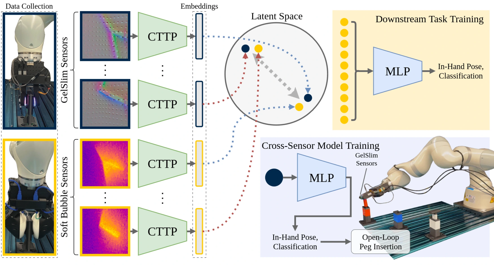

<!-- Generated by scripts/generate.py; edit data/works.json and data/media.json. -->

[← Back to the Awesome index](../../../README.md) · [Interactive website](https://chang-xinhai.github.io/Awesome-RGBDT-Manipulation/?collection=policy&item=cttp#library)

# CTTP / Contrastive Touch-to-Touch Pretraining

Contrastive Touch-to-Touch Pretraining

**2024-10-15 · Preprint · University of Michigan**

**[Paper](https://arxiv.org/abs/2410.11834)** · [Project](https://www.mmintlab.com/research/cttp/)

Aligns tactile signals from GelSlim and SoftBubble in a shared space, transferring pose/classification heads between sensors.

*cttp authors; original paper figure · [Figure source](https://arxiv.org/html/2410.11834#S1.F1) · Original rights retained.*

| Field | Reported value and source scope |
| :-- | :-- |
| Record type | model |
| Model role and downstream interface | Reusable representation or perception model; downstream controllers are separate systems [1](https://arxiv.org/abs/2410.11834)  |
| Model family | Tactile encoder [1](https://arxiv.org/abs/2410.11834)  |
| Model architecture | ResNet-50 encoder with a two-layer MLP into a 64-dimensional contrastive space [1](https://arxiv.org/abs/2410.11834)  |
| Model size and component | 64-dimensional contrastive projection; total network parameters not reported [1](https://arxiv.org/abs/2410.11834)  |
| Model inputs | Paired GelSlim and SoftBubble tactile signals during pretraining; one sensor at inference [1](https://arxiv.org/abs/2410.11834)  |
| Model outputs | Shared tactile embeddings; optional tool identity or in-hand pose estimates [1](https://arxiv.org/abs/2410.11834)  |
| Training method | Cross-sensor contrastive positives from matched object/grasp configurations; supervised downstream decoders [1](https://arxiv.org/abs/2410.11834)  |
| Training data and scale | Matched tactile observations of tools grasped by two heterogeneous sensor systems; seen/unseen grasp and tool splits [1](https://arxiv.org/abs/2410.11834)  |
| Training duration | 100 epochs; wall-clock duration not reported [1](https://arxiv.org/abs/2410.11834)  |
| Training hardware | Not reported [1](https://arxiv.org/abs/2410.11834)  |
| Inference setting and runtime | Not reported [1](https://arxiv.org/abs/2410.11834)  |
| Downstream evaluation and scope | Tool classification and in-hand pose estimation; transferred features also evaluated in an insertion experiment. [1](https://arxiv.org/abs/2410.11834)  |
| Observations / modalities | Tactile |
| Evaluation domain | Real world |
| Embodiment |  |
| Release: code | Not verified [2](https://www.mmintlab.com/research/cttp/)  |
| Release: weights | Not verified [2](https://www.mmintlab.com/research/cttp/)  |
| Release: data | Not verified [2](https://www.mmintlab.com/research/cttp/)  |
| Release: license | Paper copyright applies; code/model/data release license not verified [2](https://www.mmintlab.com/research/cttp/)  |
| Release: notes | Code, pretrained encoders and downstream task data are separate artifacts; no policy checkpoint is implied by an encoder release. [2](https://www.mmintlab.com/research/cttp/)  |

**Scope and qualifications**

- The project URL is identified by the original paper, but the site returned an access error during this audit; no unverified code/weights link was invented.
- Closed-loop insertion uses an additional downstream system; the reusable contrastive encoder is the recorded model.

**Primary evidence**

1. [Original model paper and first submission](https://arxiv.org/abs/2410.11834) — Method, experiments and implementation sections; specifications retain component and evaluation scope.
2. [Official project](https://www.mmintlab.com/research/cttp/) — Author project; author-reported release scope is distinguished from an executed reproduction.
