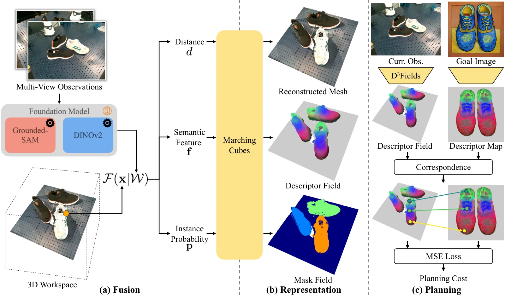

<!-- Generated by scripts/generate.py; edit data/works.json and data/media.json. -->

[← Back to the Awesome index](../../../README.md) · [Interactive website](https://chang-xinhai.github.io/Awesome-RGBDT-Manipulation/?collection=policy&item=d3fields#library)

# D³Fields

D³Fields: Dynamic 3D Descriptor Fields for Zero-Shot Generalizable Rearrangement

**2023-09-28 · CoRL 2024 · Columbia; UIUC; NUS; Boston Dynamics AI Institute; Stanford**

**[Paper](https://arxiv.org/abs/2309.16118)** · [Project](https://robopil.github.io/d3fields/) · [Code](https://github.com/WangYixuan12/d3fields)

Dynamic semantic 3D descriptor fields support image-goal rearrangement with a model-predictive execution system.

*D³Fields authors · [Figure source](https://arxiv.org/html/2309.16118) · Original rights retained.*

| Field | Reported value and source scope |
| :-- | :-- |
| Record type | policy |
| Policy family | Planning / hybrid [1](https://arxiv.org/abs/2309.16118)  |
| Base model and architecture | Multi-view visual-foundation features fused into distance, descriptor and instance fields; action optimization. [1](https://arxiv.org/abs/2309.16118)  |
| Model size and component | Not reported in the inspected primary-source sections [1](https://arxiv.org/abs/2309.16118)  |
| Deployment inputs | Multiple calibrated RGB-D views and a 2D goal image. [1](https://arxiv.org/abs/2309.16118)  |
| Action outputs and horizon | Rearrangement action sequences via geometry-aware planning. [1](https://arxiv.org/abs/2309.16118)  |
| Training method | Training-free representation construction with pretrained foundation models and task optimization. [1](https://arxiv.org/abs/2309.16118)  |
| Training data | No task-specific descriptor training; demonstrations are not required for its image-goal specification. [1](https://arxiv.org/abs/2309.16118)  |
| Training duration | Not reported in the inspected primary-source sections [1](https://arxiv.org/abs/2309.16118)  |
| Training hardware | Not reported in the inspected primary-source sections [1](https://arxiv.org/abs/2309.16118)  |
| Inference and control rates | 0.166 ± 0.002 s representation construction on A6000 for four views; not the complete planning/control rate. [1](https://arxiv.org/abs/2309.16118)  |
| Evaluation scope | Real Kinova Gen3 household rearrangement and OmniGibson/Fetch mobile manipulation. [1](https://arxiv.org/abs/2309.16118)  |
| Observations / modalities | RGB · Depth · Point cloud · Proprioception |
| Evaluation domain | Simulation · Real world |
| Embodiment | Parallel-jaw gripper |
| Release: code | Available [2](https://robopil.github.io/d3fields/) [3](https://github.com/WangYixuan12/d3fields) [5](https://github.com/WangYixuan12/d3fields/tree/main)  |
| Release: weights | Not verified [2](https://robopil.github.io/d3fields/) [3](https://github.com/WangYixuan12/d3fields)  |
| Release: data | Not verified [2](https://robopil.github.io/d3fields/) [3](https://github.com/WangYixuan12/d3fields)  |
| Release: license | MIT for repository code; pretrained models, data and figure rights remain separate [2](https://robopil.github.io/d3fields/) [3](https://github.com/WangYixuan12/d3fields) [4](https://github.com/WangYixuan12/d3fields/blob/main/LICENSE)  |
| Release: notes | Code, data and weights are checked independently; an upstream pretrained model is not a released task policy. [2](https://robopil.github.io/d3fields/) [3](https://github.com/WangYixuan12/d3fields)  |

**Scope and qualifications**

- Four calibrated fixed RGB-D views used in real experiments; descriptor extraction speed excludes downstream planning.

**Primary evidence**

1. [Original manuscript and first submission history](https://arxiv.org/abs/2309.16118) — Full author HTML method/evaluation/appendix inspected; depth observations, pseudo-labels and generated outputs retain distinct roles.
2. [Official author project](https://robopil.github.io/d3fields/) — Public author-linked project; figure and downstream scope verified separately.
3. [Official implementation and release scope](https://github.com/WangYixuan12/d3fields) — Availability of research implementation does not establish public task-policy checkpoints.
4. [Actual license file in released source](https://github.com/WangYixuan12/d3fields/blob/main/LICENSE) — Only source code covered by this file; not a blanket license for paper figures or upstream weights.
5. [Actual repository content inventory](https://github.com/WangYixuan12/d3fields/tree/main) — 188 tracked paths inspected; code release is distinguished from a README/project/figure-only repository.
