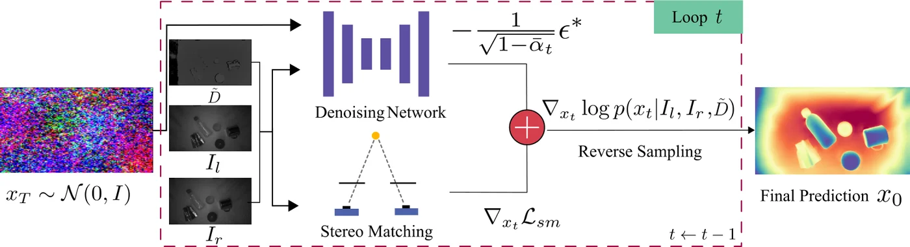

<!-- Generated by scripts/generate.py; edit data/works.json and data/media.json. -->

[← Back to the Awesome index](../../../README.md) · [Interactive website](https://chang-xinhai.github.io/Awesome-RGBDT-Manipulation/?collection=policy&item=d3roma#library)

# D3RoMa

D3RoMa: Disparity Diffusion-based Depth Sensing for Material-Agnostic Robotic Manipulation

**2024-09-22 · Preprint · Peking University and Galbot**

**[Paper](https://arxiv.org/abs/2409.14365)** · [Project](https://pku-epic.github.io/D3RoMa/) · [Code](https://github.com/songlin/d3roma) · [Data](https://huggingface.co/datasets/songlinwei/HISS) · [Weights](https://huggingface.co/songlinwei/d3roma)

Refines noisy raw disparity with guided diffusion and stereo consistency, including difficult transparent and reflective scenes.

*D3RoMa authors · [Figure source](https://arxiv.org/html/2409.14365v2) · Original rights retained.*

| Field | Reported value and source scope |
| :-- | :-- |
| Record type | model |
| Model role and downstream interface | Stereo and sensor-depth restoration for manipulation [1](https://arxiv.org/html/2409.14365)  |
| Model family | Stereo-geometry-guided disparity diffusion [1](https://arxiv.org/html/2409.14365)  |
| Model architecture | Stable Diffusion initialization [1](https://arxiv.org/html/2409.14365)  |
| Model size and component | Not reported [1](https://arxiv.org/html/2409.14365)  |
| Model inputs | Rectified stereo plus raw disparity or RGB plus raw depth, depending on checkpoint. [1](https://arxiv.org/html/2409.14365)  |
| Model outputs | Refined disparity and calibrated depth. [1](https://arxiv.org/html/2409.14365)  |
| Training method | Learn to denoise disparity; inject stereo photometric consistency during inference where stereo is available. [1](https://arxiv.org/html/2409.14365)  |
| Training data and scale | HISS plus task-dependent subsets of DREDS, SceneFlow or ClearPose. [1](https://arxiv.org/html/2409.14365)  |
| Training duration | Not reported [1](https://arxiv.org/html/2409.14365)  |
| Training hardware | Not reported [1](https://arxiv.org/html/2409.14365)  |
| Inference setting and runtime | Select checkpoint by sensor mode; stereo branch can add consistency gradients to reverse sampling. [1](https://arxiv.org/html/2409.14365)  |
| Downstream evaluation and scope | Depth benchmarks, cross-scene material tests and real manipulation cases. [1](https://arxiv.org/html/2409.14365)  |
| Observations / modalities | RGB · Depth |
| Evaluation domain | Simulation · Real world |
| Embodiment |  |
| Release: code | Available — training, inference and evaluation source [2](https://pku-epic.github.io/D3RoMa/) [3](https://github.com/songlin/d3roma)  |
| Release: weights | Published stereo and RGB-plus-raw-depth checkpoint variants [2](https://pku-epic.github.io/D3RoMa/) [3](https://github.com/songlin/d3roma)  |
| Release: data | HISS synthetic dataset available [2](https://pku-epic.github.io/D3RoMa/) [3](https://github.com/songlin/d3roma)  |
| Release: license | CC BY-NC 4.0 declared in original source README; individual upstream data and models retain separate terms [2](https://pku-epic.github.io/D3RoMa/) [3](https://github.com/songlin/d3roma)  |
| Release: notes | Official repository includes scripts for training and inference with multiple input variants. [2](https://pku-epic.github.io/D3RoMa/) [3](https://github.com/songlin/d3roma)  |

**Scope and qualifications**

- Stereo and RGB-plus-raw-depth checkpoints consume different inputs. Stereo-geometric guidance is an optional input path and should not be attributed to the RGB-only image stream.
- Reported grasping/depth evaluation scope differs from the HISS training corpus.

**Primary evidence**

1. [Primary paper and evaluated setting](https://arxiv.org/html/2409.14365)
2. [Author project and artifact status](https://pku-epic.github.io/D3RoMa/)
3. [Official repository and public artifact inventory](https://github.com/songlin/d3roma) — Verified train.py, inference.py, evaluation sources and declared noncommercial terms.
